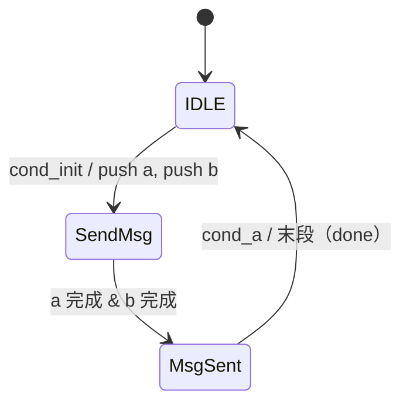

# async/await 状态机 DSL 设计（草案）

> 状态：**设计草案，未实现**。没有命令、没有 `help` 主题，`help status` 不列。
> 来源：初稿 `demo/state/demo.md` 与值模型试验 `demo/state/demo.ts`，已并入本文后删除；原文见 git 提交 `21cb9ca`。本文是这套设计的唯一来源。
> 初稿没说清的地方标为「决定」（本文给出的取舍）或「开放」（§10，需作者拍板）。
> 作者源码是 **ECMAScript**（`.mjs`），不是 TypeScript：端口方向和位宽是运行时可见的值（§2.2），状态名用原生标签语句（§3.5）。选型理由见 §8.2。
> **文档规范**：每段 DSL 示例紧跟它生成的 SystemVerilog，两者一一对照；SV 示例与 §6.5 的 `aw_dff` 一起要能过 Verilator `--lint-only -Wall -Wno-DECLFILENAME`。除 §7.1 外，SV 示例省略文件头（§7.1）。示例、生成规则任何一方改动，都要同步更新另一方；将来 `demo/state/` 有可运行示例时，它与本文的对照示例保持一致。

## 背景

- async/await 把时间上不确定的 IO 事件按顺序写出来，底层由编译器转成链式状态机。RTL 状态机做的事情相同：流程、分支、在某个状态等一个条件或 done 脉冲。
- 手写 RTL 状态机虽有范式，工程里仍是大量信号拉来拉去，条件和输出信号难以组织；子状态机嵌套与信号耦合尤其难理清。
- 很多子状态机在逻辑上互斥：A 工作时 B 必然不工作。软件里这类状态只是栈上的临时变量，离开就回收；RTL 里它们一直存在，语义上表达不出互斥，也就无法复用资源。
- 控制型状态机不是计算密集的顺序逻辑；计算交给流水线和 SV，本 DSL 只管控制流。

## 0. 目标与不做

目标：

- 用 ECMAScript `async` 函数描述控制型状态机：流程、分支、等待条件、握手。时钟节拍在作者面隐藏。
- 生成可综合 SV：状态寄存器、次态逻辑、动作脉冲。
- 语言结构直接给出子状态机的互斥关系（顺序调用的两个子状态机不会同时工作），生成器据此复用资源。手写 RTL 表达不了这一点（见「背景」）。

不做：

- 四则运算、有符号比较、数据通路、流水线、脉动阵列。这些写在 SV 里：DSL 只消费其结果信号，或调用用户 package 里的 SV 函数（§2.3）。
- 多时钟域、CDC。一个 async 函数属于一个时钟和一个复位（**决定**，初稿未提）。

## 1. 术语

| 术语 | 含义 |
|---|---|
| 拍 | 一个时钟周期。作者面不可见，是所有语义的背景 |
| channel | 信号在 DSL 中的类型。每拍产出一个值；作者不关心具体值，只关心事件何时到来 |
| 状态 S | 一个 `await` 等待点。状态机停在 S，直到该 `await` 的条件成立 |
| `state_is_S` | 当前状态是 S。只用于判断条件，不驱动动作 |
| `state_move_to_S` | 进入 S 的那一拍的脉冲（组合逻辑）。所有动作挂在它上面 |
| 段 | 两个相邻 `await` 之间的代码。段内代码全部在一拍内执行 |
| 状态标签 | `await` 语句前的 ES 标签 `Name:`，给该状态命名 |

## 2. 信号模型：channel

信号不是 `int` / `string` / 数组这样的值类型，而是带方向的异步 channel，类似 Go 的 `chan<-` / `<-chan` 和 Rust 的 `Sender` / `Receiver`。

| 声明 | 方向 | 含义 |
|---|---|---|
| `Input(N)` | rx | 每拍可读出一个 N 位值 |
| `Output(N)` | tx | 由状态机的动作驱动 |
| `Const(N, v)` | rx | 每拍都读出 v、永远读不完的 channel。生成常量或一条 `assign` |

规则：

- 作者代码拿不到「当前值」去做 JS 计算。对 channel 只能做三件事：组合运算得到新 channel（§2.1）、等待（`wait`）、采样做分支（`read`，§4）。
- 每拍从每个 channel 读到一个值。`Const` 每拍读到同一个常数。

### 2.1 组合运算

运算只限逻辑、比较和位选，直接用 ES 运算符书写；结果是新的 channel，生成一条 `assign`。

| 运算符 | 含义 | 输入位宽 | 输出位宽 |
|---|---|---|---|
| `&` `\|` `^` | 按位与 / 或 / 异或 | 两侧同为 N | N |
| `~` | 按位取反 | N | N |
| `!` `&&` `\|\|` | 逻辑非 / 与 / 或 | 1 | 1 |
| `===` `!==` | 等于 / 不等 | 两侧同为 N | 1 |
| `<` `>` `<=` `>=` | 无符号比较 | 两侧同为 N | 1 |
| `x.bits(i)` | 取第 i 位 | N | 1 |
| `x.bits(hi, lo)` | 取 hi 到 lo 的位段 | N | hi − lo + 1 |

- 数字字面量取另一侧 channel 的位宽，不必写 `Const(8, 0xff)`。值超出位宽、或两侧都是字面量时，编译期报错。
- 其余运算符编译期报错：`==` / `!=`（统一写 `===` / `!==`）、`+ - * / %`、`<< >> >>>`、`**`。这些计算写成用户 SV 函数（§2.3）。
- 位选的下标必须是整数字面量，满足 `N > hi ≥ lo ≥ 0`，否则编译期报错。不支持变量下标：那是一个多路选择器，写成用户函数。
- 位选写成方法调用 `bits`，不用 `[]`：SV 的 `x[hi:lo]` 在 ES 里是语法错误，而 `x[hi, lo]` 是逗号表达式，ES 会把它读成 `x[lo]`，容易误读。`bits` 是检查器认识的内建方法，和 `wait` / `read` 一样只作用于 channel。
- 被选的对象必须是有名字的 channel（端口、`Dff` 的 `val`、`const` 绑定的 channel）或用户函数调用结果。生成器在需要时先把它落成一根线再选，因为 SV 不允许对表达式或函数调用结果直接位选。
- **不支持拼接和移位（决定）**。ES 没有拼接运算符，数组字面量 `[a, b]` 不被解释为拼接，编译期报错；`<<` / `>>` / `>>>` 同样报错。这两类变换写成用户函数（§2.3）。
- 比较只按无符号（**决定**）。DSL 不提供有符号类型，也不提供有符号比较；需要有符号判断时调用用户函数，这是 §2.3 的典型用法。
- 位宽不一致编译期报错（**决定**）。
- 优先级沿用 ES 解析结果。ES 的 `===` 比 `&` 结合得紧，与 SV 中 `==` 和 `&` 的相对次序一致；生成 SV 时统一加满括号，不依赖两边优先级逐条相同。

这些运算符在 ES 运行时对对象没有意义：Bun 实测 `{} & !{}` 得 `0`，`==` 比较引用；TC39 的运算符重载提案已于 2023-11 撤回。DSL 源码从不执行（§8.2），运算符的含义由编译器从 AST 赋予。初稿里 `msg_valid & !skip & (msg_val == const_val)` 的写法因此成立，只需把 `==` 改成 `===`：

```js
const next_cond = msg_valid & !skip & (msg_val === 0xff);
const is_wr = ports.cmd.bits(31) & (ports.cmd.bits(27, 24) === 0x3);
WaitMsg: await next_cond.wait(1);
```

生成的 SV：

```systemverilog
assign next_cond = msg_valid & !skip & (msg_val == 8'hff);
assign is_wr     = cmd[31] & (cmd[27:24] == 4'h3);
// in the next-state block (§6.5):
//   WaitMsg: if (next_cond) begin state_next = X; move_to_X = 1'b1; end
```

- DSL 的 `===` / `!==` 生成 SV 的 `==` / `!=`。SV 的 `===` 是四态逐位比较，语义不同，不生成。
- 字面量按另一侧位宽写成带宽度的常量：`msg_val` 是 8 位，生成 `8'hff`；`cmd.bits(27, 24)` 是 4 位，生成 `4'h3`。
- `x.bits(hi, lo)` 生成 `x[hi:lo]`，`x.bits(i)` 生成 `x[i]`。

### 2.2 端口声明

初稿用 TS `interface` 声明端口。ES 没有类型，而生成 SV 端口恰好需要方向和位宽，所以端口是运行时值：

```js
const FsmPorts = Ports({
  cond_init: Input(1),
  cond_a: Input(1),
  fifo_a: PushPort(8),
  fifo_b: PushPort(8),
});
```

- `Ports({...})` 必须是模块顶层的 `const` 声明，参数是对象字面量。编译器直接从 AST 读出方向和位宽，不执行它（§8）。
- 位宽、方向错误由我们自己写的检查器在编译期报出（§8.3），不依赖 tsc 或任何类型检查。
- `PushPort(N)` 是 `vld` / `rdy` / `data[N]` 三根线的打包（§6.2），名字待定。
- `Dff(N)` 声明一个寄存器，接口是 `{ set: Output(1), next: Output(N), val: Input(N) }`（方向以状态机为准），DSL 里用 `.set(v)` 写、`.val` 读（§6.5）。寄存器放在哪由声明位置和选项决定：

  | 声明 | 寄存器 | 生成的端口 | 典型用途 |
  |---|---|---|---|
  | `Ports` 里 `x: Dff(N)` | 模块内 `aw_dff` | 一个输出口 `x`，即 `val` | 给外部的电平标志：active、busy、enable（§6.1） |
  | `Ports` 里 `x: Dff(N, { external: true })` | 模块外，属于别人 | `x_set` / `x_next` 输出，`x_val` 输入 | regfile 字段、别的模块也读写的寄存器（§6.5） |
  | 函数体里 `const x = Dff(N)` | 模块内 `aw_dff` | 无 | 状态机私有的寄存器，例如锁存 `read()` 的结果（§4） |

  `Output(N)` 只表示由动作驱动的组合输出（脉冲），不带寄存器。

生成的 SV 端口（`clk` / `rst_n` 由生成器加上，作者面不出现，与「节拍是背景」一致）：

```systemverilog
module fsm_drive_signal (
  input  logic       clk,
  input  logic       rst_n,
  input  logic       cond_init,
  input  logic       cond_a,
  output logic       fifo_a_vld,
  input  logic       fifo_a_rdy,
  output logic [7:0] fifo_a_data,
  output logic       fifo_b_vld,
  input  logic       fifo_b_rdy,
  output logic [7:0] fifo_b_data
);
```

### 2.3 调用用户 SV 函数

较复杂的组合逻辑和信号转换（有符号比较、取绝对值、拼接、移位、变量下标选择、字段解码）写在用户自己的 SV package 里，DSL 声明函数签名后直接调用。DSL：

```js
const num_pkg = SvPackage("num_pkg", {
  lt_s8: SvFunction({ args: { a: 8, b: 8 }, ret: 1 }),
  abs8:  SvFunction({ args: { x: 8 }, ret: 8 }),
});

const CmpPorts = Ports({
  vld: Input(1),
  err: Input(8),
  limit: Input(8),
  mag: Dff(8),
  alarm: Output(1),
});

export const cmp_fsm = Fsm(CmpPorts, async (ports) => {
  const below = num_pkg.lt_s8(ports.err, ports.limit);   // signed compare, done in SV
  IDLE: await (ports.vld & below).wait(1);
  ports.mag.set(num_pkg.abs8(ports.err));
  ports.alarm.pulse();
  Hold: await (ports.vld & !below).wait(1);
});
```

用户自己的 package（不是生成物）：

```systemverilog
package num_pkg;
  // user code: signed compare and magnitude on 8-bit two's complement
  function automatic logic lt_s8(input logic signed [7:0] a, input logic signed [7:0] b);
    return a < b;
  endfunction
  function automatic logic [7:0] abs8(input logic signed [7:0] x);
    return x[7] ? -x : x;
  endfunction
endpackage
```

生成的 SV：

```systemverilog
package cmp_fsm_pkg;
  typedef enum logic [0:0] {IDLE, Hold} state_t;
endpackage

module cmp_fsm
  import cmp_fsm_pkg::*;
(
  input  logic       clk,
  input  logic       rst_n,
  input  logic       vld,
  input  logic [7:0] err,
  input  logic [7:0] limit,
  output logic [7:0] mag,
  output logic       alarm
);
  state_t     state_val, state_next;
  logic       fn_lt_s8_0;
  logic [7:0] fn_abs8_0;
  logic       move_to_Hold;

  // user functions: one wire per distinct call
  assign fn_lt_s8_0 = num_pkg::lt_s8(err, limit);
  assign fn_abs8_0  = num_pkg::abs8(err);

  always_comb begin
    state_next   = state_val;
    move_to_Hold = 1'b0;
    unique case (state_val)
      IDLE:
        if (vld & fn_lt_s8_0) begin
          state_next   = Hold;
          move_to_Hold = 1'b1;
        end
      Hold:
        if (vld & !fn_lt_s8_0) state_next = IDLE;
      default:
        state_next = IDLE;
    endcase
  end

  always_ff @(posedge clk or negedge rst_n)
    if (!rst_n) state_val <= IDLE;
    else        state_val <= state_next;

  aw_dff #(.T(logic [7:0])) u_mag (.clk, .rst_n,
    .set(move_to_Hold), .next(fn_abs8_0), .val(mag));            // ports.mag.set(num_pkg.abs8(ports.err))
  assign alarm = move_to_Hold;                                    // ports.alarm.pulse()
endmodule
```

| DSL | SV |
|---|---|
| `SvPackage("num_pkg", {...})` | 不生成任何东西；只声明用户 package 的名字和函数签名 |
| `num_pkg.lt_s8(ports.err, ports.limit)` | `fn_lt_s8_0 = num_pkg::lt_s8(err, limit)`，结果是 1 位 channel |
| `ports.mag.set(num_pkg.abs8(ports.err))` | `u_mag.next = fn_abs8_0` |

规则：

- `SvPackage(...)` 与 `Ports(...)` 一样，必须是模块顶层的 `const`，参数是字面量。`args` 按声明顺序对应 SV 形参，值是位宽；`ret` 是返回值位宽。
- 调用结果是一个普通 channel，位宽为 `ret`，可以参与 §2.1 的运算、`wait`、`read`、`Dff.set` 和 `push` 的数据。实参只能是 channel 或数字字面量；字面量取对应形参的位宽。
- 实参个数和位宽在编译期检查（§8.3）。签名与 package 源码是否一致，DSL 不检查：RtlIndex 只按名字记录 package（[hdxml/module-info.md](../hdxml/module-info.md) B-5），不含函数签名；不一致由 SV 编译器（Verilator 等）报错。见 §10。
- 生成的 SV 一律用作用域调用 `pkg::fn(...)`，不写 `import pkg::*`，避免与状态 enum 成员重名。
- 相同函数加相同实参只生成一根线（`fn_<函数名>_<序号>`），被条件和动作共用。
- 组合 channel 的 `const` 定义（运算或函数调用）不是动作，可以写在第一个 `await` 之前；它在每一拍都有值。
- 用户函数必须是 `function automatic`、纯组合、无副作用，作者负责。它的输入只能是 channel，主状态不是 channel，传不进去，所以 §6.5 的状态机识别条件不受影响。
- 用户 package 是分析与仿真 filelist 的输入，必须排在生成的 `.sv` 之前编译。

## 3. 状态与节拍

### 3.1 原语

| 原语 | 占用拍数 | 是否生成状态 | 生成 |
|---|---|---|---|
| `await ch.wait(v)` | ≥ 1 | 是 | `state_is_S & (ch == v)` 作为离开 S 的条件 |
| `await ch.read()` | 0 | 否 | 在当前段所在的那一拍采样，只用于分支（§4） |
| `await fsm(ports)` | ≥ 1 | 是（调用状态） | 子状态机的 `start` / `done` / `result`（§5） |
| `ch.push(v)` | 发起 0 拍，完成 ≥ 0 拍 | 否，返回 Future | 握手子状态机（§6.2） |
| `await Promise.all([...])` | 等全部 Future 完成 | 是 | fork / join（§6.3） |
| `Name: await …` | 0 | 否 | 给该 `await` 的状态命名（§3.5） |

### 3.2 段与状态的对应（核心规则）

第 K 个 `await` 与第 K+1 个 `await` 之间的段，在 `state_move_to_S(K+1)` 这一拍执行，其中：

```text
state_move_to_S(K+1) = state_is_S(K) & cond(K)
```

S(K+1) 是第 K+1 个 `await` 的等待状态，名字是该 `await` 语句上的标签。段里的动作写在标签之前，发生在进入这个状态的那一拍：读法是「做完这些动作，进入 SendMsg 等待」。

初稿的例子（先等 `cond_init`，再同时向两个 FIFO 发消息并等两边完成，最后等 `cond_a`）：

```js
export const fsm_drive_signal = Fsm(FsmPorts, async (ports) => {
  IDLE:    await ports.cond_init.wait(1);         // IDLE 等 cond_init
  const a_done = ports.fifo_a.push(0x00);         // move_to_SendMsg 这一拍发起
  const b_done = ports.fifo_b.push(0x10);
  SendMsg: await Promise.all([a_done, b_done]);   // SendMsg 等两个 push 完成
  MsgSent: await ports.cond_a.wait(1);            // MsgSent 等 cond_a；之后是末段（§3.4）
});
```



生成的 SV（`exportState: true`，§6.5）：

```systemverilog
package fsm_drive_signal_pkg;
  typedef enum logic [1:0] {IDLE, SendMsg, MsgSent} state_t;  // no values: left to synthesis
endpackage

module fsm_drive_signal
  import fsm_drive_signal_pkg::*;
(
  input  logic       clk,
  input  logic       rst_n,
  input  logic       cond_init,
  input  logic       cond_a,
  output logic       fifo_a_vld,
  input  logic       fifo_a_rdy,
  output logic [7:0] fifo_a_data,
  output logic       fifo_b_vld,
  input  logic       fifo_b_rdy,
  output logic [7:0] fifo_b_data,
  output logic       state_set_o,  // exportState
  output state_t     state_next_o,
  output state_t     state_val_o
);
  state_t state_val, state_next;
  logic   move_to_SendMsg, move_to_MsgSent, move_to_IDLE, join_SendMsg;
  logic   a_pending_val, a_done, a_fin_val;
  logic   b_pending_val, b_done, b_fin_val;

  assign join_SendMsg = (a_done | a_fin_val) & (b_done | b_fin_val);

  // next state and moves: each condition written once
  always_comb begin
    state_next      = state_val;
    move_to_SendMsg = 1'b0;
    move_to_MsgSent = 1'b0;
    move_to_IDLE    = 1'b0;
    unique case (state_val)
      IDLE:
        if (cond_init) begin
          state_next      = SendMsg;
          move_to_SendMsg = 1'b1;
        end
      SendMsg:
        if (join_SendMsg) begin
          state_next      = MsgSent;
          move_to_MsgSent = 1'b1;
        end
      MsgSent:
        if (cond_a) begin                // tail segment = done
          state_next   = IDLE;
          move_to_IDLE = 1'b1;
        end
      default:
        state_next = IDLE;
    endcase
  end

  always_ff @(posedge clk or negedge rst_n)
    if (!rst_n) state_val <= IDLE;
    else        state_val <= state_next;

  // ports.fifo_a.push(0x00), started on move_to_SendMsg
  assign fifo_a_vld  = move_to_SendMsg | a_pending_val;
  assign fifo_a_data = 8'h00;                                   // constant payload: no data register
  assign a_done      = fifo_a_vld & fifo_a_rdy;
  aw_dff u_a_pending (.clk, .rst_n,
    .set((move_to_SendMsg & ~fifo_a_rdy) | (a_pending_val & fifo_a_rdy)),
    .next(move_to_SendMsg & ~fifo_a_rdy), .val(a_pending_val));
  aw_dff u_a_fin (.clk, .rst_n, .set(a_done | move_to_MsgSent), .next(~move_to_MsgSent), .val(a_fin_val));

  // ports.fifo_b.push(0x10)
  assign fifo_b_vld  = move_to_SendMsg | b_pending_val;
  assign fifo_b_data = 8'h10;
  assign b_done      = fifo_b_vld & fifo_b_rdy;
  aw_dff u_b_pending (.clk, .rst_n,
    .set((move_to_SendMsg & ~fifo_b_rdy) | (b_pending_val & fifo_b_rdy)),
    .next(move_to_SendMsg & ~fifo_b_rdy), .val(b_pending_val));
  aw_dff u_b_fin (.clk, .rst_n, .set(b_done | move_to_MsgSent), .next(~move_to_MsgSent), .val(b_fin_val));

  // exportState: enum members selected by comparisons, never state_val itself
  always_comb begin
    unique case (state_val)
      IDLE:    state_val_o = IDLE;
      SendMsg: state_val_o = SendMsg;
      MsgSent: state_val_o = MsgSent;
      default: state_val_o = IDLE;
    endcase
  end
  assign state_set_o = move_to_SendMsg | move_to_MsgSent | move_to_IDLE;
  always_comb begin
    state_next_o = state_val_o;
    if (move_to_SendMsg) state_next_o = SendMsg;
    if (move_to_MsgSent) state_next_o = MsgSent;
    if (move_to_IDLE)    state_next_o = IDLE;
  end
endmodule
```

| DSL | SV |
|---|---|
| `IDLE:` / `SendMsg:` / `MsgSent:` 标签 | `state_t` 成员，名字原样 |
| `await ports.cond_init.wait(1)` 在 IDLE | 次态块的 `IDLE` 分支：`if (cond_init)` 里同时写 `state_next = SendMsg` 和 `move_to_SendMsg = 1'b1` |
| 段内 `ports.fifo_a.push(0x00)` | `fifo_a_vld = move_to_SendMsg \| a_pending_val`（§6.2） |
| `await Promise.all([a_done, b_done])` | `join_SendMsg` 与 `a_fin_val` / `b_fin_val`（§6.3） |
| 函数末尾 | `move_to_IDLE`：回到入口状态（§3.4） |

### 3.3 等待从进入后的第一拍开始

**决定**：进入 S 的那一拍属于上一个状态；S 从下一拍开始判断自己的条件。所以每个 `wait` 至少占 1 拍，哪怕条件在进入时已经成立。两个连续的 `Const(1,1).wait(1)` 占 2 拍。这让「一个 `await` = 一个状态 = 至少一拍」成立，状态计数和时序可从源码直接读出。

### 3.4 函数结束

最后一个 `await` 之后的段（末段）在最后一次 move 那一拍执行，然后：

- 子状态机：同一拍发出 `done` 脉冲和 `result`，回到入口状态。
- 顶层状态机：回到入口状态（复位后的第一个状态）。

**决定**：回到入口状态，而不是停在终态。硬件状态机没有「返回后不存在」的状态；回到 IDLE 是手写 RTL 的惯例。需要显式循环时写 `while (true)`（开放，§10）。

### 3.5 状态命名

状态名是 `await` 语句上的 ES 标签：`Name: await …;`。标签从 ES1 起就是标准语法，运行时没有作用。

- 标签所在的语句必须从一个产生状态的 `await` 开始求值：`await x.wait(…)`、`await fsm(…)`、`await Promise.all(…)`。可以是表达式语句、赋值（`StepB: r = await sub(p);`），或 `if (await …)` 的条件。否则编译期报错。
- 声明语句不能带标签：`S: const x = await …` 是 ES 语法错误（`Cannot use a declaration in a single-statement context`，实测）。需要返回值时先 `let r;`，再写带标签的赋值。
- ES 只禁止嵌套的同名标签。同一函数内的所有状态名必须唯一，由编译器检查。
- 标签必须是合法的 SV 标识符。ES 标识符允许 Unicode 和以 `$` 开头，SV 不允许，由编译器检查。
- 没有标签的 `await` 生成匿名状态（按源码顺序编号）。
- 末段没有 `await`，所以没有状态可命名。**决定**：末段那次 move 就是 `done`，不需要名字。
- 循环上的标签（`Retry: while (…) { … continue Retry; }`）同时供 `continue` / `break` 引用；循环语义见 §10。
- 工具链：`bun run lint` 不检查 DSL 源码。`tsconfig.json` 的 `include` 只含 `.ts`，`biome.json` 排除了 `demo/`。放到 `test/` 下的 `.mjs` 夹具会被 biome 扫到，`lint/suspicious/noConfusingLabels` 会对非循环标签报警告（实测），需要对该路径关掉这条规则。

## 4. 分支

初稿的分支例子：在步骤 A 里看用户配置 `rg_user_config_do_step_b`，决定做 B 还是直接做 C。

```js
StepA: await ports.cond_a.wait(1);
if (await ports.rg_user_config_do_step_b.read()) {
  StepB: await do_step_b(ports.b);
}
StepC: await ports.cond_c.wait(1);
```

- `read()` 不占拍、不生成状态：在 `(state_val == StepA) & cond_a` 那一拍采样。生成的是次态选择，不是新状态。

生成的 SV（调用方部分；`do_step_b` 的端口见 §5）：

```systemverilog
typedef enum logic [1:0] {StepA, StepB, StepC} state_t;

always_comb begin
  state_next    = state_val;
  move_to_StepB = 1'b0;
  unique case (state_val)
    StepA:
      if (cond_a) begin
        if (rg_user_config_do_step_b) begin
          state_next    = StepB;
          move_to_StepB = 1'b1;
        end else begin
          state_next    = StepC;
        end
      end
    StepB:
      if (do_step_b_done) state_next = StepC;
    StepC:
      if (cond_c) state_next = StepA;
    default:
      state_next = StepA;
  endcase
end

do_step_b u_do_step_b (
  .clk, .rst_n,
  .start   (move_to_StepB),
  .done    (do_step_b_done),
  .go      (b_go),
  .cnt_clr (b_cnt_clr),
  .send_vld(b_send_vld)
);
```

- 分支只改变次态选择：`StepA` 分支里是一个两路选择，叶子都是常量，符合 §6.5 的识别条件。
- 只有被用到的 move 才生成信号。这里 `move_to_StepB` 驱动子状态机的 `start`；`move_to_StepC` 没有动作，不生成。
- 同一段里的多个 `read()` 采样同一拍。
- `read()` 的结果只能直接用在分支条件里。**决定**：不允许存进 JS 变量留到后面的段再用，因为那需要一个寄存器；要用请显式写 `Dff`（§2.2）。
- 初稿里 `do_step_b()` 没有 `await`。按 §6.3 的规则，没有被 join 的 Future 是编译期错误，所以这里必须写 `await`。

## 5. 子状态机与调用

一个 `Fsm(ports, async (ports) => { … })` 就是一个状态机：第一个参数是端口声明（§2.2），第二个是函数体。

```js
const StepBPorts = Ports({
  go: Input(1),
  cnt_clr: Output(1),
  send_vld: Output(1),
});
export const do_step_b = Fsm(StepBPorts, async (ports) => {
  ports.cnt_clr.pulse();              // start 那一拍
  Busy: await ports.go.wait(1);
  ports.send_vld.pulse();             // 末段，与 done 同拍
});
```

生成的 SV：

```systemverilog
package do_step_b_pkg;
  typedef enum logic [0:0] {IDLE, Busy} state_t;  // IDLE: implicit entry, waits for start
endpackage

module do_step_b
  import do_step_b_pkg::*;
(
  input  logic clk,
  input  logic rst_n,
  input  logic start,      // caller: move_to_<call state>
  output logic done,       // callee: move of the tail segment
  input  logic go,
  output logic cnt_clr,
  output logic send_vld
);
  state_t state_val, state_next;
  logic   move_to_Busy, move_to_IDLE;

  always_comb begin
    state_next   = state_val;
    move_to_Busy = 1'b0;
    move_to_IDLE = 1'b0;
    unique case (state_val)
      IDLE:
        if (start) begin
          state_next   = Busy;
          move_to_Busy = 1'b1;
        end
      Busy:
        if (go) begin                    // tail segment
          state_next   = IDLE;
          move_to_IDLE = 1'b1;
        end
      default:
        state_next = IDLE;
    endcase
  end

  always_ff @(posedge clk or negedge rst_n)
    if (!rst_n) state_val <= IDLE;
    else        state_val <= state_next;

  assign cnt_clr  = move_to_Busy;   // ports.cnt_clr.pulse()
  assign send_vld = move_to_IDLE;   // ports.send_vld.pulse()
  assign done     = move_to_IDLE;
endmodule
```

有 `return` 时多一个 `output logic [N-1:0] result`，与 `done` 同拍有效。

**被调用方的入口状态（决定）**：生成器给被调用方加一个隐式状态 `IDLE`。复位进入 `IDLE`；`start` 时离开，第一段（第一个 `await` 之前的动作）在 `start` 那一拍执行；末段的 move 回到 `IDLE`，同拍发出 `done`。

- 名字用 `IDLE` 而不用 `RESET`：这个状态在每次调用结束后都会回来，不只在复位后出现。`RESET` 容易被读成「复位期间」或「复位后要做初始化」，而这里两者都不是。
- 在被调用方里 `IDLE` 是保留名，作者标签用它时编译期报错。
- `start` 只在 `IDLE` 被响应。调用方保证不在被调用方忙时再发 `start`：同一状态机内的顺序调用天然满足，并发调用各有实例（§5.1）。
- 顶层状态机没有 `start`，不加隐式状态：第一个 `await` 的状态就是入口（§3.2 的 `IDLE` 是作者自己写的标签）。顶层第一个 `await` 之前不能有动作，检查器报错；复位后要做的事写在第一个等待之后。
- 一个 `Fsm` 被其他 `Fsm` `await` 调用时按被调用方生成（`start` / `done` / 隐式 `IDLE`），否则按顶层生成。同一个 `Fsm` 两种用法都出现时怎么办见 §10。

- `Fsm(...)` 必须绑定到模块顶层的 `const`；绑定名就是生成的模块名。用 `Fsm` 显式标出状态机，编译器不用猜文件里哪些 `async` 函数要综合。
- `result` 的位宽就是 `return` 的那个 channel 的位宽。多个 `return` 的位宽不一致时编译期报错。

调用 `await do_step_b(p)` 隐含三个信号：

| 信号 | 驱动方 | 时刻 |
|---|---|---|
| `do_step_b_start` | 调用方 | 调用方进入调用状态的 move 那一拍 |
| `do_step_b_done` | 被调用方 | 被调用方末段那一拍（§3.4） |
| `do_step_b_result` | 被调用方 | 与 `done` 同拍有效 |

调用方停在调用状态 S_call，离开条件是 `state_is_S_call & do_step_b_done`。`result` 与 `read()` 一样只在 `done` 那一拍可用；后面还要用就锁进 DFF。

被调用方没有任何 `await` 时，它只是一段动作，按内联处理，不生成调用状态（**决定**）。

### 5.1 生成方式与资源复用

这是本方案的核心动机（见「背景」）：顺序调用的子状态机天然互斥，像线程栈上的临时变量，只在该状态存在。

| 方式 | 互斥如何体现 | 代价 |
|---|---|---|
| 内联：被调用方的状态并入调用方的状态寄存器 | 一个状态寄存器，同一拍只有一个状态，天然互斥 | 状态数相加；被调用方的局部寄存器仍各自独立 |
| 每个调用点一个实例（`start` / `done`） | 不体现，等同手写 | 资源最多 |
| 每个被调用函数一个共享实例，调用点之间对参数做 mux | 顺序调用不重叠，一个实例服务所有调用点 | 参数 mux；`Promise.all` 里同时调用同一函数时必须复制实例 |

**决定**：默认用共享实例；`Promise.all` 里并发的同名调用各自一个实例。互斥的被调用方之间复用局部寄存器（例如两个互斥子状态机各自的计数器共用一个），像栈帧复用，是第二步，见 §10。

## 6. 动作

基本原则（来自初稿）：

1. `state_move` 是动作信号（组合逻辑），所有动作都挂在它上面。
2. `state_is` 只用来判断次态条件；停留在某状态期间，生成的 RTL 不执行动作。
3. 不提供 `keep()`。需要「在某段时间内保持有效」的电平输出，用 DFF 在 move 那一拍 `set`，在离开那一拍再 `set` 回去。DFF 输出与 `state_is` 组合同步，但没有状态译码的组合路径，时序更好。
4. 对外不暴露 `state_is`。外部模块要在 Active 期间收发数据，看的是一个 active DFF，而不是 `state == Active`。

### 6.1 动作原语

| 动作 | 写法 | 生成 |
|---|---|---|
| 脉冲输出 | `ports.cnt_clr.pulse()` | `cnt_clr = move_to_S` |
| DFF 写入 | `dff.set(v)` | `dff.set = move_to_S`，`dff.next = v`（§6.5） |
| 电平标志 | `active.set(1)` … `active.set(0)` | DFF，两个 move 分别置位和清零 |
| FIFO 发送 | `const f = ports.fifo.push(v)` | 握手子状态机，返回 Future（§6.2） |

`Dff(N)` 的标准接口见 §6.5：`{ set, next, val }`。`val` 是 N 位的 rx，可以参与条件；`set` / `next` 只由动作驱动。

DSL：

```js
const ActPorts = Ports({
  go: Input(1),
  stop: Input(1),
  cnt_clr: Output(1),
  active: Dff(1),
});
export const act_demo = Fsm(ActPorts, async (ports) => {
  IDLE: await ports.go.wait(1);
  ports.cnt_clr.pulse();
  ports.active.set(1);
  Run:  await ports.stop.wait(1);
  ports.active.set(0);
});
```

生成的 SV：

```systemverilog
package act_demo_pkg;
  typedef enum logic [0:0] {IDLE, Run} state_t;
endpackage

module act_demo
  import act_demo_pkg::*;
(
  input  logic clk,
  input  logic rst_n,
  input  logic go,
  input  logic stop,
  output logic cnt_clr,
  output logic active
);
  state_t state_val, state_next;
  logic   move_to_Run, move_to_IDLE;

  always_comb begin
    state_next   = state_val;
    move_to_Run  = 1'b0;
    move_to_IDLE = 1'b0;
    unique case (state_val)
      IDLE:
        if (go) begin
          state_next  = Run;
          move_to_Run = 1'b1;
        end
      Run:
        if (stop) begin
          state_next   = IDLE;
          move_to_IDLE = 1'b1;
        end
      default:
        state_next = IDLE;
    endcase
  end

  always_ff @(posedge clk or negedge rst_n)
    if (!rst_n) state_val <= IDLE;
    else        state_val <= state_next;

  assign cnt_clr = move_to_Run;                                 // ports.cnt_clr.pulse()
  aw_dff u_active (.clk, .rst_n,
    .set(move_to_Run | move_to_IDLE),                           // active.set(1) / active.set(0)
    .next(move_to_Run), .val(active));
endmodule
```

`active` 在进入 `Run` 的那一拍写 1、离开 `Run` 的那一拍写 0，所以它与 `state_val == Run` 同步为高，但输出直接来自寄存器，没有状态译码的组合路径（原则 3）。

同一目标被多个段驱动：一个状态机同一拍只有一个 move，各段天然互斥，生成 OR（脉冲）或按 move 选择的 mux（DFF 数据）。同一段内写同一目标两次，或 `Promise.all` 的两个分支写同一目标，编译期报错。

### 6.2 push：move 脉冲加一个 DFF

FIFO 满时一拍发不出去，`vld` 要保持到 `rdy`。这用原则 1 和 3 组合出来，不违反「停留期间不执行动作」：保持靠的是 DFF，不是状态译码。

```text
start       = move_to_S                        // 发起
pending.val : set on start & ~rdy, clear on rdy
vld         = start | pending.val
data        = start ? v : data.val             // data 在 start 那一拍锁存 v
done        = vld & rdy
```

`rdy` 已经为高时，`done` 与 `start` 同拍，这次 push 不占拍。

`pending`、`data` 都是 §6.5 的标准 DFF：`pending.set = (start & ~rdy) | (pending.val & rdy)`，`pending.next = start & ~rdy`；`data.set = start`，`data.next = v`。`v` 是常量时不生成 `data`（§3.2 的 SV）。

### 6.3 Promise.all：fork / join

- 段内创建的 Future 在 move 那一拍同时发起，各自需要独立硬件（它们会重叠）。
- `done` 可能在发起那一拍就到（§6.2），所以每个分支有一个完成标志 `fin`（§6.5 的标准 DFF）。记 join 离开的 move 为 `leave`：`fin.set = done | leave`，`fin.next = ~leave`；分支完成 = `done | fin.val`。`done` 与 `leave` 同拍时清零。
- join 状态的离开条件是所有分支完成的与。
- **决定**：每个 Future 必须在函数结束前被 `await`（直接或经 `Promise.all`）。悬空的 Future 是编译期错误，因为它的完成没人接收，硬件里就是一个没人复位的标志。

以 §3.2 的例子，fifo_a 晚一拍就绪、fifo_b 立即就绪：

| 拍 | 状态 | cond_init | move_to_SendMsg | a_vld | a_rdy | a_done | b_done | b_fin.val | 离开 SendMsg |
|---|---|---|---|---|---|---|---|---|---|
| t0 | IDLE | 1 | 1 | 1 | 0 | 0 | 1 | 0 | 0 |
| t1 | SendMsg | - | 0 | 1 | 0 | 0 | 0 | 1 | 0 |
| t2 | SendMsg | - | 0 | 1 | 1 | 1 | 0 | 1 | 1 |
| t3 | MsgSent | - | 0 | 0 | - | 0 | 0 | 0 | - |

### 6.4 输出时序

move 脉冲是 Mealy 输出：同拍的输入条件经组合逻辑到达输出。需要更宽松的时序时，在端口上加一级寄存器，代价是晚一拍；状态机写法不变。端口上的寄存器选项 API 未定（§10）。

### 6.5 标准 DFF 与主状态寄存器

除主状态以外的时序元件都是同一个参考 DFF：作者声明的 `Dff(N)`、§6.2 的 `pending` / `data`、§6.3 的 `fin`。DFF 的接口固定为一组三个信号，方向以状态机为准：

```js
{ set: Output(1), next: Output(N), val: Input(N) }
```

- `set`：这一拍写入 `next`，不是 SR 触发器的置 1。`set = 0` 时保持。
- `next`：要写入的值。
- `val`：寄存器当前值，可以参与条件。

主状态在语义上也是这样一个 DFF，但现阶段生成为本模块内的 `always_ff`，以 EDA 工具能识别为状态机为准（见下）。状态机本体因此是：一个产出全部驱动信号的 `always_comb`，加一个只做状态寄存的 `always_ff`。

内部 DFF 生成为 `aw_dff` 实例：

```systemverilog
module aw_dff #(parameter type T = logic, parameter T RST = T'(0)) (
  input  logic clk, rst_n,
  input  logic set,
  input  T     next,
  output T     val
);
  always_ff @(posedge clk or negedge rst_n)
    if (!rst_n)   val <= RST;
    else if (set) val <= next;
endmodule
```

- 多个 move 写同一个 DFF：move 互斥，`set` 是这些 move 的或，`next` 是不带优先级的与-或选择。
- 复位与仓库现有 RTL 一致：`negedge rst_n` 异步低有效。复位值写在 `Dff(N, { reset: v })`，缺省 0；`external: true` 时复位值由寄存器的拥有者决定，不能写 `reset`。
- `parameter type` 需要工具支持。Verilator 5.050 `--lint-only -Wall` 通过（实测）；iverilog 未验证（本机 `iverilog.exe` 缺 DLL 起不来）。

寄存器放在模块外（例如 regfile 字段）时，端口声明成 `Dff(N, { external: true })`，同一组接口展开成三个端口。DSL：

```js
const RegPorts = Ports({
  go: Input(1),
  mode: Dff(8, { external: true }),
});
export const reg_demo = Fsm(RegPorts, async (ports) => {
  IDLE:  await ports.go.wait(1);
  ports.mode.set(0x5a);
  Check: await (ports.mode.val === 0x5a).wait(1);
});
```

生成的 SV：

```systemverilog
package reg_demo_pkg;
  typedef enum logic [0:0] {IDLE, Check} state_t;
endpackage

module reg_demo
  import reg_demo_pkg::*;
(
  input  logic       clk,
  input  logic       rst_n,
  input  logic       go,
  output logic       mode_set,
  output logic [7:0] mode_next,
  input  logic [7:0] mode_val
);
  state_t state_val, state_next;
  logic   move_to_Check;

  always_comb begin
    state_next    = state_val;
    move_to_Check = 1'b0;
    unique case (state_val)
      IDLE:
        if (go) begin
          state_next    = Check;
          move_to_Check = 1'b1;
        end
      Check:
        if (mode_val == 8'h5a) state_next = IDLE;
      default:
        state_next = IDLE;
    endcase
  end

  always_ff @(posedge clk or negedge rst_n)
    if (!rst_n) state_val <= IDLE;
    else        state_val <= state_next;

  assign mode_set  = move_to_Check;                             // ports.mode.set(0x5a)
  assign mode_next = 8'h5a;
endmodule
```

`mode_next` 只有一个写入点，直接是常量；有多个写入点时按 move 做与-或选择。

**主状态的语义**仍按 DFF 理解：

```text
state.set = move_to_A | move_to_B | …     // 任意一次 move
state.next = 目标状态
```

等待期间 `state.set = 0`，状态保持；状态更新与其他动作一样，只在 move 那一拍发生。回边指向自身的 move（循环）同样 `set = 1`。

**主状态的生成形式（缺省）**按 Yosys `fsm_detect` 的识别条件来写（[Yosys FSM handling](https://yosyshq.readthedocs.io/projects/yosys/en/stable/using_yosys/synthesis/fsm.html)）：状态寄存器由单个 `$dff` / `$adff` 驱动；它的 D 输入是一棵叶子只有常量或旧状态值的 mux 树；状态值只用于这棵 mux 树或与常量比较；**它不是所在模块的输出口**。生成规则：

1. `always_ff` 只写 `state_val <= state_next`，带异步复位到入口状态；不写使能。`set = 0` 由 `state_next` 缺省等于 `state_val` 表达。
2. 次态和 move 在同一个 `always_comb` 里（**决定**）：先写缺省值 `state_next = state_val;` 和每个有消费者的 `move_to_S = 1'b0;`，再 `unique case (state_val)`；每个分支 `if (条件) begin state_next = 常量; move_to_S = 1'b1; end`。离开条件只写一次，次态和 move 不会写出两份可能不一致的条件。[INFERENCE] 这不改变 `state_next` 那棵 mux 树（叶子仍是常量或 `state_val`），move 成了由同一组状态比较选出的控制输出，按 Yosys 文档的识别条件不受影响；未实测（§10）。
3. `state_val` 只出现在 `case` 和 `state_val == 常量` 里；move 不再单独写成 `(state_val == S) & cond`。
4. `state_val` 是 enum 类型，不接模块输出口，也不做位选。
5. 状态定义放在该状态机的 package 里：`typedef enum logic [W-1:0] {IDLE, SendMsg, MsgSent} state_t;`，成员名就是状态标签原文，W = ⌈log2(状态数)⌉，至少 1。**缺省不写数值**，实际编码由综合器在识别出状态机后决定。enum 成员顺序按源码中状态出现的顺序，入口状态排第一（被调用方是隐式 `IDLE`，§5）。

不写数值时，仿真按 IEEE 1800 的规则取隐式值：第一个成员为 0，其后依次加 1。综合器重编码（例如 Yosys `fsm_recode` 改成 one-hot）只改变内部状态寄存器的位型，RTL 里的比较和赋值都写成 enum 成员名，不受影响。生成的 RTL 不得出现状态的数字字面量，也不得对 `state_val` 做算术或位选，否则重编码会改变行为（检查器之外由生成器保证）。

[INFERENCE] 仿真器的 FSM 覆盖率（例如 VCS）一般也要求同一模块内的状态寄存器加常量赋值和常量比较；第 1-5 条同样满足。未实测（本机没有 Yosys / VCS）。

约束（检查器负责第 1 条）：

1. 核心只读输入和各 DFF 的 `val`，不读自己的输出，否则形成组合环。
2. 对端模块的 `rdy` 不能组合依赖我们的 `vld`（valid/ready 通用规则），否则 `vld → rdy → done` 与对端连成环。这一条在模块外，检查器管不到，写进端口文档。

#### 选项：`stateReg` 与 `exportState`

```js
export const fsm_drive_signal = Fsm(FsmPorts, async (ports) => { … }, {
  exportState: true,                             // 缺省 false
  // stateValues: { IDLE: 0, SendMsg: 1, MsgSent: 2 },   // 缺省不写
});
```

生成的 SV：`exportState: true` 的导出口见 §3.2 示例末尾。写了 `stateValues` 时，只有 enum 定义变化：

```systemverilog
typedef enum logic [1:0] {IDLE = 2'd0, SendMsg = 2'd1, MsgSent = 2'd2} state_t;
```

| 选项 | 取值 | 生成 |
|---|---|---|
| `stateReg` | `"always_ff"`（缺省） | 主状态按上面第 1-5 条生成在本模块内 |
| | `"dff"` | 主状态是 `aw_dff` 实例；放弃工具识别，现阶段不推荐 |
| `exportState` | `true` | 模块多出输出口 `state_set_o` / `state_next_o` / `state_val_o`，类型 `state_t`（DFF 接口形状，三个都是输出） |
| `stateValues` | 状态名 → 数值 | 在 enum 里写出显式数值。必须列全全部状态、互不相同、放得进 W 位，由检查器检查 |

`stateValues` 只固定 enum 成员的值，也就是仿真值和导出口的值。综合时内部寄存器是否仍被重编码取决于工具设置（例如 Yosys 的 `fsm -norecode`、`fsm_encoding` 属性），不由本 DSL 控制。

导出口不直接接 `state_val`。直接接会违反 Yosys 的「不是模块输出口」和「只与常量比较」两条，状态机识别和重编码随之失效。导出口从比较结果重新选出 enum 成员：

```text
state_val_o  = case (state_val) 每个成员 S 输出成员 S
state_set_o  = 所有 move 之或
state_next_o = move_to_S 时输出成员 S；state_set_o = 0 时取 state_val_o
```

- 导出口上的值是 enum 成员这个常量，不是内部寄存器的位型。综合器把内部状态改成 one-hot，导出值仍是成员值：缺省时是声明顺序 0、1、2…，写了 `stateValues` 时就是写的值。
- 导出口只由「与常量比较」和 move 脉冲构成，按 Yosys 文档这些属于状态机的控制输出，不妨碍识别。
- 用途：`state_val_o` 接 wishbone-regfile 的 RO 字段（`ro_<field>` 输入）上报当前状态，RO 字段位宽等于 W；`state_set_o` 是状态变化事件，可接计数器、中断或调试 trace。
- 软件按成员值解读上报值。缺省编码随声明顺序变化：增删或重排状态会改变已有状态的值。要给软件一个稳定的编码，写 `stateValues`。
- 导出的状态只用于观测。原则 4 仍然成立：其他模块的功能逻辑不应译码 `state_val_o`，需要电平信号时用 `Dff`。这一条在模块外，检查器管不到。
- 两种 `stateReg` 下导出口的形状和值完全一样，切换寄存器生成方式不影响外部连线。

## 7. 生成 SV 的约定

完整的对照示例在各节里：§2.1（运算与位选）、§2.3（用户函数）、§3.2（顺序、push、join、`exportState`）、§4（分支与子状态机调用）、§5（被调用方与隐式 `IDLE`）、§6.1（脉冲与 DFF 输出）、§6.5（`Dff(N)` 端口）。其中完整模块与 `aw_dff` 一起过了 Verilator 5.050 `--lint-only -Wall -Wno-DECLFILENAME`（实测）。本节只列它们共同遵守的约定。

| DSL | SV |
|---|---|
| `export const X = Fsm(...)` | `package X_pkg`（状态 enum）+ `module X` |
| 状态标签 `S:` | `state_t` 的成员 `S`，名字原样，缺省不写数值（§6.5） |
| 进入 `S` 的 move | `logic move_to_S`，只在有消费者时生成（§4） |
| `Ports({...})` 的端口 | 同名端口；`PushPort(N)` 展开为 `<name>_vld` / `<name>_rdy` / `<name>_data`；`Dff(N)` 是输出口 `<name>`（`aw_dff` 的 `val`）；`Dff(N, { external: true })` 展开为 `<name>_set` / `<name>_next` / `<name>_val` |
| 用户函数调用 | `fn_<函数名>_<序号> = pkg::fn(...)`，相同调用共用一根线（§2.3） |
| 时钟、复位 | 生成器加上 `clk` / `rst_n`（`negedge` 异步低有效） |
| 主状态 | 本模块内的 `state_val` / `state_next`，一个 `always_comb` + 一个 `always_ff`（§6.5） |
| 其他寄存器（`DFF`、`pending`、`fin`、`data`） | `aw_dff` 实例 `u_<名字>`，端口 `set` / `next` / `val`，`val` 接到 `<名字>_val` |
| 子状态机调用 | 被调用方实例 `u_<fsm 名>`，`start` 接调用状态的 move（§5） |
| 被调用方 | 隐式入口状态 `IDLE`，端口 `start` / `done`（/ `result`） |

- 次态与 move 由同一个 `always_comb` 的同一个分支写出（§6.5 第 2 条），离开条件只出现一次。
- 生成器自己写的注释用英文（仓库约束）；作者的业务注释原样搬运（§7.1）。

### 7.1 文件头与业务注释

**文件头（决定）**：每个生成的 `.sv` 第一行标明是生成物、不得手改、源文件在哪，格式与仓库现有生成器一致（`src/core/printer.ts`、`src/plugins/wishbone-*` 的 `// Generated by autowire … Do not edit…`）：

```systemverilog
// Generated by autowire fsm (act_demo). Do not edit: SoT is fsm/act_demo.mjs.
```

括号里是 `Fsm` 的绑定名，`SoT is` 后是 DSL 源文件相对工作区的路径。生成物要改，就改 `.mjs` 再重新生成。落地时把输出目录加进 `AGENTS.md` 的「Generated and MUST NOT be hand-edited」清单（输出目录见 §10）。

**业务注释（决定）**：只搬运一处注释，即紧挨在 `export const X = Fsm(...)` 前面的 `/** … */`，放在 `module X` 之前，说明这个状态机整体做什么。状态、端口、分支的细节不搬运，读 RTL 的人按文件头里的 SoT 路径去看 `.mjs` 源码里的注释。

- 只认这一处 `/** … */`。源码里其他位置的注释（`//`、`/* … */`、别处的 `/** … */`）都是给读源码的人看的，不搬运，也不报错。
- 「紧挨在前面」指两者之间只有空白。
- 去掉每行开头的 `*` 和首尾空行后，每行生成一行 `// `。
- 文本原样搬运，不翻译。仓库的英文约束管的是生成器自己写的注释；作者用什么语言由作者决定，RTL 文件按 UTF-8 写出。
- ES 解析器需要能给出注释及其位置（acorn 的 `onComment` 可以，§10 的解析器选型要满足这一点）。

DSL：

```js
const ActPorts = Ports({
  go: Input(1),      // start request from the host
  stop: Input(1),
  cnt_clr: Output(1),
  active: Dff(1),
});

/**
 * Counter control.
 * Clears the counter on go and holds active high until stop.
 */
export const act_demo = Fsm(ActPorts, async (ports) => {
  IDLE: await ports.go.wait(1);
  ports.cnt_clr.pulse();
  ports.active.set(1);
  Run:  await ports.stop.wait(1);   // active stays high here
  ports.active.set(0);
});
```

生成的 SV（完整文件；`go`、`Run` 后面的 `//` 注释不搬运）：

```systemverilog
// Generated by autowire fsm (act_demo). Do not edit: SoT is fsm/act_demo.mjs.

package act_demo_pkg;
  typedef enum logic [0:0] {IDLE, Run} state_t;
endpackage

// Counter control.
// Clears the counter on go and holds active high until stop.
module act_demo
  import act_demo_pkg::*;
(
  input  logic clk,
  input  logic rst_n,
  input  logic go,
  input  logic stop,
  output logic cnt_clr,
  output logic active
);
  state_t state_val, state_next;
  logic   move_to_Run, move_to_IDLE;

  always_comb begin
    state_next   = state_val;
    move_to_Run  = 1'b0;
    move_to_IDLE = 1'b0;
    unique case (state_val)
      IDLE:
        if (go) begin
          state_next  = Run;
          move_to_Run = 1'b1;
        end
      Run:
        if (stop) begin
          state_next   = IDLE;
          move_to_IDLE = 1'b1;
        end
      default:
        state_next = IDLE;
    endcase
  end

  always_ff @(posedge clk or negedge rst_n)
    if (!rst_n) state_val <= IDLE;
    else        state_val <= state_next;

  assign cnt_clr = move_to_Run;                                 // ports.cnt_clr.pulse()
  aw_dff u_active (.clk, .rst_n,
    .set(move_to_Run | move_to_IDLE),                           // active.set(1) / active.set(0)
    .next(move_to_Run), .val(active));
endmodule
```

没有业务注释时，`module` 前不生成注释块。

## 8. 实现路线：为什么需要编译器前端

### 8.1 纯运行时 DSL 做不到原生写法

现有 Wishbone DSL 是运行时构造：执行 TS，构造器返回描述对象。对本方案这条路走不通，原因在 JS 语义本身：

| 写法 | 运行时执行时发生什么 | 硬件需要什么 |
|---|---|---|
| `if (await c.read())` | JS 只走进一个分支，另一个分支的代码根本不执行 | 两个分支都要生成状态 |
| `while (await c.read())` | 循环要么不进、要么永不结束 | 一条回边 |
| `await` | 只能得到「之后继续执行」，拿不到续体（continuation），不能回退、不能分叉 | 每个等待点的完整后继图 |
| 段内的 JS 局部变量 | 只有一次执行的具体值 | 要么是常量，要么是寄存器 |

不写编译器的替代方案：

| 方案 | 做法 | 问题 |
|---|---|---|
| 组合子 | `If(cond, () => …)`、`While(cond, () => …)` 代替原生 `if` / `while` | 可行，与 Wishbone DSL 同风格；但放弃了原生 async/await 的可读性，`await` 只剩装饰作用 |
| 重放 | 多次执行函数，每次让 `read()` 返回预定的真假，按 `await` 调用点（调用栈 + 源码位置）识别状态 | 路径数随分支指数增长；循环要靠「回到同一调用点」检测；段内 JS 变量跨次执行不一致，结果不可靠 |

### 8.2 推荐：ES 源码 + ES 解析器，自写后端

要保留原生写法，需要一个编译器，但**不需要写一个 tsc**。状态机用到的 `async` / `await`、`if` / `while`、函数调用、`Promise.all`、标签、位运算和比较运算符都是 ECMAScript 语法；方向和位宽是运行时声明（§2.2），编译器用不到类型。

| 阶段 | 来源 | 说明 |
|---|---|---|
| 解析 | 现成的纯 JS ES 解析器（acorn 一类，无原生依赖；新依赖，选型见 §10） | 解析的就是作者写的 `.mjs`，AST 位置即报错位置 |
| 检查器 | 自写 | 全部规则见 §8.3；不调用 tsc，不依赖任何类型检查 |
| async 函数 → 控制流图 | 自写 | 每个 `await` 是状态，段是边上的动作；这与 JS 引擎和转译器把 `async` 降级成状态机是同一种变换，目标从 JS 换成 SV |
| 调用图、互斥与资源分析 | 自写 | §5.1 |
| SV 发射 | 自写，可复用 `src/core/printer.ts` | |

编译器只读源码，不执行用户函数，所以 §8.1 的问题都不存在：`if` 的两个分支、循环回边都在 AST 上；运算符也不受 ES 运行时语义约束（§2.1）。

`Ports`、`Input`、`Fsm` 等内建名通过 `import` 引入，检查器按 import 绑定识别它们，而不是按全局名，作者的同名局部变量不会被误认。import 路径待定（§10）。

为什么不用 TS 源码（**决定**）：

| 方案 | 生产包带的解析器 | 报错行号 | 运算符写法 |
|---|---|---|---|
| TS 源码 + tsc compiler API | `typescript.js`，9.1 MB（实测 5.9.3） | 准 | tsc 报错，见下 |
| TS 源码 → `Bun.Transpiler` 去类型 → ES 解析器 | 小型 ES 解析器 | 偏移：去掉 `interface` 后整行删除，后续行号上移（实测） | tsc 报错，见下 |
| ES 源码 + ES 解析器 | 小型 ES 解析器 | 准 | 由检查器定义 |

tsc 不能在类型层面重载运算符，§2.1 的写法过不了类型检查（tsc 5.9.3 实测）：channel 是对象类型时，`a & !b` 报 TS2362 / TS2363，`v === 0xff` 报 TS2367；channel 声明成 `number & { wait() }` 时，`(a & ~b).wait(1)` 报 TS2339，因为结果退化成 `number`。所以 DSL 源码不做 `@ts-check`，也不配 `.d.ts`，检查全部由 §8.3 的检查器负责。

代价与风险：

- 生产包 `out/autowire.js` 多一个解析器依赖。
- 编辑器对 DSL 源码没有类型提示和报错；错误只在运行编译器时出现。
- 子集边界要写清楚并给出带源码位置的错误，否则作者会写出「ES 合法、DSL 不收」的代码而不知原因。
- 与 Wishbone「运行时构造」是两种机制，源码语言也不同（Wishbone SoT 是 `.ts`）。DSL 源码用 `.mjs` 区分。

### 8.3 检查器

全部在编译期完成，不执行源码。每条错误带 `文件:行:列`，文案用英文（仓库约束），并指出违反的规则。

| 检查 | 规则出处 |
|---|---|
| `Ports(...)` / `Fsm(...)` 是模块顶层 `const`，参数是字面量；内建名按 import 绑定识别 | §2.2、§5、§8.2 |
| 端口方向：`Input` 不能被动作驱动，`Output` 不能被读 | §2 |
| 运算符白名单（拼接、移位、变量下标报错）；位宽一致；字面量位宽和取值范围；`bits` 的下标为字面量且在范围内 | §2.1 |
| 状态标签：所在语句的形状、函数内唯一、合法 SV 标识符 | §3.5 |
| `read()` 的结果只用在分支条件里 | §4 |
| 悬空 Future | §6.3 |
| 同一段或 `Promise.all` 的并行分支对同一目标多驱动 | §6.1 |
| 多个 `return` 的位宽一致 | §5 |
| 状态机核心只读输入和各 DFF 的 `val`，不读自己的输出（组合环） | §6.5 |
| 被调用方不得把 `IDLE` 用作标签；顶层第一个 `await` 之前不得有动作 | §5 |
| `Fsm(...)` 第三个参数的选项名和取值（`stateReg`、`exportState`、`stateValues`）；`Dff` 的选项（`reset`、`external`，两者不能同时出现） | §2.2、§6.5 |
| `SvPackage(...)` 是模块顶层 `const`，参数是字面量；调用的实参个数、位宽与声明一致 | §2.3 |
| 子集：拒绝闭包捕获可变变量、`SvPackage` 以外的任意 JS 函数调用、递归、动态属性 | §8.2 |

## 9. 相对初稿的改动

初稿原文见 git 提交 `21cb9ca` 的 `demo/state/demo.md` / `demo.ts`。

| 初稿写法 | 问题 | 本文写法 |
|---|---|---|
| `msg_valid & !skip & (msg_val == const_var)` | `const_var` 应为 `const_val`；`==` 不收（§2.1）；常量可直接写字面量 | `msg_valid & !skip & (msg_val === 0xff)` |
| `LogicStateHint("ReceivedMsg")` | 改用标签（§3.5）。hint 命名「从这一行起的状态」，标签命名「它所在的 `await` 的等待状态」；初稿放在 `await` 之后的 `ReceivedMsg` 指事件之后的状态，用标签时应写在下一个 `await` 上，或把这个等待状态改名为 `WaitMsg` | `WaitMsg: await next_cond.wait(1);` |
| `LogicStateHint("StepB") do_step_b();` | 缺 `await`，悬空 Future（§6.3） | `StepB: await do_step_b(...)` |
| `interface { a: Input<...> }` | ES 无类型，位宽和方向要运行时可见 | `Ports({ a: Input(1), ... })`（§2.2） |
| `a_rdy = ports.fifo_a.push(...)` | 未声明；返回的是完成 Future，不是 rdy | `const a_done = ...` |
| `MsSended` | 命名 | `MsgSent` |
| `ports.out_cond.keep(1)` | 初稿自己已否定 | DFF `set`（§6 原则 3） |
| `Wire<N> = FixedArray<Bit, N>`（demo.ts） | 值类型，与 channel 模型矛盾；且是 TS | §2 的 channel 模型 |

## 10. 开放问题

1. 循环：`while` / `for` 的语义（回边上的段在哪一拍执行），以及顶层是否必须写 `while (true)`。初稿未涉及，但重试、逐个处理消息都离不开它。
2. 用户函数签名与 package 源码的一致性：现在只靠 SV 编译器报错（§2.3）。若 hdxml 将来在 RtlIndex 里记录 package 函数签名，检查器可以改为对照检查，`SvFunction` 的位宽也可以省略。另外，形参或返回值是 packed struct 等用户类型时怎么声明未定。
3. 互斥被调用方之间的局部寄存器复用（§5.1 第二步）：如何证明互斥（同一状态机内的顺序调用可证；跨状态机不可证），以及复用后的复位语义。
4. 端口寄存器选项的 API（§6.4）。
5. 状态编码：内部编码交给综合器，enum 缺省不写数值（§6.5）。软件怎么拿到成员值或 `stateValues`（随 regfile 的 C / UVM 导出，或由本编译器单独导出头文件）未定。
6. 工具链接入：输出 `.sv` 放到哪个目录、由哪个命令写出（例如做成 `plugin <name> run`）。落地前不加命令，不写 help。
7. 编译器的子集边界（§8.2）：允许哪些 ES 语法，例如 `const` 别名、辅助函数是否可内联、箭头函数和 `async function` 是否都接受。
8. ES 解析器选型（§8.2）：acorn 或其他纯 JS 解析器；要求能给出行列号和注释位置（§7.1）、支持 ES2022 及以上。引入前确认打包进 `autowire.js` 后的体积。
9. 内建名的 import 路径（§8.2），例如 `autowire/fsm`；检查器只认这个路径导入的绑定。
10. 导出口的命名（`state_set_o` / `state_next_o` / `state_val_o`）与仓库 connect、regfile 端口命名惯例对齐。
11. 用 Yosys 实测 §2.3 / §3.2 / §4 / §5 / §6.1 / §6.5 / §7.1 的 SV 能被 `fsm_detect` 识别，以及 VCS FSM 覆盖率能否提取（本机暂无这两个工具）。`stateReg: "dff"` 在 `synth -flatten` 后是否也能被识别，同样待测。
12. 同一个 `Fsm` 既被调用又被当作顶层时（§5）：生成两个模块，还是要求作者显式标出。
