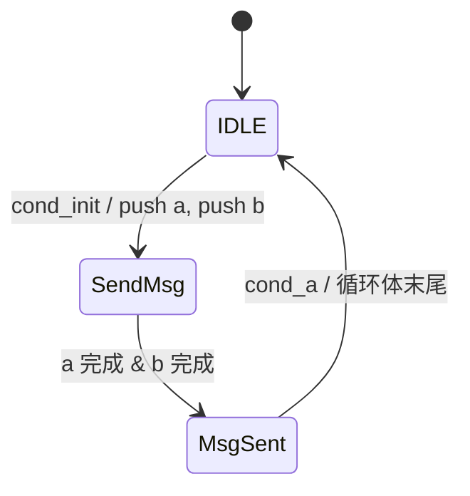
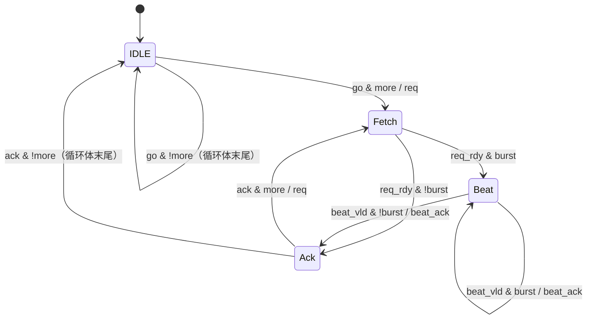
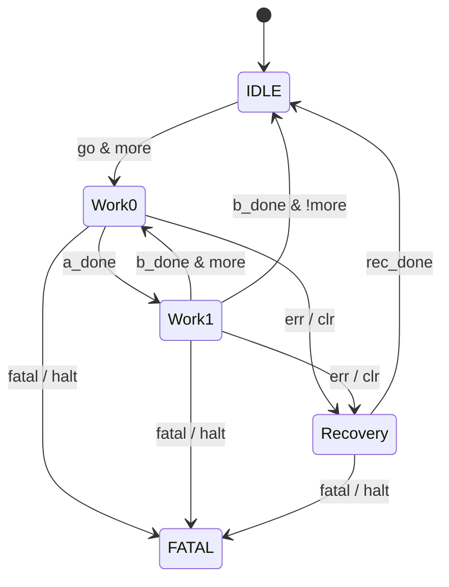
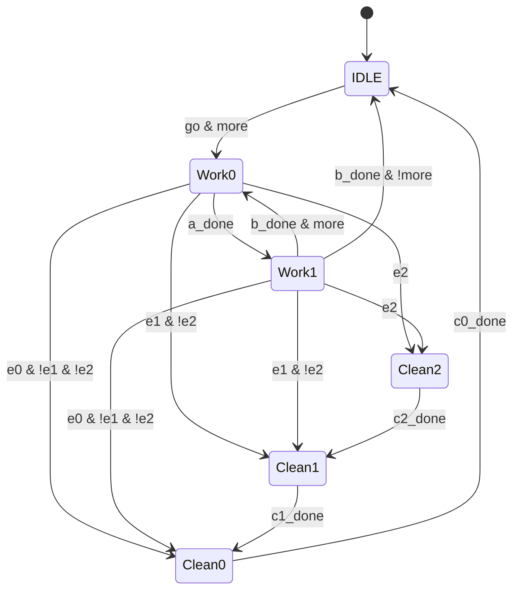
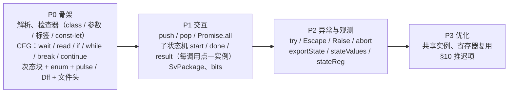

# async/await 状态机 DSL 设计（草案）

> 状态：**设计草案，未实现**。没有命令、没有 `help` 主题，`help status` 不列。
> 来源：初稿 `demo/state/demo.md` 与值模型试验 `demo/state/demo.ts`，已并入本文后删除；原文见 git 提交 `21cb9ca`。本文是这套设计的唯一来源。
> 初稿没说清的地方标为「决定」（本文给出的取舍）或「开放」（§10，需作者拍板）。
> 作者源码是 **ECMAScript**（`.mjs`），不是 TypeScript：一组状态机写成带 `@FsmGroup` 的 class，对外的状态机是带 `@Fsm` 的 async 方法，端口是方法的解构参数（§2.2）；状态名用原生标签语句（§3.5）。选型理由见 §8.2。
> **文档规范**：每段 DSL 示例紧跟它生成的 SystemVerilog，两者一一对照；SV 示例与 §6.5 的 `aw_dff` 一起要能过 Verilator `--lint-only -Wall -Wno-DECLFILENAME`。除 §7.1 外，SV 示例省略文件头（§7.1）。示例、生成规则任何一方改动，都要同步更新另一方；将来 `demo/state/` 有可运行示例时，它与本文的对照示例保持一致。

## 背景

- async/await 把时间上不确定的 IO 事件按顺序写出来，底层由编译器转成链式状态机。RTL 状态机做的事情相同：流程、分支、在某个状态等一个条件或 done 脉冲。
- 手写 RTL 状态机虽有范式，工程里仍是大量信号拉来拉去，条件和输出信号难以组织；子状态机嵌套与信号耦合尤其难理清。
- 很多子状态机在逻辑上互斥：A 工作时 B 必然不工作。软件里这类状态只是栈上的临时变量，离开就回收；RTL 里它们一直存在，语义上表达不出互斥，也就无法复用资源。
- 控制型状态机不是计算密集的顺序逻辑；计算交给流水线和 SV，本 DSL 只管控制流。

## 0. 目标与不做

目标：

- 用 ECMAScript `async` 方法描述控制型状态机：流程、分支、循环、等待条件、握手。时钟节拍在作者面隐藏。
- 生成可综合 SV：状态寄存器、次态逻辑、动作脉冲。
- 语言结构直接给出子状态机的互斥关系（顺序调用的两个子状态机不会同时工作），生成器据此复用资源。手写 RTL 表达不了这一点（见「背景」）。

不做：

- 四则运算、有符号比较、数据通路、流水线、脉动阵列。这些写在 SV 里：DSL 只消费其结果信号，或调用用户 package 里的 SV 函数（§2.3）。
- 多时钟域、CDC。一个状态机属于一个时钟和一个复位（**决定**，初稿未提）。

## 1. 术语

| 术语 | 含义 |
|---|---|
| 拍 | 一个时钟周期。作者面不可见，是所有语义的背景 |
| channel | 信号在 DSL 中的类型。每拍产出一个值；作者不关心具体值，只关心事件何时到来 |
| 状态 S | 一个 `await` 等待点。状态机停在 S，直到该 `await` 的条件成立 |
| `state_is_S` | 当前状态是 S。只用于判断条件，不驱动动作 |
| `state_move_to_S` | 进入 S 的那一拍的脉冲（组合逻辑）。所有动作挂在它上面 |
| 段 | 两个相邻 `await` 之间的代码。段内代码全部在一拍内执行 |
| 状态标签 | `await` 语句前的 ES 标签 `Name:`，给该状态命名 |
| 状态机组 | 带 `@FsmGroup` 的 class，生成一个 `.sv` 文件（§2.2） |
| 顶层状态机 | 组里带 `@Fsm` 的 async 方法，对外的模块，没有 `start` / `done` |
| 子状态机 | 组里不带装饰器的 async 方法，只能被组内方法 `await this.xxx({...})` 调用（§5） |

## 2. 信号模型：channel

信号不是 `int` / `string` / 数组这样的值类型，而是带方向的异步 channel，类似 Go 的 `chan<-` / `<-chan` 和 Rust 的 `Sender` / `Receiver`。

| 声明 | 方向 | 含义 |
|---|---|---|
| `Input(N)` | rx | 每拍可读出一个 N 位值 |
| `Output(N)` | tx | 由状态机的动作驱动 |
| `Const(N, v)` | rx | 每拍都读出 v、永远读不完的 channel。生成常量或一条 `assign` |
| `ALWAYS_0` / `ALWAYS_1` | rx | 内建 1 位常量，等同 `Const(1, 0)` / `Const(1, 1)`。陷阱状态写 `await ALWAYS_0.wait(1)`（§3.7） |

规则：

- 作者代码拿不到「当前值」去做 JS 计算。对 channel 只能做三件事：组合运算得到新 channel（§2.1）、等待（`wait`）、采样做分支（`read`，§4）。
- 每拍从每个 channel 读到一个值。`Const` / `ALWAYS_0` / `ALWAYS_1` 每拍读到同一个常数。
- 多位常量写 `Const(N, v)`；参与 §2.1 的运算时也可以直接写数字字面量，位宽取另一侧。

### 2.1 组合运算

运算只限逻辑、比较和位选，直接用 ES 运算符书写；结果是新的 channel，生成一条 `assign`。

| 运算符 | 含义 | 输入位宽 | 输出位宽 |
|---|---|---|---|
| `&` `\|` `^` | 按位与 / 或 / 异或 | 两侧同为 N | N |
| `~` | 按位取反 | N | N |
| `!` `&&` `\|\|` | 逻辑非 / 与 / 或 | 1 | 1 |
| `===` `!==` | 等于 / 不等 | 两侧同为 N | 1 |
| `<` `>` `<=` `>=` | 无符号比较 | 两侧同为 N | 1 |
| `x.bits(i)` | 取第 i 位 | N | 1 |
| `x.bits(hi, lo)` | 取 hi 到 lo 的位段 | N | hi − lo + 1 |

- 数字字面量取另一侧 channel 的位宽，不必写 `Const(8, 0xff)`。值超出位宽、或两侧都是字面量时，编译期报错。
- 其余运算符编译期报错：`==` / `!=`（统一写 `===` / `!==`）、`+ - * / %`、`<< >> >>>`、`**`。这些计算写成用户 SV 函数（§2.3）。
- 位选的下标必须是整数字面量，满足 `N > hi ≥ lo ≥ 0`，否则编译期报错。不支持变量下标：那是一个多路选择器，写成用户函数。
- 位选写成方法调用 `bits`，不用 `[]`：SV 的 `x[hi:lo]` 在 ES 里是语法错误，而 `x[hi, lo]` 是逗号表达式，ES 会把它读成 `x[lo]`，容易误读。`bits` 是检查器认识的内建方法，和 `wait` / `read` 一样只作用于 channel。
- 被选的对象必须是有名字的 channel（端口、`Dff` 的 `val`、`const` 绑定的 channel）或用户函数调用结果。生成器在需要时先把它落成一根线再选，因为 SV 不允许对表达式或函数调用结果直接位选。
- **不支持拼接和移位（决定）**。ES 没有拼接运算符，数组字面量 `[a, b]` 不被解释为拼接，编译期报错；`<<` / `>>` / `>>>` 同样报错。这两类变换写成用户函数（§2.3）。
- 比较只按无符号（**决定**）。DSL 不提供有符号类型，也不提供有符号比较；需要有符号判断时调用用户函数，这是 §2.3 的典型用法。
- 位宽不一致编译期报错（**决定**）。
- 优先级沿用 ES 解析结果。ES 的 `===` 比 `&` 结合得紧，与 SV 中 `==` 和 `&` 的相对次序一致；生成 SV 时统一加满括号，不依赖两边优先级逐条相同。

这些运算符在 ES 运行时对对象没有意义：Bun 实测 `{} & !{}` 得 `0`，`==` 比较引用；TC39 的运算符重载提案已于 2023-11 撤回。DSL 源码从不执行（§8.2），运算符的含义由编译器从 AST 赋予。初稿里 `msg_valid & !skip & (msg_val == const_val)` 的写法因此成立，只需把 `==` 改成 `===`：

```js
const next_cond = msg_valid & !skip & (msg_val === 0xff);
const is_wr = cmd.bits(31) & (cmd.bits(27, 24) === 0x3);
WaitMsg: await next_cond.wait(1);
```

生成的 SV：

```systemverilog
assign next_cond = msg_valid & !skip & (msg_val == 8'hff);
assign is_wr     = cmd[31] & (cmd[27:24] == 4'h3);
// in the next-state block (§6.5):
//   WaitMsg: if (next_cond) begin state_next = X; move_to_X = 1'b1; end
```

- DSL 的 `===` / `!==` 生成 SV 的 `==` / `!=`。SV 的 `===` 是四态逐位比较，语义不同，不生成。
- 字面量按另一侧位宽写成带宽度的常量：`msg_val` 是 8 位，生成 `8'hff`；`cmd.bits(27, 24)` 是 4 位，生成 `4'h3`。
- `x.bits(hi, lo)` 生成 `x[hi:lo]`，`x.bits(i)` 生成 `x[i]`。

### 2.2 状态机组、状态机与端口

初稿用 TS `interface` 声明端口。ES 没有类型，而生成 SV 端口恰好需要方向和位宽，所以端口写成**方法的解构参数，默认值就是端口声明**：

```js
import { FsmGroup, Fsm, Input, PushPort } from "autowire/fsm";

@FsmGroup
export class MsgCtl {
  @Fsm
  async fsm_drive_signal({
    cond_init = Input(1),
    cond_a = Input(1),
    fifo_a = PushPort(8),
    fifo_b = PushPort(8),
  }) {
    // … 见 §3.2
  }
}
```

- `@FsmGroup` 标记一组状态机，一个 class 生成一个 `.sv` 文件。class 上的 `/** … */` 是文件级业务注释（§7.1）。
- `@Fsm` 标记对外的顶层状态机，方法名就是生成的 `module` 名。选项写在装饰器参数里：`@Fsm({ exportState: true })`（§6.5）。
- 不带装饰器的 async 方法是组内子状态机（§5）。
- 参数必须是一个对象解构模式，每个属性都写默认值，默认值是端口声明。属性名就是 SV 端口名。默认值不是运行时语义：源码从不执行（§8.2），编译器只从 AST 读出方向和位宽。
- 方法体里直接用参数名，不需要 `ports.` 前缀。`autowire/fsm` 是暂定的 import 路径（§10）。
- 位宽、方向错误由我们自己写的检查器在编译期报出（§8.3），不依赖 tsc 或任何类型检查。
- 装饰器只能用在 class 和 class 方法上。ES 不允许装饰普通函数，`@Fsm async function f() {}` 是语法错误（Bun 实测：`Expected "class" but found "async"`），所以状态机必须写成 class 方法。
- `PushPort(N)` 是 `<name>_vld` 出 / `<name>_rdy` 入 / `<name>_data[N]` 出 三根线的打包，用 `.push(v)` 发送（§6.2）。`PopPort(N)` 是对称的接收口：`<name>_vld` 入 / `<name>_rdy` 出 / `<name>_data[N]` 入，用 `.pop()` 接收（§6.2）。
- `Dff(N)` 声明一个寄存器，接口是 `{ set: Output(1), next: Output(N), val: Input(N) }`（方向以状态机为准），DSL 里用 `.set(v)` 写、`.val` 读（§6.5）。寄存器放在哪由声明位置和选项决定：

  | 声明 | 寄存器 | 生成的端口 | 典型用途 |
  |---|---|---|---|
  | 参数里 `x = Dff(N)` | 模块内 `aw_dff` | 一个输出口 `x`，即 `val` | 给外部的电平标志：active、busy、enable（§6.1） |
  | 参数里 `x = Dff(N, { external: true })` | 模块外，属于别人 | `x_set` / `x_next` 输出，`x_val` 输入 | regfile 字段、别的模块也读写的寄存器（§6.5） |
  | 方法体里 `const x = Dff(N)` | 模块内 `aw_dff` | 无 | 状态机私有的寄存器，例如锁存 `read()` 的结果（§4） |

  `Output(N)` 只表示由动作驱动的组合输出（脉冲），不带寄存器。

class 的其他写法都由检查器拒绝（§8.3）：`constructor`、字段、`static`、getter / setter、`extends`、`this` 的其他用法。源码虽不执行，但 Bun 会把装饰器转成 `__decorateElement` 等运行时调用（实测），误运行时会真的调用 `FsmGroup` / `Fsm`；`autowire/fsm` 因此导出同名的空实现，误运行不会崩溃，也不会产生任何输出。

生成的 SV 端口（`clk` / `rst_n` 由生成器加上，作者面不出现，与「节拍是背景」一致）：

```systemverilog
module fsm_drive_signal (
  input  logic       clk,
  input  logic       rst_n,
  input  logic       cond_init,
  input  logic       cond_a,
  output logic       fifo_a_vld,
  input  logic       fifo_a_rdy,
  output logic [7:0] fifo_a_data,
  output logic       fifo_b_vld,
  input  logic       fifo_b_rdy,
  output logic [7:0] fifo_b_data
);
```

### 2.3 调用用户 SV 函数

较复杂的组合逻辑和信号转换（有符号比较、取绝对值、拼接、移位、变量下标选择、字段解码）写在用户自己的 SV package 里，DSL 声明函数签名后直接调用。DSL：

```js
const num_pkg = SvPackage("num_pkg", {
  lt_s8: SvFunction({ args: { a: 8, b: 8 }, ret: 1 }),
  abs8:  SvFunction({ args: { x: 8 }, ret: 8 }),
});

@FsmGroup
export class CmpCtl {
  @Fsm
  async cmp_fsm({
    vld = Input(1),
    err = Input(8),
    limit = Input(8),
    mag = Dff(8),
    alarm = Output(1),
  }) {
    const below = num_pkg.lt_s8(err, limit);   // signed compare, done in SV
    while (true) {
      IDLE: await (vld & below).wait(1);
      mag.set(num_pkg.abs8(err));
      alarm.pulse();
      Hold: await (vld & !below).wait(1);
    }
  }
}
```

用户自己的 package（不是生成物）：

```systemverilog
package num_pkg;
  // user code: signed compare and magnitude on 8-bit two's complement
  function automatic logic lt_s8(input logic signed [7:0] a, input logic signed [7:0] b);
    return a < b;
  endfunction
  function automatic logic [7:0] abs8(input logic signed [7:0] x);
    return x[7] ? -x : x;
  endfunction
endpackage
```

生成的 SV：

```systemverilog
package cmp_fsm_pkg;
  typedef enum logic [0:0] {IDLE, Hold} state_t;
endpackage

module cmp_fsm
  import cmp_fsm_pkg::*;
(
  input  logic       clk,
  input  logic       rst_n,
  input  logic       vld,
  input  logic [7:0] err,
  input  logic [7:0] limit,
  output logic [7:0] mag,
  output logic       alarm
);
  state_t     state_val, state_next;
  logic       fn_lt_s8_0;
  logic [7:0] fn_abs8_0;
  logic       move_to_Hold;

  // user functions: one wire per distinct call
  assign fn_lt_s8_0 = num_pkg::lt_s8(err, limit);
  assign fn_abs8_0  = num_pkg::abs8(err);

  always_comb begin
    state_next   = state_val;
    move_to_Hold = 1'b0;
    unique case (state_val)
      IDLE:
        if (vld & fn_lt_s8_0) begin
          state_next   = Hold;
          move_to_Hold = 1'b1;
        end
      Hold:
        if (vld & !fn_lt_s8_0) state_next = IDLE;
      default:
        state_next = IDLE;
    endcase
  end

  always_ff @(posedge clk or negedge rst_n)
    if (!rst_n) state_val <= IDLE;
    else        state_val <= state_next;

  aw_dff #(.T(logic [7:0])) u_mag (.clk, .rst_n,
    .set(move_to_Hold), .next(fn_abs8_0), .val(mag));            // mag.set(num_pkg.abs8(err))
  assign alarm = move_to_Hold;                                    // alarm.pulse()
endmodule
```

| DSL | SV |
|---|---|
| `SvPackage("num_pkg", {...})` | 不生成任何东西；只声明用户 package 的名字和函数签名 |
| `num_pkg.lt_s8(err, limit)` | `fn_lt_s8_0 = num_pkg::lt_s8(err, limit)`，结果是 1 位 channel |
| `mag.set(num_pkg.abs8(err))` | `u_mag.next = fn_abs8_0` |

规则：

- `SvPackage(...)` 必须是模块顶层的 `const`（在 class 之外），参数是字面量。`args` 按声明顺序对应 SV 形参，值是位宽；`ret` 是返回值位宽。
- 调用结果是一个普通 channel，位宽为 `ret`，可以参与 §2.1 的运算、`wait`、`read`、`Dff.set` 和 `push` 的数据。实参只能是 channel 或数字字面量；字面量取对应形参的位宽。
- 实参个数和位宽在编译期检查（§8.3）。签名与 package 源码是否一致，DSL 不检查：RtlIndex 只按名字记录 package（[hdxml/module-info.md](../hdxml/module-info.md) B-5），不含函数签名；不一致由 SV 编译器（Verilator 等）报错。见 §10。
- 生成的 SV 一律用作用域调用 `pkg::fn(...)`，不写 `import pkg::*`，避免与状态 enum 成员重名。
- 相同函数加相同实参只生成一根线（`fn_<函数名>_<序号>`），被条件和动作共用。
- 组合 channel 的 `const` 定义（运算或函数调用）不是动作，可以写在第一个 `await` 之前；它在每一拍都有值（§2.4）。
- 用户函数必须是 `function automatic`、纯组合、无副作用，作者负责。它的输入只能是 channel，主状态不是 channel，传不进去，所以 §6.5 的状态机识别条件不受影响。
- 用户 package 是分析与仿真 filelist 的输入，必须排在生成的 `.sv` 之前编译。

### 2.4 绑定：`const` 与 `let`

`const` / `let` 沿用 JS 的含义（**决定**）：它们区分的是**绑定能不能重新赋值**，不区分值是不是常数。生成常量还是组合信号，由编译器看右边的表达式决定，作者不用另外声明。

| 写法 | 生成 | 依据 |
|---|---|---|
| `const K = Const(8, 0xa5)`、`const K = ALWAYS_1` | 常量（`localparam` 或直接内联） | 右边能在编译期求出常数 |
| `const c = a & b`、`const f = pkg.fn(x)` | `logic c; assign c = …;` | 右边是组合表达式 |
| `let r;` 后在带标签的调用或接收语句里赋值一次：`StepB: r = await this.sub({...});`、`Recv: d = await fifo.pop();` | 子状态机的 `result`（§5）或 `pop` 的数据（§6.2） | 唯一允许的 `let` 用法 |
| `let x = …` 之后重新赋值，或在多个段里赋值 | 编译期报错，提示改用 `Dff` | 重新赋值意味着需要寄存器或按状态的选择器，assign 表达不了 |

- `const` 绑定的组合信号可以在多个段里读，它每一拍都有值；`read()` 的结果不能绑定到变量上（§4）。
- `let r` 拿到的 `result` 只在 `done` 那一拍有效，与 `read()` 相同；要在后面的段里用，先 `Dff.set(r)`（§5）。

## 3. 状态与节拍

### 3.1 原语

| 原语 | 占用拍数 | 是否生成状态 | 生成 |
|---|---|---|---|
| `await ch.wait(v)` | ≥ 1 | 是 | `state_is_S & (ch == v)` 作为离开 S 的条件 |
| `await ch.read()` | 0 | 否 | 在当前段所在的那一拍采样，只用于分支（§4） |
| `await this.sub({...})` | ≥ 1 | 是（调用状态） | 子状态机的 `start` / `done` / `result`（§5） |
| `ch.push(v)` | 发起 0 拍，完成 ≥ 0 拍 | 否，返回 Future | 握手子状态机（§6.2） |
| `await Promise.all([...])` | 等全部 Future 完成 | 是 | fork / join（§6.3） |
| `Name: await …` | 0 | 否 | 给该 `await` 的状态命名（§3.5） |
| `while` / `do…while` / `break` / `continue` | 0 | 否 | 控制流图上的回边与出口（§3.6） |
| `try { Escape(c); … } catch { … }` | 0 | 否 | 异常区域：区域内每个状态多一条「`c` 成立就进 `catch`」的出口（§3.7） |
| `throw Raise()` | 0 | 否 | 当前段结束时跳进最近的 `catch`（§3.7） |

### 3.2 段与状态的对应（核心规则）

第 K 个 `await` 与第 K+1 个 `await` 之间的段，在 `state_move_to_S(K+1)` 这一拍执行，其中：

```text
state_move_to_S(K+1) = state_is_S(K) & cond(K)
```

S(K+1) 是第 K+1 个 `await` 的等待状态，名字是该 `await` 语句上的标签。段里的动作写在标签之前，发生在进入这个状态的那一拍：读法是「做完这些动作，进入 SendMsg 等待」。

初稿的例子（先等 `cond_init`，再同时向两个 FIFO 发消息并等两边完成，最后等 `cond_a`）：

```js
@Fsm({ exportState: true })
async fsm_drive_signal({ cond_init = Input(1), cond_a = Input(1), fifo_a = PushPort(8), fifo_b = PushPort(8) }) {
  while (true) {
    IDLE:    await cond_init.wait(1);               // IDLE 等 cond_init
    const a_done = fifo_a.push(0x00);               // move_to_SendMsg 这一拍发起
    const b_done = fifo_b.push(0x10);
    SendMsg: await Promise.all([a_done, b_done]);   // SendMsg 等两个 push 完成
    MsgSent: await cond_a.wait(1);                  // MsgSent 等 cond_a；之后是循环体末尾（§3.4）
  }
}
```



生成的 SV（`exportState: true`，§6.5）：

```systemverilog
package fsm_drive_signal_pkg;
  typedef enum logic [1:0] {IDLE, SendMsg, MsgSent} state_t;  // no values: left to synthesis
endpackage

module fsm_drive_signal
  import fsm_drive_signal_pkg::*;
(
  input  logic       clk,
  input  logic       rst_n,
  input  logic       cond_init,
  input  logic       cond_a,
  output logic       fifo_a_vld,
  input  logic       fifo_a_rdy,
  output logic [7:0] fifo_a_data,
  output logic       fifo_b_vld,
  input  logic       fifo_b_rdy,
  output logic [7:0] fifo_b_data,
  output logic       state_set_o,  // exportState
  output state_t     state_next_o,
  output state_t     state_val_o
);
  state_t state_val, state_next;
  logic   move_to_SendMsg, move_to_MsgSent, move_to_IDLE, join_SendMsg;
  logic   a_pending_val, a_done, a_fin_val;
  logic   b_pending_val, b_done, b_fin_val;

  assign join_SendMsg = (a_done | a_fin_val) & (b_done | b_fin_val);

  // next state and moves: each condition written once
  always_comb begin
    state_next      = state_val;
    move_to_SendMsg = 1'b0;
    move_to_MsgSent = 1'b0;
    move_to_IDLE    = 1'b0;
    unique case (state_val)
      IDLE:
        if (cond_init) begin
          state_next      = SendMsg;
          move_to_SendMsg = 1'b1;
        end
      SendMsg:
        if (join_SendMsg) begin
          state_next      = MsgSent;
          move_to_MsgSent = 1'b1;
        end
      MsgSent:
        if (cond_a) begin                // loop body end: back to the entry
          state_next   = IDLE;
          move_to_IDLE = 1'b1;
        end
      default:
        state_next = IDLE;
    endcase
  end

  always_ff @(posedge clk or negedge rst_n)
    if (!rst_n) state_val <= IDLE;
    else        state_val <= state_next;

  // fifo_a.push(0x00), started on move_to_SendMsg
  assign fifo_a_vld  = move_to_SendMsg | a_pending_val;
  assign fifo_a_data = 8'h00;                                   // constant payload: no data register
  assign a_done      = fifo_a_vld & fifo_a_rdy;
  aw_dff u_a_pending (.clk, .rst_n,
    .set((move_to_SendMsg & ~fifo_a_rdy) | (a_pending_val & fifo_a_rdy)),
    .next(move_to_SendMsg & ~fifo_a_rdy), .val(a_pending_val));
  aw_dff u_a_fin (.clk, .rst_n, .set(a_done | move_to_MsgSent), .next(~move_to_MsgSent), .val(a_fin_val));

  // fifo_b.push(0x10)
  assign fifo_b_vld  = move_to_SendMsg | b_pending_val;
  assign fifo_b_data = 8'h10;
  assign b_done      = fifo_b_vld & fifo_b_rdy;
  aw_dff u_b_pending (.clk, .rst_n,
    .set((move_to_SendMsg & ~fifo_b_rdy) | (b_pending_val & fifo_b_rdy)),
    .next(move_to_SendMsg & ~fifo_b_rdy), .val(b_pending_val));
  aw_dff u_b_fin (.clk, .rst_n, .set(b_done | move_to_MsgSent), .next(~move_to_MsgSent), .val(b_fin_val));

  // exportState: enum members selected by comparisons, never state_val itself
  always_comb begin
    unique case (state_val)
      IDLE:    state_val_o = IDLE;
      SendMsg: state_val_o = SendMsg;
      MsgSent: state_val_o = MsgSent;
      default: state_val_o = IDLE;
    endcase
  end
  assign state_set_o = move_to_SendMsg | move_to_MsgSent | move_to_IDLE;
  always_comb begin
    state_next_o = state_val_o;
    if (move_to_SendMsg) state_next_o = SendMsg;
    if (move_to_MsgSent) state_next_o = MsgSent;
    if (move_to_IDLE)    state_next_o = IDLE;
  end
endmodule
```

| DSL | SV |
|---|---|
| `IDLE:` / `SendMsg:` / `MsgSent:` 标签 | `state_t` 成员，名字原样 |
| `await cond_init.wait(1)` 在 IDLE | 次态块的 `IDLE` 分支：`if (cond_init)` 里同时写 `state_next = SendMsg` 和 `move_to_SendMsg = 1'b1` |
| 段内 `fifo_a.push(0x00)` | `fifo_a_vld = move_to_SendMsg \| a_pending_val`（§6.2） |
| `await Promise.all([a_done, b_done])` | `join_SendMsg` 与 `a_fin_val` / `b_fin_val`（§6.3） |
| 循环体末尾 | 回边 `MsgSent → IDLE`：回到 `while (true)` 开头的入口状态（§3.4） |

### 3.3 等待从进入后的第一拍开始

**决定**：进入 S 的那一拍属于上一个状态；S 从下一拍开始判断自己的条件。所以每个 `wait` 至少占 1 拍，哪怕条件在进入时已经成立。两个连续的 `ALWAYS_1.wait(1)` 占 2 拍。这让「一个 `await` = 一个状态 = 至少一拍」成立，状态计数和时序可从源码直接读出。

### 3.4 有结束与无结束：`while (true)` 与 `return`

状态机分两类，写法必须显式区分（**决定**）：

| | 顶层 `@Fsm` | 子状态机（未装饰的方法，§5） |
|---|---|---|
| 语义 | 无结束：一直运行 | 有结束：每次调用都要返回 |
| 写法 | 方法体是 `while (true) { … }`；只跑一次的流程最后停在陷阱状态（`await ALWAYS_0.wait(1)`） | 走到方法末尾或执行 `return` |
| `return` | 编译期报错 | 发出 `done`；`return x` 同时给出 `result` |
| 能走到方法末尾 | 编译期报错 | 必须能走到，否则 `done` 永远不会发出，编译期报错 |

- **顶层的 `while (true)`**：循环体末尾的段在最后一次 move 那一拍执行，然后回到循环开头，也就是第一个 `await` 的状态（复位后的初始状态）。`continue` 同样回到开头，用来跳过循环体剩下的代码（例如 `catch` 之后不走正常流程，§3.7）。生成的 SV 里这条回边就是「回到入口」的那条边。
- 顶层方法体只能是一条 `while (true)`，前后不能有其他语句；`SvPackage` 调用结果、组合运算这类 `const` 定义（不是动作，§2.3）可以写在循环之前。
- `while (true)` 循环体里第一个 `await` 之前不能有动作：复位进入时没有 move 那一拍，这些动作在复位后的第一轮执行不到，只在回边上执行，前后不一致。复位后要做的事写在第一个等待之后。`try` 和 `Escape(...)` 是声明，不是动作，可以写在第一个 `await` 之前（§3.7.1）。
- 顶层里 `break` 跳出 `while (true)` 会走到方法末尾，编译期报错；`break` 之后紧接陷阱状态的写法除外，因为陷阱状态之后的代码不可达。
- 无限循环只接受 `while (true)`，`for (;;)` 仍然禁止（§3.6）。
- 子状态机：最后一个 `await` 之后的段（末段）或 `return` 所在的段在最后一次 move 那一拍执行，同一拍发出 `done` 脉冲和 `result`，回到隐式入口 `IDLE`（§5）。被调用方的 `abort` 使它不经末段直接回到入口，不发 `done`（§3.7、§5）。`return` 可以写在方法的任何位置，含义都是「本次调用结束」。
- 回到入口而不是停在终态，是硬件状态机的惯例；需要终态时写陷阱状态。

### 3.5 状态命名

状态名是 `await` 语句上的 ES 标签：`Name: await …;`。标签从 ES1 起就是标准语法，运行时没有作用。

ES 标签还能挂在循环和块上。编译器按**标签挂在什么语句上**区分它的含义，不需要额外语法：

| 标签挂在 | 含义 | 生成 FSM 状态 | `break` / `continue` 能否指向它 |
|---|---|---|---|
| 以产生状态的 `await` 开头的语句 | 状态名 | 是，`state_t` 的成员 | 不能，ES 语法禁止（见下） |
| `while` / `do…while` | 循环名 | 否 | `break` 跳到循环之后，`continue` 回到循环条件（§3.6.1） |
| `{ … }` 块 | 块名 | 否 | `break` 跳到块之后（§3.6.1） |
| 其他语句 | 编译期报错 | — | — |

ES 规定 `break L` / `continue L` 只能指向**包住**当前语句的那条语句的标签。状态标签挂在 `await` 表达式语句上，它不包住任何语句，所以 `break 状态名` / `continue 状态名` 一定是语法错误（`@babel/parser` 报 `Unsyntactic break.`，Bun 报 `There is no containing label named "…"`，均实测）。状态标签和跳转标签因此不会混淆。

- 状态标签所在的语句必须从一个产生状态的 `await` 开始求值：`await x.wait(…)`、`await this.sub({...})`、`await Promise.all(…)`。可以是表达式语句、赋值（`StepB: r = await this.sub({...});`），或 `if (await …)` 的条件。
- 一条语句只能有一个标签。`A: B: await x.wait(1);` 在 ES 里合法（实测），但会让一个状态有两个名字，编译期报错。
- 声明语句不能带标签：`S: const x = await …` 是 ES 语法错误（`Cannot use a declaration in a single-statement context`，实测）。需要返回值时先 `let r;`，再写带标签的赋值。
- ES 只禁止嵌套的同名标签。同一方法内的所有状态名必须唯一，由编译器检查。
- 标签必须是合法的 SV 标识符。ES 标识符允许 Unicode 和以 `$` 开头，SV 不允许，由编译器检查。
- 没有标签的 `await` 生成匿名状态（按源码顺序编号）。
- 末段没有 `await`，所以没有状态可命名。**决定**：末段那次 move 就是 `done`，不需要名字。
- 循环名和块名不生成状态，也不在 enum 里出现（§3.6.1）。
- 工具链：`bun run lint` 不检查 DSL 源码。`tsconfig.json` 的 `include` 只含 `.ts`，`biome.json` 排除了 `demo/`。放到 `test/` 下的 `.mjs` 夹具会被 biome 扫到，`lint/suspicious/noConfusingLabels` 会对非循环标签报警告（实测），需要对该路径关掉这条规则。

### 3.6 循环

循环在编译器里只是控制流图上的回边。编译器的做法不变：从一个 `await` 沿源码往下走，走到下一个 `await` 为止，途中的代码就是这次离开要做的事；循环只是让这条路可能拐回循环开头。状态数仍等于 `await` 的个数，与嵌套层数无关。

支持的写法：`while (cond) { … }`、`do { … } while (cond)`、`break`、`continue`，可以带循环标签；带标签的块配合 `break` 使用（§3.6.1）。循环条件和分支条件一样，写成 `await x.read()` 或组合 channel，不占拍，并进前一个状态的离开条件。

规则：

- **每个环至少经过一个 `await`（决定）**。没有 `await` 的环在硬件里是组合环，编译期报错。有了这条，「从一个 `await` 走到下一个 `await`」一定会停。
- **不支持 `for`（决定）**，包括计数循环和 `for…of`。编译期展开计数循环会让状态数乘以次数，嵌套时相乘；而且 JS 的循环变量不是 channel，DSL 也没有 `+`。计数交给外部计数器（脉冲清零、加一，「到数」作为条件读回），或写成用户函数（§2.3）。
- 一次迭代里发起的 Future（`push`、子状态机调用）必须在同一次迭代内 join，否则就是悬空 Future（§6.3）。
- 段被分支或循环条件分成几截时，条件之前的动作挂在 **`leave_S`**（S 的离开脉冲，不管去哪个状态），条件之后的动作挂在具体的 `move_to_T`。`leave_S` 与 `move_to_T` 一样，只在有消费者时生成，并在同一个次态块里赋值（§6.5）。
- `move_to_T` 只合并执行同一段动作的边。到达同一个 T 的几条边若动作不同（例如末段回到入口和 `catch` 走完回到入口），动作挂在各自的 `leave_S` 或按边生成的 `move_<S>_to_<T>` 上，不挂在共用的 `move_to_T` 上（§3.7.1）。
- 循环开头、第一个 `await` 之前的动作有多个前驱（第一次进入、回边），每个前驱在次态块里各写一次，份数等于前驱数。
- 循环名、块名与状态名在同一命名空间里，不能重名。
- 顶层状态机的 `while (true)` 之外不能有别的循环包住第一个 `await`（§3.4）；`while (true)` 循环体内第一个 `await` 之前也不能有循环：那时没有可以采样条件的离开拍。

DSL（两层嵌套）：

```js
@Fsm
async burst_ctl({
  go = Input(1), more = Input(1), req_rdy = Input(1),
  burst = Input(1), beat_vld = Input(1), ack = Input(1),
  req = Output(1), beat_ack = Output(1),
}) {
  while (true) {
    IDLE: await go.wait(1);
    while (await more.read()) {
      req.pulse();
      Fetch: await req_rdy.wait(1);
      while (await burst.read()) {
        Beat: await beat_vld.wait(1);
        beat_ack.pulse();
      }
      Ack: await ack.wait(1);
    }
  }
}
```



生成的 SV：

```systemverilog
package burst_ctl_pkg;
  typedef enum logic [1:0] {IDLE, Fetch, Beat, Ack} state_t;
endpackage

module burst_ctl
  import burst_ctl_pkg::*;
(
  input  logic clk,
  input  logic rst_n,
  input  logic go,
  input  logic more,
  input  logic req_rdy,
  input  logic burst,
  input  logic beat_vld,
  input  logic ack,
  output logic req,
  output logic beat_ack
);
  state_t state_val, state_next;
  logic   move_to_Fetch, leave_Beat;

  // next state, moves and leaves: each condition written once
  always_comb begin
    state_next    = state_val;
    move_to_Fetch = 1'b0;
    leave_Beat    = 1'b0;
    unique case (state_val)
      IDLE:
        if (go) begin
          if (more) begin                // outer loop: enter
            state_next    = Fetch;
            move_to_Fetch = 1'b1;
          end else begin                 // outer loop: skip, tail segment
            state_next    = IDLE;
          end
        end
      Fetch:
        if (req_rdy) begin
          if (burst) state_next = Beat;  // inner loop: enter
          else       state_next = Ack;   // inner loop: skip
        end
      Beat:
        if (beat_vld) begin
          leave_Beat = 1'b1;
          if (burst) state_next = Beat;  // inner loop: back edge
          else       state_next = Ack;   // inner loop: exit
        end
      Ack:
        if (ack) begin
          if (more) begin                // outer loop: back edge
            state_next    = Fetch;
            move_to_Fetch = 1'b1;
          end else begin                 // outer loop: exit, tail segment
            state_next    = IDLE;
          end
        end
      default:
        state_next = IDLE;
    endcase
  end

  always_ff @(posedge clk or negedge rst_n)
    if (!rst_n) state_val <= IDLE;
    else        state_val <= state_next;

  assign req      = move_to_Fetch;       // req.pulse()
  assign beat_ack = leave_Beat;          // beat_ack.pulse()
endmodule
```

| DSL | SV |
|---|---|
| `while (await more.read())` | `IDLE` 和 `Ack` 分支里的 `if (more)`：进入与回边各写一次 |
| 循环体开头的 `req.pulse()` | `move_to_Fetch`，在两个前驱分支里各置一次 |
| `Beat:` 之后、内层条件之前的 `beat_ack.pulse()` | `leave_Beat`：不管去 `Beat` 还是 `Ack` 都发 |
| 外层循环退出、循环体末尾 | `state_next = IDLE`：回到 `while (true)` 开头（§3.4） |

#### 3.6.1 `break` / `continue` 与跳转标签

`break` / `continue` 不等待，所以不生成状态。`break L` 的意思是：这次离开当前状态时，不走循环或块里的下一步，改为从 `L` 之后的代码继续往下走，直到下一个 `await`；`continue L` 是回到循环 `L` 的条件重新判断。这和「从一个 `await` 走到下一个 `await`」是同一条规则（§3.6），`break` / `continue` 只改变走的路径。在 SV 里，它是当前状态分支里多出来的一条 `if`，目标是常量状态。

- 不带标签的 `break` / `continue` 作用于最内层循环；带标签的可以跳出多层循环。
- 块标签只能 `break`，等于一条向前的边，不形成环。
- `break` 之后的动作（例如循环后面的 `found.pulse()`）由所有到达那里的边共用，挂在 `move_to_<目标状态>` 上。
- 要跳到任意指定状态（例如 `FATAL`）时，ES 没有 `goto`，用 §3.7 的 `throw Raise()` 或 `Escape`。
- 用 `break` 离开 `try` 块是正常出口：不进 `catch`，也不做 §3.7 的在途清理，所以区域内发起的 Future 必须在 `break` 之前已经 join（§6.3）。

DSL（二维扫描，找到即结束）：

```js
@Fsm
async scan_ctl({
  go = Input(1), row_more = Input(1), row_rdy = Input(1),
  col_more = Input(1), col_rdy = Input(1), hit = Input(1),
  ack = Input(1), found = Output(1),
}) {
  while (true) {
    IDLE: await go.wait(1);
    Outer: while (await row_more.read()) {
      Row: await row_rdy.wait(1);
      while (await col_more.read()) {
        Col: await col_rdy.wait(1);
        if (await hit.read()) break Outer;   // found: stop the whole scan
      }
    }
    found.pulse();
    Report: await ack.wait(1);
  }
}
```

生成的 SV（`Outer` 不是状态）：

```systemverilog
package scan_ctl_pkg;
  typedef enum logic [1:0] {IDLE, Row, Col, Report} state_t;  // no member for the loop label Outer
endpackage

module scan_ctl
  import scan_ctl_pkg::*;
(
  input  logic clk,
  input  logic rst_n,
  input  logic go,
  input  logic row_more,
  input  logic row_rdy,
  input  logic col_more,
  input  logic col_rdy,
  input  logic hit,
  input  logic ack,
  output logic found
);
  state_t state_val, state_next;
  logic   move_to_Report;

  always_comb begin
    state_next     = state_val;
    move_to_Report = 1'b0;
    unique case (state_val)
      IDLE:
        if (go) begin
          if (row_more) state_next = Row;        // Outer: enter
          else begin                             // Outer: skip
            state_next     = Report;
            move_to_Report = 1'b1;
          end
        end
      Row:
        if (row_rdy) begin
          if (col_more) state_next = Col;        // inner: enter
          else if (row_more) state_next = Row;   // inner: skip, Outer: back edge
          else begin                             // Outer: exit
            state_next     = Report;
            move_to_Report = 1'b1;
          end
        end
      Col:
        if (col_rdy) begin
          if (hit) begin                         // break Outer
            state_next     = Report;
            move_to_Report = 1'b1;
          end else if (col_more) state_next = Col;   // inner: back edge
          else if (row_more) state_next = Row;       // inner: exit, Outer: back edge
          else begin                                 // Outer: exit
            state_next     = Report;
            move_to_Report = 1'b1;
          end
        end
      Report:
        if (ack) state_next = IDLE;              // loop body end: back to the entry
      default:
        state_next = IDLE;
    endcase
  end

  always_ff @(posedge clk or negedge rst_n)
    if (!rst_n) state_val <= IDLE;
    else        state_val <= state_next;

  assign found = move_to_Report;                 // found.pulse() after the loop
endmodule
```

| DSL | SV |
|---|---|
| `Outer:` 循环标签 | 不生成 enum 成员 |
| `break Outer` | `Col` 分支里 `if (hit)` → `Report` |
| 外层循环自然结束 | 同样到 `Report`，与 `break Outer` 共用 `move_to_Report` |
| 循环后的 `found.pulse()` | `found = move_to_Report`：三条到达 `Report` 的边都发 |

### 3.7 异常区域：`try` / `catch`

「任意工作状态出错就进恢复流程」这类需求，用 ES 原生的 `try` / `catch` 表达。`try` 块圈出一个区域，块开头的 `Escape(c)` 声明出错条件；区域内任何状态满足 `c`，都跳进 `catch` 的流程。`catch` 走完就是区域结束，接着往下执行；后面没有代码时到达 `while (true)` 循环体末尾，回到入口状态（§3.4）。所以「恢复后回到 IDLE，再重新进入工作」不需要额外写。`try` 后面还有只属于正常流程的代码时，在 `catch` 末尾写 `continue`，跳过它们直接回到入口。

DSL（两级错误：可恢复的 `err`，致命的 `fatal`）：

```js
@Fsm
async work_ctl({
  go = Input(1), err = Input(1), fatal = Input(1), more = Input(1),
  a_done = Input(1), b_done = Input(1), rec_done = Input(1),
  clr = Output(1), halt = Dff(1),
}) {
  while (true) {
    IDLE: await go.wait(1);                 // 第一个 await = 复位后的初始状态
    try {
      Escape(fatal);                        // 外层：致命错误
      try {
        Escape(err);                        // 内层：可恢复错误
        while (await more.read()) {
          Work0: await a_done.wait(1);
          Work1: await b_done.wait(1);
        }
      } catch {
        clr.pulse();
        Recovery: await rec_done.wait(1);   // 恢复完 → 循环体末尾 → IDLE
      }
    } catch {
      halt.set(1);
      FATAL: await ALWAYS_0.wait(1);        // 陷阱状态：条件永不成立
    }
  }
}
```



生成的 SV：

```systemverilog
package work_ctl_pkg;
  typedef enum logic [2:0] {IDLE, Work0, Work1, Recovery, FATAL} state_t;
endpackage

module work_ctl
  import work_ctl_pkg::*;
(
  input  logic clk,
  input  logic rst_n,
  input  logic go,
  input  logic err,
  input  logic fatal,
  input  logic more,
  input  logic a_done,
  input  logic b_done,
  input  logic rec_done,
  output logic clr,
  output logic halt
);
  state_t state_val, state_next;
  logic   move_to_Recovery, move_to_FATAL;

  always_comb begin
    state_next       = state_val;
    move_to_Recovery = 1'b0;
    move_to_FATAL    = 1'b0;
    unique case (state_val)
      IDLE:
        if (go) begin
          if (more) state_next = Work0;    // enter the loop
          else      state_next = IDLE;     // skip: back to the entry
        end
      Work0:
        if (fatal) begin                   // outer Escape(fatal): highest priority
          state_next    = FATAL;
          move_to_FATAL = 1'b1;
        end else if (err) begin            // inner Escape(err)
          state_next       = Recovery;
          move_to_Recovery = 1'b1;
        end else if (a_done) begin
          state_next = Work1;
        end
      Work1:
        if (fatal) begin
          state_next    = FATAL;
          move_to_FATAL = 1'b1;
        end else if (err) begin
          state_next       = Recovery;
          move_to_Recovery = 1'b1;
        end else if (b_done) begin
          if (more) state_next = Work0;    // loop back edge
          else      state_next = IDLE;     // loop exit: back to the entry
        end
      Recovery:
        if (fatal) begin                   // still inside the outer region
          state_next    = FATAL;
          move_to_FATAL = 1'b1;
        end else if (rec_done) begin
          state_next = IDLE;               // handler done: back to the entry
        end
      FATAL:
        state_next = FATAL;                // trap: await ALWAYS_0 never leaves
      default:
        state_next = IDLE;
    endcase
  end

  always_ff @(posedge clk or negedge rst_n)
    if (!rst_n) state_val <= IDLE;
    else        state_val <= state_next;

  assign clr = move_to_Recovery;           // clr.pulse()
  aw_dff u_halt (.clk, .rst_n, .set(move_to_FATAL), .next(1'b1), .val(halt));
endmodule
```

| DSL | SV |
|---|---|
| `Escape(err)` 所在的 `try` 块 | `Work0`、`Work1` 分支里排在正常条件之前的 `else if (err)` |
| 外层 `Escape(fatal)` | 外层区域内每个状态（含内层 `catch` 的 `Recovery`）最前面的 `if (fatal)` |
| `catch` 里的第一个动作 `clr.pulse()` | `move_to_Recovery`：所有出错出口共用 |
| `catch` 走完、循环体末尾 | `Recovery` 的 `rec_done` → `IDLE`（§3.4） |
| `FATAL: await ALWAYS_0.wait(1)` | `FATAL: state_next = FATAL`，复位之外不再离开 |

规则：

- **作用范围**：`Escape(c)` 作用于本 `try` 块里的每个状态，包括嵌套的循环、分支和内层区域；不作用于本区域自己的 `catch`。所以上例 `Recovery` 不会被 `err` 打断，但仍受外层 `fatal` 约束。
- **优先级（决定）**：出错条件排在状态自身条件之前。多层同时成立时外层优先：外层包住内层，语义上更严重。同一个 `try` 里写多个 `Escape` 时按书写顺序。
- **写法**：`Escape(...)` 只能写在 `try` 块开头；`catch` 必须写成 `catch {`，不能绑定变量（没有异常值可接）；不支持 `finally`。
- **主动跳转**：分支里要主动进入 `catch` 时写 `throw Raise()`，它在当前段结束时跳进最近的 `catch`。内层 `catch` 里再写 `throw Raise()`，就把错误升级给外层。
- **陷阱状态**：写成 `await ALWAYS_0.wait(1)`，复位之外永不离开。
- **`catch` 的入口**：`catch` 里第一个 `await` 之前的动作，挂在所有出错出口共用的 `move_to_<catch 的第一个状态>` 上，与循环开头多前驱的处理一致（§3.6）。
- **在途工作的清理（决定）**：经出错出口离开区域时，区域内发起、尚未 join 的 Future 被放弃：生成器把它们的 `pending` / `fin` 辅助寄存器清零（§6.2、§6.3），被调用的子状态机通过 `abort` 口回到 `IDLE`（§5）。作者声明的 `Dff` 保持原值，需要复位就在 `catch` 里显式 `set`。放弃一个握手到一半的 `push` 会在 `rdy` 之前撤掉 `vld`，对端协议是否允许由作者负责（§10）。
- **`IDLE` 由作者写**：顶层状态机的初始状态就是第一个 `await` 的标签，`IDLE`、`FATAL`、`Recovery` 都是作者起的名字，不是保留字。只有子状态机的隐式入口固定叫 `IDLE`（§5）。
- **出错出口不算 `leave_S`**：`leave_S` 只在 S 自己的 `await` 条件成立时发出（§3.6）；经 `Escape` 离开 S 时执行的是 `catch` 的第一段，不执行 S 后面的段。

#### 3.7.1 示例：软复位

「任意状态收到 `force_reset` 就进入 RESET 状态，做完清理再回到初始状态」是软复位：它是一个有动作、会等待完成的普通状态，不是数字电路意义上的强制复位。写法就是 §3.7 的异常区域，**把第一个 `await` 也放进 `try` 块**，入口状态才会被覆盖。

DSL：

```js
@Fsm
async soft_rst_ctl({ force_reset = Input(1), clean_done = Input(1), go = Input(1), stop = Input(1),
                     clean_start = Output(1), active = Dff(1) }) {
  while (true) {
    try {
      Escape(force_reset);              // covers every working state, entry IDLE included
      IDLE: await go.wait(1);
      active.set(1);
      Run:  await stop.wait(1);
      active.set(0);
    } catch {
      active.set(0);                    // cleanup: the author decides what to clear
      clean_start.pulse();
      RESET: await clean_done.wait(1);  // cleanup done → loop body end → IDLE
    }
  }
}
```

生成的 SV：

```systemverilog
package soft_rst_ctl_pkg;
  typedef enum logic [1:0] {IDLE, Run, RESET} state_t;
endpackage

module soft_rst_ctl
  import soft_rst_ctl_pkg::*;
(
  input  logic clk,
  input  logic rst_n,
  input  logic force_reset,
  input  logic clean_done,
  input  logic go,
  input  logic stop,
  output logic clean_start,
  output logic active
);
  state_t state_val, state_next;
  logic   move_to_Run, move_to_RESET, leave_Run;

  always_comb begin
    state_next    = state_val;
    move_to_Run   = 1'b0;
    move_to_RESET = 1'b0;
    leave_Run     = 1'b0;
    unique case (state_val)
      IDLE:
        if (force_reset) begin             // Escape(force_reset)
          state_next    = RESET;
          move_to_RESET = 1'b1;
        end else if (go) begin
          state_next  = Run;
          move_to_Run = 1'b1;
        end
      Run:
        if (force_reset) begin
          state_next    = RESET;
          move_to_RESET = 1'b1;
        end else if (stop) begin           // normal exit only
          state_next = IDLE;               // loop body end: back to the entry
          leave_Run  = 1'b1;
        end
      RESET:
        if (clean_done) state_next = IDLE; // catch done: back to the entry
      default:
        state_next = IDLE;
    endcase
  end

  always_ff @(posedge clk or negedge rst_n)
    if (!rst_n) state_val <= IDLE;
    else        state_val <= state_next;

  assign clean_start = move_to_RESET;      // clean_start.pulse() in catch
  aw_dff u_active (.clk, .rst_n,
    .set(move_to_Run | leave_Run | move_to_RESET),   // set(1) / set(0) / cleanup set(0)
    .next(move_to_Run), .val(active));
endmodule
```

| DSL | SV |
|---|---|
| `try` 包住第一个 `await` | `IDLE` 分支也有 `if (force_reset)` |
| `catch` 里的 `active.set(0)`、`clean_start.pulse()` | `move_to_RESET`：所有出错出口共用 |
| 循环体末尾的 `active.set(0)` | `leave_Run`：只在 `stop` 成立时发出；`RESET → IDLE` 这条边不执行它 |
| `RESET: await clean_done.wait(1)` 之后到循环体末尾 | `RESET` 的 `clean_done` → `IDLE` |

- 与强制复位的区别：RESET 是普通状态，进入时执行 `catch` 的清理动作，等待清理完成；作者声明的 `Dff` 不会自动回到复位值，要清什么在 `catch` 里显式 `set`。生成器只按 §3.7 清理在途的 `pending` / `fin` 和子状态机。
- `force_reset` 是保持为高的电平时，上面的写法会在清理完成后回到 `IDLE` 一拍，再被拉回 `RESET`，每轮重新清理一次。要在 `force_reset` 撤掉之前一直停在 `RESET`，写成：

  ```js
  RESET: await (clean_done & !force_reset).wait(1);
  ```

- 和其他出错条件一起用时，把软复位的 `try` 放在最外层：外层优先（§3.7），复位压过所有内层的出错条件。
- 需要「所有寄存器同步强制回到复位值」的硬复位时，这种写法不够，见 §10。

#### 3.7.2 示例：多级错误逐级退出

三个错误等级 `e0` < `e1` < `e2`。WORK 期间任何一级都可能直接出现；进入哪一级，就从那一级的清理开始，逐级做到等级 0，再回到 `IDLE` 重新开始。写法是**一个 `try` 加 `catch` 里的嵌套 `if` 贯穿**，与 C 语言 `switch` 不写 `break` 往下贯穿同理，不需要多层 `try`，也不需要额外的优先级规则。

DSL：

```js
@Fsm
async err_ctl({
  go = Input(1), more = Input(1), a_done = Input(1), b_done = Input(1),
  e0 = Input(1), e1 = Input(1), e2 = Input(1),
  c0_done = Input(1), c1_done = Input(1), c2_done = Input(1),
  c0_start = Output(1), c1_start = Output(1), c2_start = Output(1),
}) {
  while (true) {
    IDLE: await go.wait(1);
    try {
      Escape(e0 | e1 | e2);                  // any level leaves WORK
      while (await more.read()) {
        Work0: await a_done.wait(1);
        Work1: await b_done.wait(1);
      }
    } catch {
      if (await (e1 | e2).read()) {          // sampled in the escape cycle
        if (await e2.read()) {
          c2_start.pulse();
          Clean2: await c2_done.wait(1);
        }
        c1_start.pulse();                    // level 2 done: fall through to level 1
        Clean1: await c1_done.wait(1);
      }
      c0_start.pulse();                      // every path ends at level 0
      Clean0: await c0_done.wait(1);         // loop body end → IDLE
    }
  }
}
```



生成的 SV：

```systemverilog
package err_ctl_pkg;
  typedef enum logic [2:0] {IDLE, Work0, Work1, Clean2, Clean1, Clean0} state_t;
endpackage

module err_ctl
  import err_ctl_pkg::*;
(
  input  logic clk,
  input  logic rst_n,
  input  logic go,
  input  logic more,
  input  logic a_done,
  input  logic b_done,
  input  logic e0,
  input  logic e1,
  input  logic e2,
  input  logic c0_done,
  input  logic c1_done,
  input  logic c2_done,
  output logic c0_start,
  output logic c1_start,
  output logic c2_start
);
  state_t state_val, state_next;
  logic   move_to_Clean0, move_to_Clean1, move_to_Clean2;

  always_comb begin
    state_next     = state_val;
    move_to_Clean0 = 1'b0;
    move_to_Clean1 = 1'b0;
    move_to_Clean2 = 1'b0;
    unique case (state_val)
      IDLE:
        if (go) begin
          if (more) state_next = Work0;
          else      state_next = IDLE;
        end
      Work0:
        if (e0 | e1 | e2) begin            // Escape(e0 | e1 | e2)
          if (e1 | e2) begin               // catch: reads sampled in this same cycle
            if (e2) begin
              state_next     = Clean2;
              move_to_Clean2 = 1'b1;
            end else begin
              state_next     = Clean1;
              move_to_Clean1 = 1'b1;
            end
          end else begin
            state_next     = Clean0;
            move_to_Clean0 = 1'b1;
          end
        end else if (a_done) begin
          state_next = Work1;
        end
      Work1:
        if (e0 | e1 | e2) begin
          if (e1 | e2) begin
            if (e2) begin
              state_next     = Clean2;
              move_to_Clean2 = 1'b1;
            end else begin
              state_next     = Clean1;
              move_to_Clean1 = 1'b1;
            end
          end else begin
            state_next     = Clean0;
            move_to_Clean0 = 1'b1;
          end
        end else if (b_done) begin
          if (more) state_next = Work0;    // loop back edge
          else      state_next = IDLE;     // loop exit: back to the entry
        end
      Clean2:                              // catch is outside its own region: not interrupted
        if (c2_done) begin
          state_next     = Clean1;         // fall through to level 1
          move_to_Clean1 = 1'b1;
        end
      Clean1:
        if (c1_done) begin
          state_next     = Clean0;         // fall through to level 0
          move_to_Clean0 = 1'b1;
        end
      Clean0:
        if (c0_done) state_next = IDLE;    // loop body end: back to the entry
      default:
        state_next = IDLE;
    endcase
  end

  always_ff @(posedge clk or negedge rst_n)
    if (!rst_n) state_val <= IDLE;
    else        state_val <= state_next;

  assign c2_start = move_to_Clean2;
  assign c1_start = move_to_Clean1;
  assign c0_start = move_to_Clean0;
endmodule
```

| DSL | SV |
|---|---|
| `Escape(e0 \| e1 \| e2)` | `Work0` / `Work1` 分支最前面的 `if (e0 \| e1 \| e2)`，每个工作状态只写一次 |
| `catch` 里的 `read()` | 在出错那一拍采样，并进同一个分支，选出第一个清理状态 |
| 嵌套 `if` 之后的代码 | 清理状态之间固定的向下跳转：`Clean2 → Clean1 → Clean0` |
| `catch` 走完、循环体末尾 | `Clean0` 的 `c0_done` → `IDLE` |

- **进入点**：WORK 期间出现哪一级就直接进哪一级的清理，不经过更高等级的清理状态。同一拍出现多级时，嵌套 `if` 的顺序决定先处理高等级；因为每条路线都会经过所有更低等级，低等级的清理不会漏。
- **清理期间的新错误**：`catch` 不在自己的 `Escape` 范围内，清理不会被打断。`Clean2` 期间来的 `e1` 不需要处理，后面本来就会经过 `Clean1`；`Clean0` 期间来的 `e2` 不处理，回到 `IDLE`、重新进入 WORK 时若仍为高，会再触发一次。需要清理中途升级时，把升级条件写进对应清理状态的 `await` 条件，或在清理段里加分支。
- **为什么不用 `do…while` + `break` 退出 WORK**：`break` 只在它所在的段执行时生效，也就是前一个 `await` 条件成立、离开状态的那一拍。停在 `Work0` 等不来 `a_done` 时，`break` 没有机会执行。要用 `break`，每个 `await` 都得改成 `await (a_done | e0 | e1 | e2).wait(1)` 再加判断分支；`Escape` 就是替作者在区域内每个状态、每一拍检查出错条件。
- 错误等级通常是保持为高的电平。若是单拍脉冲，它在出错那一拍有效，`catch` 的 `read()` 也在同一拍采样，不会丢。

## 4. 分支

初稿的分支例子：在步骤 A 里看用户配置 `rg_user_config_do_step_b`，决定做 B 还是直接做 C。

```js
StepA: await cond_a.wait(1);
if (await rg_user_config_do_step_b.read()) {
  StepB: await this.do_step_b({ go: b_go, cnt_clr: b_cnt_clr, send_vld: b_send_vld });
}
StepC: await cond_c.wait(1);
```

- `read()` 不占拍、不生成状态：在 `(state_val == StepA) & cond_a` 那一拍采样。生成的是次态选择，不是新状态。

生成的 SV（调用方部分；`do_step_b` 的端口见 §5）：

```systemverilog
typedef enum logic [1:0] {StepA, StepB, StepC} state_t;

always_comb begin
  state_next    = state_val;
  move_to_StepB = 1'b0;
  unique case (state_val)
    StepA:
      if (cond_a) begin
        if (rg_user_config_do_step_b) begin
          state_next    = StepB;
          move_to_StepB = 1'b1;
        end else begin
          state_next    = StepC;
        end
      end
    StepB:
      if (do_step_b_done) state_next = StepC;
    StepC:
      if (cond_c) state_next = StepA;
    default:
      state_next = StepA;
  endcase
end

do_step_b u_do_step_b (
  .clk, .rst_n,
  .start   (move_to_StepB),
  .done    (do_step_b_done),
  .go      (b_go),
  .cnt_clr (b_cnt_clr),
  .send_vld(b_send_vld)
);
```

- 分支只改变次态选择：`StepA` 分支里是一个两路选择，叶子都是常量，符合 §6.5 的识别条件。
- 只有被用到的 move 才生成信号。这里 `move_to_StepB` 驱动子状态机的 `start`；`move_to_StepC` 没有动作，不生成。
- 同一段里的多个 `read()` 采样同一拍。
- `read()` 的结果只能直接用在分支条件里。**决定**：不允许存进 JS 变量留到后面的段再用，因为那需要一个寄存器；要用请显式写 `Dff`（§2.2）。
- 初稿里 `do_step_b()` 没有 `await`。按 §6.3 的规则，没有被 join 的 Future 是编译期错误，所以这里必须写 `await this.do_step_b({...})`。

## 5. 子状态机与调用

组里不带装饰器的 async 方法是子状态机。它的端口同样写成解构参数（§2.2），调用方用 `await this.方法名({ 端口: 调用方的 channel, … })` 按名字连接：

```js
@FsmGroup
export class StepCtl {
  @Fsm
  async step_ctl({ /* …, */ b_go = Input(1), b_cnt_clr = Output(1), b_send_vld = Output(1) }) {
    while (true) {
      // … 见 §4
      StepB: await this.do_step_b({ go: b_go, cnt_clr: b_cnt_clr, send_vld: b_send_vld });
    }
  }

  async do_step_b({ go = Input(1), cnt_clr = Output(1), send_vld = Output(1) }) {
    cnt_clr.pulse();              // start 那一拍
    Busy: await go.wait(1);
    send_vld.pulse();             // 末段，与 done 同拍
  }
}
```

生成的 SV：

```systemverilog
package do_step_b_pkg;
  typedef enum logic [0:0] {IDLE, Busy} state_t;  // IDLE: implicit entry, waits for start
endpackage

module do_step_b
  import do_step_b_pkg::*;
(
  input  logic clk,
  input  logic rst_n,
  input  logic start,      // caller: move_to_<call state>
  output logic done,       // callee: move of the tail segment
  input  logic go,
  output logic cnt_clr,
  output logic send_vld
);
  state_t state_val, state_next;
  logic   move_to_Busy, move_to_IDLE;

  always_comb begin
    state_next   = state_val;
    move_to_Busy = 1'b0;
    move_to_IDLE = 1'b0;
    unique case (state_val)
      IDLE:
        if (start) begin
          state_next   = Busy;
          move_to_Busy = 1'b1;
        end
      Busy:
        if (go) begin                    // tail segment
          state_next   = IDLE;
          move_to_IDLE = 1'b1;
        end
      default:
        state_next = IDLE;
    endcase
  end

  always_ff @(posedge clk or negedge rst_n)
    if (!rst_n) state_val <= IDLE;
    else        state_val <= state_next;

  assign cnt_clr  = move_to_Busy;   // cnt_clr.pulse()
  assign send_vld = move_to_IDLE;   // send_vld.pulse()
  assign done     = move_to_IDLE;
endmodule
```

有 `return` 时多一个 `output logic [N-1:0] result`，与 `done` 同拍有效。

**被调用方的入口状态（决定）**：生成器给被调用方加一个隐式状态 `IDLE`。复位进入 `IDLE`；`start` 时离开，第一段（第一个 `await` 之前的动作）在 `start` 那一拍执行；末段的 move 回到 `IDLE`，同拍发出 `done`。

- 名字用 `IDLE` 而不用 `RESET`：这个状态在每次调用结束后都会回来，不只在复位后出现。`RESET` 容易被读成「复位期间」或「复位后要做初始化」，而这里两者都不是。
- 在被调用方里 `IDLE` 是保留名，作者标签用它时编译期报错。
- `start` 只在 `IDLE` 被响应。调用方保证不在被调用方忙时再发 `start`：同一状态机内的顺序调用天然满足，并发调用各有实例（§5.1）。
- 顶层状态机没有 `start`，不加隐式状态：`while (true)` 里第一个 `await` 的状态就是入口（§3.2 的 `IDLE` 是作者自己写的标签）。`while (true)` 循环体里第一个 `await` 之前不能有动作，检查器报错；复位后要做的事写在第一个等待之后（§3.4）。
- **顶层与子状态机由装饰器区分（决定）**：带 `@Fsm` 的方法是顶层，没有 `start` / `done`；不带装饰器的方法是子状态机，按上面的形状生成。`@Fsm` 方法不能被 `await this.xxx(...)` 调用，编译期报错，所以每个状态机的模块形状是唯一的。不带装饰器、也没有被任何方法调用的方法，编译期报错，避免写了却没生成。
- 方法名就是生成的模块名，同一个组里唯一；跨组的模块名冲突由生成器报错。
- 调用的实参必须是对象字面量，键是被调用方的端口名，值是调用方作用域里的 channel（参数、`const` 绑定的组合 channel 或 `Dff`）。每个端口都要连，方向和位宽一致，由检查器检查。
- 子状态机不能递归调用（直接或间接），编译期报错。
- `result` 的位宽就是 `return` 的那个 channel 的位宽。多个 `return` 的位宽不一致时编译期报错。

调用 `await this.do_step_b({...})` 隐含三个信号：

| 信号 | 驱动方 | 时刻 |
|---|---|---|
| `do_step_b_start` | 调用方 | 调用方进入调用状态的 move 那一拍 |
| `do_step_b_done` | 被调用方 | 被调用方末段那一拍（§3.4） |
| `do_step_b_result` | 被调用方 | 与 `done` 同拍有效 |
| `do_step_b_abort` | 调用方 | 调用点位于异常区域内、调用方经出错出口离开该区域的那一拍（§3.7）；只在有这样的调用点时生成 |

`abort` 在被调用方里优先于一切条件：`if (abort) state_next = IDLE; else unique case …`，并清零被调用方的 `pending` / `fin`，不发 `done`，不执行末段动作。没有调用点处在异常区域内时不生成 `abort` 口，上面 `do_step_b` 的 SV 就是这种情况。

调用方停在调用状态 S_call，离开条件是 `state_is_S_call & do_step_b_done`。`result` 与 `read()` 一样只在 `done` 那一拍可用；后面还要用就锁进 DFF。

被调用方没有任何 `await` 时，它只是一段动作，按内联处理，不生成调用状态（**决定**）。

### 5.1 生成方式与资源复用

这是本方案的核心动机（见「背景」）：顺序调用的子状态机天然互斥，像线程栈上的临时变量，只在该状态存在。

| 方式 | 互斥如何体现 | 代价 |
|---|---|---|
| 内联：被调用方的状态并入调用方的状态寄存器 | 一个状态寄存器，同一拍只有一个状态，天然互斥 | 状态数相加；被调用方的局部寄存器仍各自独立 |
| 每个调用点一个实例（`start` / `done`） | 不体现，等同手写 | 资源最多 |
| 每个被调用函数一个共享实例，调用点之间对参数做 mux | 顺序调用不重叠，一个实例服务所有调用点 | 参数 mux；`Promise.all` 里同时调用同一函数时必须复制实例 |

**决定**：目标是共享实例（`Promise.all` 里并发的同名调用各自一个实例），但**第一版实现按每个调用点一个实例生成**：电路一定正确，只是资源偏多；共享实例的参数 mux 放到第二步。互斥的被调用方之间复用局部寄存器（例如两个互斥子状态机各自的计数器共用一个），像栈帧复用，是第三步，见 §10。

## 6. 动作

基本原则（来自初稿）：

1. `state_move` 是动作信号（组合逻辑），所有动作都挂在它上面。
2. `state_is` 只用来判断次态条件；停留在某状态期间，生成的 RTL 不执行动作。
3. 不提供 `keep()`。需要「在某段时间内保持有效」的电平输出，用 DFF 在 move 那一拍 `set`，在离开那一拍再 `set` 回去。DFF 输出与 `state_is` 组合同步，但没有状态译码的组合路径，时序更好。
4. 对外不暴露 `state_is`。外部模块要在 Active 期间收发数据，看的是一个 active DFF，而不是 `state == Active`。

### 6.1 动作原语

| 动作 | 写法 | 生成 |
|---|---|---|
| 脉冲输出 | `cnt_clr.pulse()` | `cnt_clr = move_to_S`（条件之前的动作挂 `leave_S`，§3.6） |
| DFF 写入 | `dff.set(v)` | `dff.set = move_to_S`，`dff.next = v`（§6.5） |
| 电平标志 | `active.set(1)` … `active.set(0)` | DFF，两个 move 分别置位和清零 |
| FIFO 发送 | `const f = fifo.push(v)` | 握手子状态机，返回 Future（§6.2） |

`Dff(N)` 的标准接口见 §6.5：`{ set, next, val }`。`val` 是 N 位的 rx，可以参与条件；`set` / `next` 只由动作驱动。

DSL：

```js
@Fsm
async act_demo({ go = Input(1), stop = Input(1), cnt_clr = Output(1), active = Dff(1) }) {
  while (true) {
    IDLE: await go.wait(1);
    cnt_clr.pulse();
    active.set(1);
    Run:  await stop.wait(1);
    active.set(0);
  }
}
```

生成的 SV：

```systemverilog
package act_demo_pkg;
  typedef enum logic [0:0] {IDLE, Run} state_t;
endpackage

module act_demo
  import act_demo_pkg::*;
(
  input  logic clk,
  input  logic rst_n,
  input  logic go,
  input  logic stop,
  output logic cnt_clr,
  output logic active
);
  state_t state_val, state_next;
  logic   move_to_Run, move_to_IDLE;

  always_comb begin
    state_next   = state_val;
    move_to_Run  = 1'b0;
    move_to_IDLE = 1'b0;
    unique case (state_val)
      IDLE:
        if (go) begin
          state_next  = Run;
          move_to_Run = 1'b1;
        end
      Run:
        if (stop) begin
          state_next   = IDLE;
          move_to_IDLE = 1'b1;
        end
      default:
        state_next = IDLE;
    endcase
  end

  always_ff @(posedge clk or negedge rst_n)
    if (!rst_n) state_val <= IDLE;
    else        state_val <= state_next;

  assign cnt_clr = move_to_Run;                                 // cnt_clr.pulse()
  aw_dff u_active (.clk, .rst_n,
    .set(move_to_Run | move_to_IDLE),                           // active.set(1) / active.set(0)
    .next(move_to_Run), .val(active));
endmodule
```

`active` 在进入 `Run` 的那一拍写 1、离开 `Run` 的那一拍写 0，所以它与 `state_val == Run` 同步为高，但输出直接来自寄存器，没有状态译码的组合路径（原则 3）。

同一目标被多个段驱动：一个状态机同一拍只有一个 move，各段天然互斥，生成 OR（脉冲）或按 move 选择的 mux（DFF 数据）。同一段内写同一目标两次，或 `Promise.all` 的两个分支写同一目标，编译期报错。

### 6.2 push：move 脉冲加一个 DFF

FIFO 满时一拍发不出去，`vld` 要保持到 `rdy`。这用原则 1 和 3 组合出来，不违反「停留期间不执行动作」：保持靠的是 DFF，不是状态译码。

```text
start       = move_to_S                        // 发起
pending.val : set on start & ~rdy, clear on rdy
vld         = start | pending.val
data        = start ? v : data.val             // data 在 start 那一拍锁存 v
done        = vld & rdy
```

`rdy` 已经为高时，`done` 与 `start` 同拍，这次 push 不占拍。

`pending`、`data` 都是 §6.5 的标准 DFF：`pending.set = (start & ~rdy) | (pending.val & rdy)`，`pending.next = start & ~rdy`；`data.set = start`，`data.next = v`。`v` 是常量时不生成 `data`（§3.2 的 SV）。

**`pop`**：`PopPort(N)` 的 `.pop()` 与 `push` 对称，返回 Future，`done = vld & rdy`，数据在 `done` 那一拍有效：

```text
start       = move_to_S
pending.val : set on start & ~vld, clear on vld
rdy         = start | pending.val
done        = vld & rdy
```

取数据用 `let d; Recv: d = await fifo.pop();`（§2.4），`d` 只在 `done` 那一拍有效，后面要用就 `Dff.set(d)`。`pop` 也可以放进 `Promise.all`，规则同 §6.3。

### 6.3 Promise.all：fork / join

- 段内创建的 Future 在 move 那一拍同时发起，各自需要独立硬件（它们会重叠）。
- `done` 可能在发起那一拍就到（§6.2），所以每个分支有一个完成标志 `fin`（§6.5 的标准 DFF）。记 join 离开的 move 为 `leave`：`fin.set = done | leave`，`fin.next = ~leave`；分支完成 = `done | fin.val`。`done` 与 `leave` 同拍时清零。
- join 状态的离开条件是所有分支完成的与。
- **决定**：每个 Future 必须在函数结束前被 `await`（直接或经 `Promise.all`）。悬空的 Future 是编译期错误，因为它的完成没人接收，硬件里就是一个没人复位的标志。

以 §3.2 的例子，fifo_a 晚一拍就绪、fifo_b 立即就绪：

| 拍 | 状态 | cond_init | move_to_SendMsg | a_vld | a_rdy | a_done | b_done | b_fin.val | 离开 SendMsg |
|---|---|---|---|---|---|---|---|---|---|
| t0 | IDLE | 1 | 1 | 1 | 0 | 0 | 1 | 0 | 0 |
| t1 | SendMsg | - | 0 | 1 | 0 | 0 | 0 | 1 | 0 |
| t2 | SendMsg | - | 0 | 1 | 1 | 1 | 0 | 1 | 1 |
| t3 | MsgSent | - | 0 | 0 | - | 0 | 0 | 0 | - |

### 6.4 输出时序

move 脉冲是 Mealy 输出：同拍的输入条件经组合逻辑到达输出。需要更宽松的时序时，在端口上加一级寄存器，代价是晚一拍；状态机写法不变。端口上的寄存器选项 API 未定（§10）。

### 6.5 标准 DFF 与主状态寄存器

除主状态以外的时序元件都是同一个参考 DFF：作者声明的 `Dff(N)`、§6.2 的 `pending` / `data`、§6.3 的 `fin`。DFF 的接口固定为一组三个信号，方向以状态机为准：

```js
{ set: Output(1), next: Output(N), val: Input(N) }
```

- `set`：这一拍写入 `next`，不是 SR 触发器的置 1。`set = 0` 时保持。
- `next`：要写入的值。
- `val`：寄存器当前值，可以参与条件。

主状态在语义上也是这样一个 DFF，但现阶段生成为本模块内的 `always_ff`，以 EDA 工具能识别为状态机为准（见下）。状态机本体因此是：一个产出全部驱动信号的 `always_comb`，加一个只做状态寄存的 `always_ff`。

内部 DFF 生成为 `aw_dff` 实例：

```systemverilog
module aw_dff #(parameter type T = logic, parameter T RST = T'(0)) (
  input  logic clk, rst_n,
  input  logic set,
  input  T     next,
  output T     val
);
  always_ff @(posedge clk or negedge rst_n)
    if (!rst_n)   val <= RST;
    else if (set) val <= next;
endmodule
```

- 多个 move 写同一个 DFF：move 互斥，`set` 是这些 move 的或，`next` 是不带优先级的与-或选择。
- 复位与仓库现有 RTL 一致：`negedge rst_n` 异步低有效。复位值写在 `Dff(N, { reset: v })`，缺省 0；`external: true` 时复位值由寄存器的拥有者决定，不能写 `reset`。
- `parameter type` 需要工具支持。Verilator 5.050 `--lint-only -Wall` 通过（实测）；iverilog 未验证（本机 `iverilog.exe` 缺 DLL 起不来）。

寄存器放在模块外（例如 regfile 字段）时，端口声明成 `Dff(N, { external: true })`，同一组接口展开成三个端口。DSL：

```js
@Fsm
async reg_demo({ go = Input(1), mode = Dff(8, { external: true }) }) {
  while (true) {
    IDLE:  await go.wait(1);
    mode.set(0x5a);
    Check: await (mode.val === 0x5a).wait(1);
  }
}
```

生成的 SV：

```systemverilog
package reg_demo_pkg;
  typedef enum logic [0:0] {IDLE, Check} state_t;
endpackage

module reg_demo
  import reg_demo_pkg::*;
(
  input  logic       clk,
  input  logic       rst_n,
  input  logic       go,
  output logic       mode_set,
  output logic [7:0] mode_next,
  input  logic [7:0] mode_val
);
  state_t state_val, state_next;
  logic   move_to_Check;

  always_comb begin
    state_next    = state_val;
    move_to_Check = 1'b0;
    unique case (state_val)
      IDLE:
        if (go) begin
          state_next    = Check;
          move_to_Check = 1'b1;
        end
      Check:
        if (mode_val == 8'h5a) state_next = IDLE;
      default:
        state_next = IDLE;
    endcase
  end

  always_ff @(posedge clk or negedge rst_n)
    if (!rst_n) state_val <= IDLE;
    else        state_val <= state_next;

  assign mode_set  = move_to_Check;                             // mode.set(0x5a)
  assign mode_next = 8'h5a;
endmodule
```

`mode_next` 只有一个写入点，直接是常量；有多个写入点时按 move 做与-或选择。

**主状态的语义**仍按 DFF 理解：

```text
state.set = move_to_A | move_to_B | …     // 任意一次 move
state.next = 目标状态
```

等待期间 `state.set = 0`，状态保持；状态更新与其他动作一样，只在 move 那一拍发生。回边指向自身的 move（循环）同样 `set = 1`。

**主状态的生成形式（缺省）**按 Yosys `fsm_detect` 的识别条件来写（[Yosys FSM handling](https://yosyshq.readthedocs.io/projects/yosys/en/stable/using_yosys/synthesis/fsm.html)）：状态寄存器由单个 `$dff` / `$adff` 驱动；它的 D 输入是一棵叶子只有常量或旧状态值的 mux 树；状态值只用于这棵 mux 树或与常量比较；**它不是所在模块的输出口**。生成规则：

1. `always_ff` 只写 `state_val <= state_next`，带异步复位到入口状态；不写使能。`set = 0` 由 `state_next` 缺省等于 `state_val` 表达。
2. 次态和 move 在同一个 `always_comb` 里（**决定**）：先写缺省值 `state_next = state_val;` 和每个有消费者的 `move_to_S = 1'b0;`，再 `unique case (state_val)`；每个分支 `if (条件) begin state_next = 常量; move_to_S = 1'b1; end`。离开条件只写一次，次态和 move 不会写出两份可能不一致的条件。[INFERENCE] 这不改变 `state_next` 那棵 mux 树（叶子仍是常量或 `state_val`），move 成了由同一组状态比较选出的控制输出，按 Yosys 文档的识别条件不受影响；未实测（§10）。
3. `state_val` 只出现在 `case` 和 `state_val == 常量` 里；move 不再单独写成 `(state_val == S) & cond`。
4. `state_val` 是 enum 类型，不接模块输出口，也不做位选。
5. 状态定义放在该状态机的 package 里：`typedef enum logic [W-1:0] {IDLE, SendMsg, MsgSent} state_t;`，成员名就是状态标签原文，W = ⌈log2(状态数)⌉，至少 1。**缺省不写数值**，实际编码由综合器在识别出状态机后决定。enum 成员顺序按源码中状态出现的顺序，入口状态排第一（被调用方是隐式 `IDLE`，§5）。

不写数值时，仿真按 IEEE 1800 的规则取隐式值：第一个成员为 0，其后依次加 1。综合器重编码（例如 Yosys `fsm_recode` 改成 one-hot）只改变内部状态寄存器的位型，RTL 里的比较和赋值都写成 enum 成员名，不受影响。生成的 RTL 不得出现状态的数字字面量，也不得对 `state_val` 做算术或位选，否则重编码会改变行为（检查器之外由生成器保证）。

[INFERENCE] 仿真器的 FSM 覆盖率（例如 VCS）一般也要求同一模块内的状态寄存器加常量赋值和常量比较；第 1-5 条同样满足。未实测（本机没有 Yosys / VCS）。

约束（检查器负责第 1 条）：

1. 核心只读输入和各 DFF 的 `val`，不读自己的输出，否则形成组合环。
2. 对端模块的 `rdy` 不能组合依赖我们的 `vld`（valid/ready 通用规则），否则 `vld → rdy → done` 与对端连成环。这一条在模块外，检查器管不到，写进端口文档。

#### 选项：`@Fsm({...})`

```js
@Fsm({
  exportState: true,                                     // 缺省 false
  // stateValues: { IDLE: 0, SendMsg: 1, MsgSent: 2 },   // 缺省不写
})
async fsm_drive_signal({ /* … */ }) { /* … */ }
```

生成的 SV：`exportState: true` 的导出口见 §3.2 示例末尾。写了 `stateValues` 时，只有 enum 定义变化：

```systemverilog
typedef enum logic [1:0] {IDLE = 2'd0, SendMsg = 2'd1, MsgSent = 2'd2} state_t;
```

| 选项 | 取值 | 生成 |
|---|---|---|
| `stateReg` | `"always_ff"`（缺省） | 主状态按上面第 1-5 条生成在本模块内 |
| | `"dff"` | 主状态是 `aw_dff` 实例；放弃工具识别，现阶段不推荐 |
| `exportState` | `true` | 模块多出输出口 `state_set_o` / `state_next_o` / `state_val_o`，类型 `state_t`（DFF 接口形状，三个都是输出） |
| `stateValues` | 状态名 → 数值 | 在 enum 里写出显式数值。必须列全全部状态、互不相同、放得进 W 位，由检查器检查 |

`stateValues` 只固定 enum 成员的值，也就是仿真值和导出口的值。综合时内部寄存器是否仍被重编码取决于工具设置（例如 Yosys 的 `fsm -norecode`、`fsm_encoding` 属性），不由本 DSL 控制。

导出口不直接接 `state_val`。直接接会违反 Yosys 的「不是模块输出口」和「只与常量比较」两条，状态机识别和重编码随之失效。导出口从比较结果重新选出 enum 成员：

```text
state_val_o  = case (state_val) 每个成员 S 输出成员 S
state_set_o  = 所有 move 之或
state_next_o = move_to_S 时输出成员 S；state_set_o = 0 时取 state_val_o
```

- 导出口上的值是 enum 成员这个常量，不是内部寄存器的位型。综合器把内部状态改成 one-hot，导出值仍是成员值：缺省时是声明顺序 0、1、2…，写了 `stateValues` 时就是写的值。
- 导出口只由「与常量比较」和 move 脉冲构成，按 Yosys 文档这些属于状态机的控制输出，不妨碍识别。
- 用途：`state_val_o` 接 wishbone-regfile 的 RO 字段（`ro_<field>` 输入）上报当前状态，RO 字段位宽等于 W；`state_set_o` 是状态变化事件，可接计数器、中断或调试 trace。
- 软件按成员值解读上报值。缺省编码随声明顺序变化：增删或重排状态会改变已有状态的值。要给软件一个稳定的编码，写 `stateValues`。
- 导出的状态只用于观测。原则 4 仍然成立：其他模块的功能逻辑不应译码 `state_val_o`，需要电平信号时用 `Dff`。这一条在模块外，检查器管不到。
- 两种 `stateReg` 下导出口的形状和值完全一样，切换寄存器生成方式不影响外部连线。

## 7. 生成 SV 的约定

完整的对照示例在各节里：§2.1（运算与位选）、§2.3（用户函数）、§3.2（顺序、push、join、`exportState`）、§3.6（嵌套循环与 `leave_S`）、§3.6.1（`break` 外层循环）、§3.7（异常区域与陷阱状态）、§3.7.1（软复位）、§3.7.2（多级错误逐级退出）、§4（分支与子状态机调用）、§5（被调用方与隐式 `IDLE`）、§6.1（脉冲与 DFF 输出）、§6.5（`Dff(N)` 端口）、§7.1（文件头与业务注释）。其中完整模块与 `aw_dff` 一起过了 Verilator 5.050 `--lint-only -Wall -Wno-DECLFILENAME`（实测）。本节只列它们共同遵守的约定。

| DSL | SV |
|---|---|
| `@FsmGroup class G` | 一个 `.sv` 文件，内含组里每个状态机的 `package <方法名>_pkg` + `module <方法名>` |
| `@Fsm` 方法 / 子状态机方法 `m` | `package m_pkg`（状态 enum）+ `module m`；子状态机多 `start` / `done`（§5） |
| 状态标签 `S:` | `state_t` 的成员 `S`，名字原样，缺省不写数值（§6.5） |
| 进入 `S` 的 move | `logic move_to_S`，只在有消费者时生成（§4） |
| 解构参数里的端口 | 同名端口；`PushPort(N)` 展开为 `<name>_vld` / `<name>_rdy` / `<name>_data`；`Dff(N)` 是输出口 `<name>`（`aw_dff` 的 `val`）；`Dff(N, { external: true })` 展开为 `<name>_set` / `<name>_next` / `<name>_val` |
| 条件之前的动作 | `logic leave_S`，只在有消费者时生成（§3.6） |
| 用户函数调用 | `fn_<函数名>_<序号> = pkg::fn(...)`，相同调用共用一根线（§2.3） |
| 时钟、复位 | 生成器加上 `clk` / `rst_n`（`negedge` 异步低有效） |
| 主状态 | 本模块内的 `state_val` / `state_next`，一个 `always_comb` + 一个 `always_ff`（§6.5） |
| 其他寄存器（`Dff`、`pending`、`fin`、`data`） | `aw_dff` 实例 `u_<名字>`，端口 `set` / `next` / `val`，`val` 接到 `<名字>_val` |
| 子状态机调用 | 被调用方实例 `u_<方法名>`，端口按调用时的对象字面量连接，`start` 接调用状态的 move（§5） |
| 被调用方 | 隐式入口状态 `IDLE`，端口 `start` / `done`（/ `result`；调用点在异常区域内时加 `abort`） |
| 异常区域 `try { Escape(c) }` | 区域内每个状态分支最前面的 `if (c)`，外层在前（§3.7） |

- 次态、move 与 leave 由同一个 `always_comb` 的同一个分支写出（§6.5 第 2 条），离开条件只出现一次。
- 生成器自己写的注释用英文（仓库约束）；作者的业务注释原样搬运（§7.1）。

### 7.1 文件头与业务注释

**文件头（决定）**：每个生成的 `.sv` 第一行标明是生成物、不得手改、源文件在哪，格式与仓库现有生成器一致（`src/core/printer.ts`、`src/plugins/wishbone-*` 的 `// Generated by autowire … Do not edit…`）：

```systemverilog
// Generated by autowire fsm (CounterCtl). Do not edit: SoT is fsm/counter_ctl.mjs.
```

括号里是 `@FsmGroup` 的 class 名，`SoT is` 后是 DSL 源文件相对工作区的路径。生成物要改，就改 `.mjs` 再重新生成。落地时把输出目录加进 `AGENTS.md` 的「Generated and MUST NOT be hand-edited」清单（输出目录见 §11）。

**业务注释（决定）**：只搬运两处整体说明，细节不搬运：

| `/** … */` 紧挨在前面的是 | 出现在 RTL 的位置 |
|---|---|
| `@FsmGroup` class | 文件头之后的注释块，说明这组状态机 |
| 状态机方法（顶层或子状态机，注释写在装饰器之前） | 对应 `module` 之前的注释块 |

- 状态、端口、分支的细节不搬运，读 RTL 的人按文件头里的 SoT 路径去看 `.mjs` 源码里的注释。源码里其他位置的注释（`//`、`/* … */`、别处的 `/** … */`）不搬运，也不报错。
- 「紧挨在前面」指两者之间只有空白。
- 去掉每行开头的 `*` 和首尾空行后，每行生成一行 `// `。
- 文本原样搬运，不翻译。仓库的英文约束管的是生成器自己写的注释；作者用什么语言由作者决定，RTL 文件按 UTF-8 写出。
- 解析器需要给出注释及其位置；`@babel/parser` 把注释挂在 AST 节点的 `leadingComments` 上（§8.2）。

DSL：

```js
/** Counter control blocks. */
@FsmGroup
export class CounterCtl {
  /**
   * Counter control.
   * Clears the counter on go and holds active high until stop.
   */
  @Fsm
  async act_demo({
    go = Input(1),      // start request from the host
    stop = Input(1),
    cnt_clr = Output(1),
    active = Dff(1),
  }) {
    while (true) {
      IDLE: await go.wait(1);
      cnt_clr.pulse();
      active.set(1);
      Run:  await stop.wait(1);   // active stays high here
      active.set(0);
    }
  }
}
```

生成的 SV（完整文件；`go`、`Run` 后面的 `//` 注释不搬运）：

```systemverilog
// Generated by autowire fsm (CounterCtl). Do not edit: SoT is fsm/counter_ctl.mjs.

// Counter control blocks.

package act_demo_pkg;
  typedef enum logic [0:0] {IDLE, Run} state_t;
endpackage

// Counter control.
// Clears the counter on go and holds active high until stop.
module act_demo
  import act_demo_pkg::*;
(
  input  logic clk,
  input  logic rst_n,
  input  logic go,
  input  logic stop,
  output logic cnt_clr,
  output logic active
);
  state_t state_val, state_next;
  logic   move_to_Run, move_to_IDLE;

  always_comb begin
    state_next   = state_val;
    move_to_Run  = 1'b0;
    move_to_IDLE = 1'b0;
    unique case (state_val)
      IDLE:
        if (go) begin
          state_next  = Run;
          move_to_Run = 1'b1;
        end
      Run:
        if (stop) begin
          state_next   = IDLE;
          move_to_IDLE = 1'b1;
        end
      default:
        state_next = IDLE;
    endcase
  end

  always_ff @(posedge clk or negedge rst_n)
    if (!rst_n) state_val <= IDLE;
    else        state_val <= state_next;

  assign cnt_clr = move_to_Run;                                 // cnt_clr.pulse()
  aw_dff u_active (.clk, .rst_n,
    .set(move_to_Run | move_to_IDLE),                           // active.set(1) / active.set(0)
    .next(move_to_Run), .val(active));
endmodule
```

没有业务注释时，`module` 前不生成注释块。

## 8. 实现路线：为什么需要编译器前端

### 8.1 纯运行时 DSL 做不到原生写法

现有 Wishbone DSL 是运行时构造：执行 TS，构造器返回描述对象。对本方案这条路走不通，原因在 JS 语义本身：

| 写法 | 运行时执行时发生什么 | 硬件需要什么 |
|---|---|---|
| `if (await c.read())` | JS 只走进一个分支，另一个分支的代码根本不执行 | 两个分支都要生成状态 |
| `while (await c.read())` | 循环要么不进、要么永不结束 | 一条回边 |
| `await` | 只能得到「之后继续执行」，拿不到续体（continuation），不能回退、不能分叉 | 每个等待点的完整后继图 |
| 段内的 JS 局部变量 | 只有一次执行的具体值 | 要么是常量，要么是寄存器 |

不写编译器的替代方案：

| 方案 | 做法 | 问题 |
|---|---|---|
| 组合子 | `If(cond, () => …)`、`While(cond, () => …)` 代替原生 `if` / `while` | 可行，与 Wishbone DSL 同风格；但放弃了原生 async/await 的可读性，`await` 只剩装饰作用 |
| 重放 | 多次执行函数，每次让 `read()` 返回预定的真假，按 `await` 调用点（调用栈 + 源码位置）识别状态 | 路径数随分支指数增长；循环要靠「回到同一调用点」检测；段内 JS 变量跨次执行不一致，结果不可靠 |

### 8.2 推荐：ES 源码 + `@babel/parser`，自写后端

要保留原生写法，需要一个编译器，但**不需要写一个 tsc**。状态机用到的 class、装饰器、`async` / `await`、`if` / `while`、方法调用、`Promise.all`、标签、位运算和比较运算符都是 ECMAScript 语法；方向和位宽是参数默认值里的声明（§2.2），编译器用不到类型。

| 阶段 | 来源 | 说明 |
|---|---|---|
| 解析 | `@babel/parser`，打开 `decorators` 插件（新依赖，`package.json` 里写死版本，不带 `^`） | 解析的就是作者写的 `.mjs`，AST 位置即报错位置；注释挂在节点的 `leadingComments` 上（§7.1） |
| 检查器 | 自写 | 全部规则见 §8.3；不调用 tsc，不依赖任何类型检查 |
| 方法 → 控制流图 | 自写 | 每个 `await` 是状态，段是边上的动作，循环是回边（§3.6）；这与 JS 引擎和转译器把 `async` 降级成状态机是同一种变换，目标从 JS 换成 SV |
| 调用图、互斥与资源分析 | 自写 | §5、§5.1 |
| SV 发射 | 自写，可复用 `src/core/printer.ts` | |

编译器只读源码，不执行用户代码，所以 §8.1 的问题都不存在：`if` 的两个分支、循环回边都在 AST 上；运算符也不受 ES 运行时语义约束（§2.1）。

`FsmGroup`、`Fsm`、`Input`、`Dff`、`SvPackage`、`ALWAYS_0` / `ALWAYS_1` 等内建名通过 `import` 引入，检查器按 import 绑定识别它们，而不是按全局名，作者的同名局部变量不会被误认。import 路径见 §11。

**解析器选型（决定，均为实测）**：

| 解析器 | 装饰器 | 大小 | 结论 |
|---|---|---|---|
| Bun 内置（1.4.4） | 能解析，但不给 AST | 0 | 不可用：`Bun.Transpiler` 只有 `transform` / `transformSync` / `scan` / `scanImports`，`scan()` 只返回 import / export 名字；`Bun` 全局上也没有解析接口 |
| acorn 8.19.0 | 不支持，`@` 报 `Unexpected character '@'` | `dist/acorn.js` 247 KB | 不可用 |
| `@babel/parser` + `decorators` 插件 | 支持，class 与方法上的装饰器都在 AST 里 | `lib/index.js` 508 KB | **采用** |
| tsc compiler API | 支持 | `typescript.js` 9.1 MB | 太大 |

`Bun.Transpiler` 仍可作辅助：`scanImports` 先拿 import 路径，`transformSync` 作一次快速语法预检。

**懒加载（决定）**：照 `exceljs` 的做法（`src/plugins/wishbone-regfile/emit-excel.ts` 的 `await import("exceljs")`）。`src/cli/plugin.ts` 注册 `plugin fsm run` 时不 import 插件代码，action 里才 `await import(...)` 插件，插件内部再 `await import("@babel/parser")`。其他命令不加载解析器。实测（Bun 单文件 bundle）：动态 import 的模块被包进 `__esm` 初始化函数，不跑 fsm 时不执行；其他命令启动 40–46 ms，静态 import 时 45–47 ms；单文件 `autowire.js` 的体积不变（523,612 B 对 507,643 B），解析器代码仍打包在里面。

为什么不用 TS 源码（**决定**）：

| 方案 | 生产包带的解析器 | 报错行号 | 运算符写法 |
|---|---|---|---|
| TS 源码 + tsc compiler API | `typescript.js`，9.1 MB（实测 5.9.3） | 准 | tsc 报错，见下 |
| TS 源码 → `Bun.Transpiler` 去类型 → ES 解析器 | 小型 ES 解析器 | 偏移：去掉 `interface` 后整行删除，后续行号上移（实测） | tsc 报错，见下 |
| ES 源码 + `@babel/parser` | 508 KB | 准 | 由检查器定义 |

tsc 不能在类型层面重载运算符，§2.1 的写法过不了类型检查（tsc 5.9.3 实测）：channel 是对象类型时，`a & !b` 报 TS2362 / TS2363，`v === 0xff` 报 TS2367；channel 声明成 `number & { wait() }` 时，`(a & ~b).wait(1)` 报 TS2339，因为结果退化成 `number`。所以 DSL 源码不做 `@ts-check`，也不配 `.d.ts`，检查全部由 §8.3 的检查器负责。

代价与风险：

- 生产包 `out/autowire.js` 多一个解析器依赖（`@babel/parser`，508 KB 未压缩）；懒加载只推迟执行，不减体积。
- 编辑器对 DSL 源码没有类型提示和报错；错误只在运行编译器时出现。
- 子集边界要写清楚并给出带源码位置的错误，否则作者会写出「ES 合法、DSL 不收」的代码而不知原因。
- 与 Wishbone「运行时构造」是两种机制，源码语言也不同（Wishbone SoT 是 `.ts`）。DSL 源码用 `.mjs` 区分。
- 装饰器在 ES 里是较新的语法，部分编辑器和 linter 默认不识别；DSL 目录不进 biome（§3.5），影响限于编辑器高亮。

### 8.3 检查器

全部在编译期完成，不执行源码。每条错误带 `文件:行:列`，文案用英文（仓库约束），并指出违反的规则。

| 检查 | 规则出处 |
|---|---|
| 一个模块里的 `@FsmGroup` class 都是顶层 `export class`；class 只含 async 方法，拒绝 `constructor`、字段、`static`、getter / setter、`extends`；`this` 只用于 `this.方法名({...})` | §2.2 |
| 方法参数是一个对象解构模式，每个属性的默认值是端口声明；内建名按 import 绑定识别 | §2.2、§8.2 |
| 端口方向：`Input` 不能被动作驱动，`Output` 不能被读 | §2 |
| 运算符白名单（拼接、移位、变量下标报错）；位宽一致；字面量位宽和取值范围；`bits` 的下标为字面量且在范围内 | §2.1 |
| 标签：按所挂语句分为状态名 / 循环名 / 块名，挂在其他语句上报错；一条语句只能有一个标签；状态标签所在语句的形状；方法内唯一、合法 SV 标识符；三类名字不重名 | §3.5、§3.6 |
| 循环：每个环至少经过一个 `await`；拒绝 `for`；`while (true)` 循环体里第一个 `await` 之前不得有循环；子状态机必须能走到方法结束 | §3.4、§3.6 |
| 有结束与无结束：`@Fsm` 方法体只有一条 `while (true)`（之前只允许 `const` 组合定义），不得 `return`、不得 `break` 出 `while (true)`（后接陷阱状态除外）、不能走到方法末尾；`while (true)` 循环体第一个 `await` 之前没有动作 | §3.4 |
| 异常区域：`Escape` 只在 `try` 块开头；`catch` 不绑定变量；拒绝 `finally`；`throw` 只能写 `throw Raise()` 且必须有外围 `try` | §3.7 |
| `read()` 的结果只用在分支条件里 | §4 |
| `const` / `let`：`let` 只允许「声明不赋值、在带标签的调用或 `pop` 语句里赋值一次」；`let` 重新赋值或多段赋值报错，提示改用 `Dff` | §2.4 |
| 悬空 Future | §6.3 |
| 同一段或 `Promise.all` 的并行分支对同一目标多驱动 | §6.1 |
| 多个 `return` 的位宽一致 | §5 |
| 状态机核心只读输入和各 DFF 的 `val`，不读自己的输出（组合环） | §6.5 |
| 被调用方不得把 `IDLE` 用作标签 | §5 |
| `@Fsm` 方法不被调用；未装饰的方法必须被调用；调用实参是对象字面量，端口连全、方向和位宽一致；无递归 | §5 |
| `@Fsm({...})` 的选项名和取值（`stateReg`、`exportState`、`stateValues`）；`Dff` 的选项（`reset`、`external`，两者不能同时出现） | §2.2、§6.5 |
| `SvPackage(...)` 是模块顶层 `const`，参数是字面量；调用的实参个数、位宽与声明一致 | §2.3 |
| 子集：拒绝闭包捕获可变变量、内建方法与 `this.方法名` 以外的任意 JS 调用、动态属性 | §8.2 |

## 9. 相对初稿的改动

初稿原文见 git 提交 `21cb9ca` 的 `demo/state/demo.md` / `demo.ts`。

| 初稿写法 | 问题 | 本文写法 |
|---|---|---|
| `msg_valid & !skip & (msg_val == const_var)` | `const_var` 应为 `const_val`；`==` 不收（§2.1）；常量可直接写字面量 | `msg_valid & !skip & (msg_val === 0xff)` |
| `LogicStateHint("ReceivedMsg")` | 改用标签（§3.5）。hint 命名「从这一行起的状态」，标签命名「它所在的 `await` 的等待状态」；初稿放在 `await` 之后的 `ReceivedMsg` 指事件之后的状态，用标签时应写在下一个 `await` 上，或把这个等待状态改名为 `WaitMsg` | `WaitMsg: await next_cond.wait(1);` |
| `LogicStateHint("StepB") do_step_b();` | 缺 `await`，悬空 Future（§6.3） | `StepB: await this.do_step_b({...})` |
| `interface { a: Input<...> }` | ES 无类型，位宽和方向要运行时可见 | 解构参数 `{ a = Input(1), ... }`（§2.2） |
| `async function fsm_drive_signal(ports)` | 普通函数分不清顶层和子状态机，也不能用装饰器 | `@FsmGroup` class 里的 `@Fsm` 方法（§2.2、§5） |
| 顶层方法走完隐式回到入口 | 有结束和无结束不分，`return` 在顶层没有含义 | 顶层显式 `while (true)`，子状态机 `return` / 走到末尾（§3.4） |
| `a_rdy = ports.fifo_a.push(...)` | 未声明；返回的是完成 Future，不是 rdy | `const a_done = fifo_a.push(...)` |
| `MsSended` | 命名 | `MsgSent` |
| `ports.out_cond.keep(1)` | 初稿自己已否定 | DFF `set`（§6 原则 3） |
| `Wire<N> = FixedArray<Bit, N>`（demo.ts） | 值类型，与 channel 模型矛盾；且是 TS | §2 的 channel 模型 |

## 10. 开放问题

1. 计数循环：外部计数器的标准写法是否要做成内建（例如 `Counter(N)`，带 `clear` / `inc` 脉冲和 `done` 条件），还是留给用户（§3.6）。
2. 用户函数签名与 package 源码的一致性：现在只靠 SV 编译器报错（§2.3）。若 hdxml 将来在 RtlIndex 里记录 package 函数签名，检查器可以改为对照检查，`SvFunction` 的位宽也可以省略。另外，形参或返回值是 packed struct 等用户类型时怎么声明未定。
3. 共享子状态机实例（§5.1 第二步）与互斥被调用方之间的局部寄存器复用（第三步）：如何证明互斥（同一状态机内的顺序调用可证；跨状态机不可证），以及复用后的复位语义。
4. 端口寄存器选项的 API（§6.4）。
5. 软件怎么拿到状态成员值或 `stateValues`（随 regfile 的 C / UVM 导出，或由本编译器单独导出头文件）（§6.5）。
6. 导出口的命名（`state_set_o` / `state_next_o` / `state_val_o`）与仓库 connect、regfile 端口命名惯例对齐；接 regfile 时再定。
7. 用 Yosys 实测 §2.3 / §3.2 / §3.6 / §3.6.1 / §3.7 / §3.7.1 / §3.7.2 / §4 / §5 / §6.1 / §6.5 / §7.1 的 SV 能被 `fsm_detect` 识别，以及 VCS FSM 覆盖率能否提取（本机暂无这两个工具）。`stateReg: "dff"` 在 `synth -flatten` 后是否也能被识别，同样待测。
8. 一个 `.mjs` 里是否允许多个 `@FsmGroup` class，以及组之间能否互相调用子状态机（§2.2 目前按一个组一个文件、只调组内方法）。
9. 出错放弃在途 `push` / `pop` 时，是否需要可选的「等握手完成再离开」模式，以满足不允许中途撤 `vld` / `rdy` 的协议（§3.7）。
10. 同步硬复位：是否提供 `SyncReset()` 端口，语义为下一拍回到入口状态、不执行任何动作、所有模块内 `Dff`（含 `pending` / `fin`）回到复位值、子状态机经 `srst` 一起复位。生成形式是次态块外层的 `if (force_reset) state_next = <入口>; else unique case …`。软复位用 §3.7.1 的写法即可，目前没有硬复位需求，暂不加。
11. 带 `abort` 的完整子状态机示例（§5）还没写，也没 lint 过；P2 实现时补。
12. 子集放宽：`switch` 是否等同多路分支、组内是否允许只内联不生成模块的辅助方法（§11 的 MVP 都不支持）。

## 11. 实现计划

**工具链接入（决定）**：

| 项 | 决定 |
|---|---|
| 命令 | `plugin fsm run`，与 `plugin wishbone run` 同为类型 A 插件；`--force` 全部重写，缺省增量写（[cli.md](../cli.md)） |
| 输出 | `plugins_dir/fsm/<组名>.sv`（一个 `@FsmGroup` 一个文件）和模板 `plugins_dir/fsm/aw_dff.sv`；按 [workspace/toml.md](../workspace/toml.md) 只写 `plugins_dir/<plugin-id>/`。这些文件是分析输入叶子，进分析 filelist |
| DSL 入口 | `autowire.toml` 里每个源一个段，形式照 `[wishbone.<id>] ts=`；具体键名实现时按 toml.md 补 |
| import 路径 | 内建名从 `.autowire/dsl/fsm/` 导入，与 wishbone 一样由 `src/cli/pack.ts` 每次运行时重写（自愈缓存）；副本只含空实现，另带 `.d.ts` 给编辑器补全 |
| 解析器 | `@babel/parser` 写死版本，懒加载（§8.2） |
| 生成物登记 | 输出目录加进 `AGENTS.md` 的「Generated and MUST NOT be hand-edited」清单 |
| 文档与帮助 | 新增 `help/fsm.txt`，在 `help status` 登记；本文状态从「设计草案」改为已落地的部分；`demo/state/` 放一个能跑的示例，与本文对照示例一致 |

**MVP 的 ES 子集（决定）**：不支持 `switch`；组内不允许只内联、不生成模块的辅助方法；变量只允许 §2.4 列出的 `const` / `let` 用法；其余语法一律编译期报错，带 `文件:行:列`。以后放宽见 §10。

**阶段**：



**验收（每个阶段相同）**：

- 本文对应章节的 DSL 示例作为测试输入，生成的 SV 与本文的 SV 比对；不一致时改生成器或同步改本文（文档规范）。
- 生成的 SV 过 Verilator `--lint-only -Wall -Wno-DECLFILENAME`，没有 verilator 时跳过。
- 从 P0 起每个示例补一个 Verilator 行为仿真，检查关键路径的拍数（例如 §6.3 的时序表）。
- `bun run lint` 干净；`test/lang-guard.test.ts` 对 CJK 的约束只管 TypeScript，生成器写出的 SV 注释用英文，作者的业务注释原样搬运（§7.1）。
