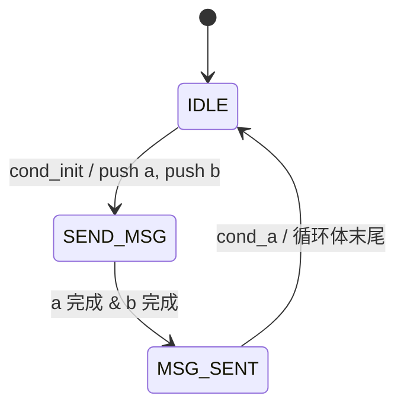
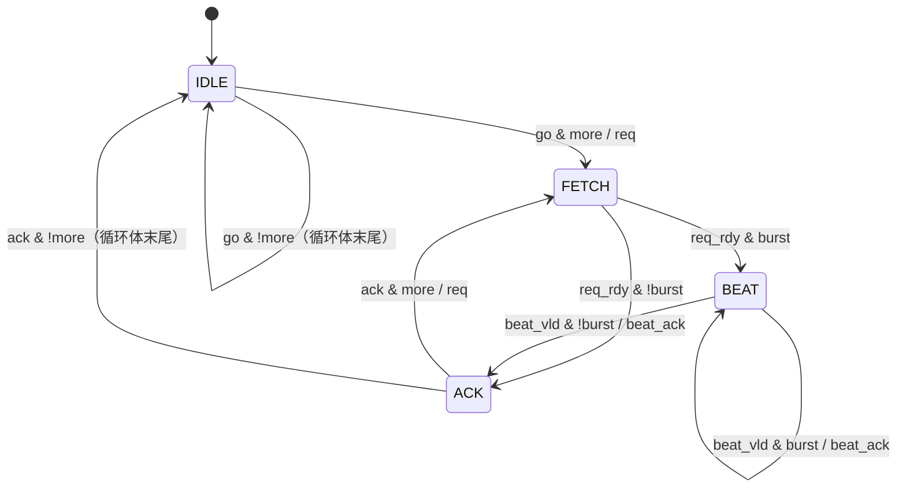
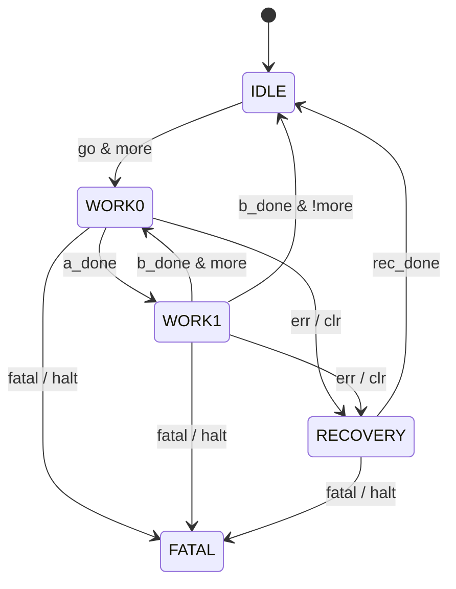
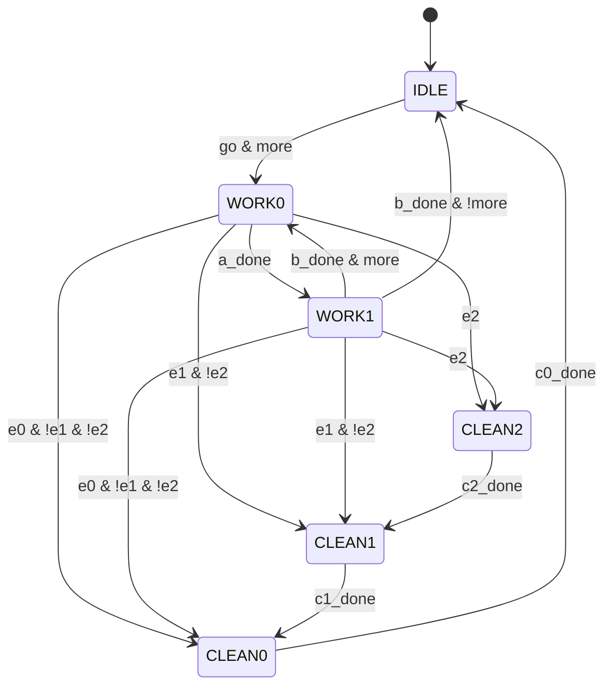
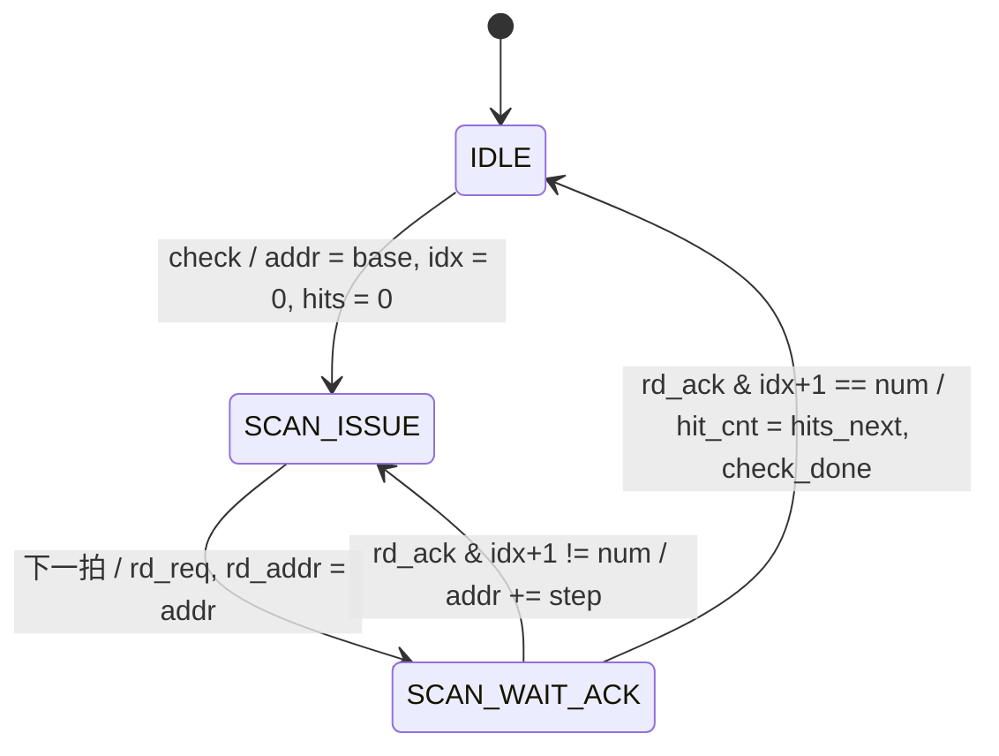
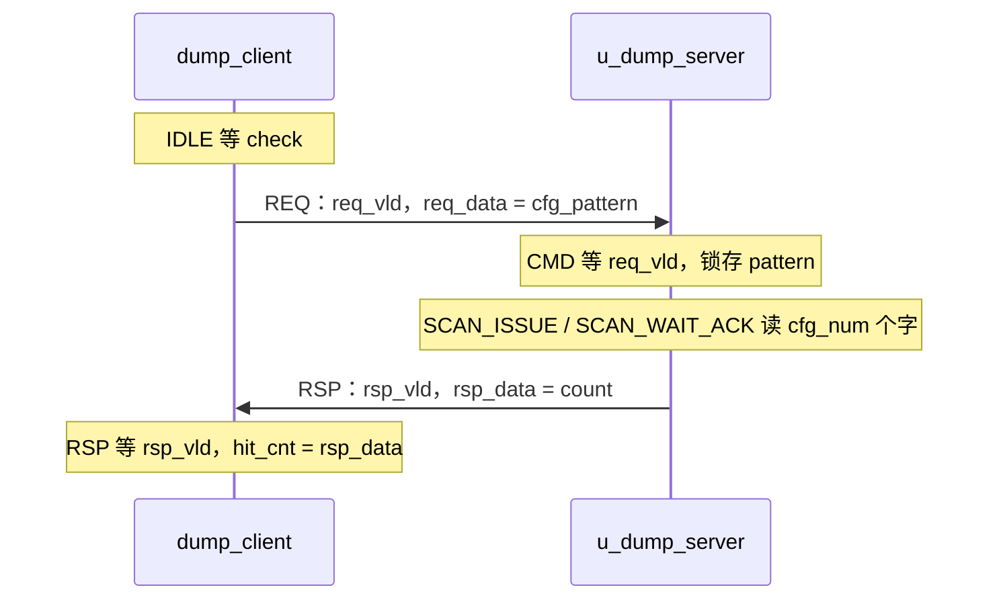
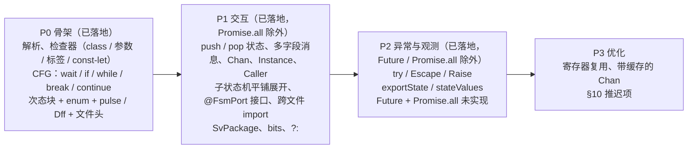

# async/await 状态机 DSL 设计（草案）

> 状态：**部分落地**。`plugin fsm run` 已编译：状态、分支、`while` / `do…while` / `break` / `continue`、`pulse`（含多位）、`Dff`、`const` / `let` 绑定、`?:`、`bits`、`SvPackage` 用户函数、`@SvEnum` 枚举类型、子状态机平铺展开与 `return` 结果、`push` / `pop`（含多字段消息）与 `Chan`、`Instance` 例化、`Caller`、`@FsmPort` 接口、跨文件 import、`try` / `Escape` / `Raise` 异常区域、`@Fsm({ statePrefix, stateEncoding, stateValues, exportState })`（`help fsm`，示例 `demo/state/`）。还没有实现：不带 `await` 的 push / pop（Future）、`Promise.all`，用到时编译期报「not implemented yet」。
> 来源：初稿 `demo/state/demo.md` 与值模型试验 `demo/state/demo.ts`，已并入本文后删除；原文见 git 提交 `21cb9ca`。本文是这套设计的唯一来源。
> 初稿没说清的地方标为「决定」（本文给出的取舍）或「开放」（§10，需作者拍板）。
> 作者源码是 **ECMAScript**（`.mjs`），不是 TypeScript：一组状态机写成带 `@FsmGroup` 的 class，对外的状态机是带 `@Fsm` 的 async 方法，端口是方法的解构参数（§2.2）；状态名用原生标签语句（§3.5）。选型理由见 §8.2。
> **术语**：「信号」指每拍都有值的线（`Input`、`Output`、`Dff`、组合表达式）；「channel」只指带 vld / rdy 握手的消息通道（`PushPort`、`PopPort`、`Chan`，§6.2）。
> **文档规范**：每段 DSL 示例紧跟它生成的 SystemVerilog，两者一一对照；SV 示例要能过 Verilator `--lint-only -Wall -Wno-DECLFILENAME`。除 §7.1 外，SV 示例省略文件头（§7.1）。示例、生成规则任何一方改动，都要同步更新另一方。已落地部分的示例（§2.3、§2.6、§2.8、§3.6、§3.6.1、§3.7、§3.7.1、§3.7.2、§4、§5.2、§5.3、§5.4、§6.1、§6.1.1、§6.5、§7.1）就是生成器的实际输出，`test/fsm.test.ts` 逐字比对，`demo/state/` 是它们的可运行副本；未落地部分的示例（§3.2 用到 `Promise.all`）按同样的格式手写。

## 背景

- async/await 把时间上不确定的 IO 事件按顺序写出来，底层由编译器转成链式状态机。RTL 状态机做的事情相同：流程、分支、在某个状态等一个条件或 done 脉冲。
- 手写 RTL 状态机虽有范式，工程里仍是大量信号拉来拉去，条件和输出信号难以组织；子状态机嵌套与信号耦合尤其难理清。
- 很多子状态机在逻辑上互斥：A 工作时 B 必然不工作。软件里这类状态只是栈上的临时变量，离开就回收；RTL 里它们一直存在，语义上表达不出互斥，也就无法复用资源。
- 控制型状态机不是计算密集的顺序逻辑；计算交给流水线和 SV，本 DSL 只管控制流。

## 0. 目标与不做

目标：

- 用 ECMAScript `async` 方法描述控制型状态机：流程、分支、循环、等待条件、握手。时钟节拍在作者面隐藏。
- 生成可综合 SV：状态寄存器、次态逻辑、动作脉冲。
- 语言结构直接给出子状态机的互斥关系（顺序调用的两个子状态机不会同时工作）：调用平铺展开进调用方的状态寄存器，互斥由一个状态寄存器保证；需要独立运行、分时复用的状态机显式例化，只通过 channel 通信（§5）。手写 RTL 表达不了这一点（见「背景」）。

不做：

- 四则运算、有符号比较、数据通路、流水线、脉动阵列。这些写在 SV 里：DSL 只消费其结果信号，或调用用户 package 里的 SV 函数（§2.3）。
- 多时钟域、CDC。一个状态机属于一个时钟和一个复位（**决定**，初稿未提）。

## 1. 术语

| 术语 | 含义 |
|---|---|
| 拍 | 一个时钟周期。作者面不可见，是所有语义的背景 |
| 信号 | 每拍产出一个值的线：`Input`、`Output`、`Dff`、`Const` 和它们的组合表达式。作者不关心具体值，只关心事件何时到来 |
| channel | vld / rdy / data 三根线组成的消息通道，一端 `push`、另一端 `pop`，双方握手交接一个消息（§6.2） |
| 状态 S | 一个 `await` 等待点。状态机停在 S，直到该 `await` 的条件成立 |
| `state_is_S` | 当前状态是 S。只用于判断条件和 channel 握手，不驱动动作 |
| `enter_S` | 进入 S 的那一拍的脉冲（组合逻辑）。所有动作挂在它上面 |
| 段 | 两个相邻 `await` 之间的代码。段内代码全部在一拍内执行 |
| 状态标签 | `await` 语句前的 ES 标签 `Name:`，给该状态命名 |
| 状态机组 | 带 `@FsmGroup` 的 class，生成一个 `.sv` 文件（§2.2） |
| 顶层状态机 | 组里带 `@Fsm` 的 async 方法，生成一个 `module` |
| 子状态机 | 组里不带装饰器的 async 方法。`await this.xxx({...})` 调用时平铺展开进调用方，不生成模块（§5） |
| 实例 | `Instance(...)` 例化的顶层状态机：一个独立运行的进程，与父级只通过端口连接的信号和 channel 通信（§5.3） |
| 接口 | 带 `@FsmPort` 的 class：一组端口加操作它们的方法（§2.6） |
| Caller | `Caller(this.sub, {...})` 把子状态机包成一个共享的服务实例，`L: r = await reg.call({...})` 从多处调用它（§5.4） |

### 1.1 底层模型

DSL 只有三层概念，其余写法都能展开成它们（**决定**）：

| 层 | 概念 | 硬件 |
|---|---|---|
| 原子 | 信号（组合）、寄存器（`Dff`）、状态寄存器 | `assign`、`always_ff`（`ff_<名字>`）、`always_ff`（`ff_state`） |
| 进程 | `@Fsm`：一个状态寄存器和它驱动的逻辑 | 一个 `module` |
| 通信 | channel：vld / rdy 加一组数据字段，双方握手交接一个消息 | 一组线 |

组合方式也只有三种：

- **平铺展开**（顺序组合）：两段流程并进同一个进程，共用一个状态寄存器。子状态机调用、接口方法调用都是这一种（§5、§2.6）。
- **`Instance`**（并行组合）：生成一个新进程，它与父级只通过端口和 channel 通信（§5.3）。
- **端口绑定**：把信号或 channel 端接到端口上。

其余写法都是这三者的固定组合，展开后的硬件完全确定：

| 写法 | 展开成 |
|---|---|
| `@FsmPort` 接口 | 一组端口加若干平铺展开的方法（§2.6） |
| `Caller(this.sub, {...})` | 一个生成的服务进程（在里面平铺展开 `sub`）、一个 `Instance`、两个 channel，调用点是两个 push / pop 状态（§5.4） |
| `Promise.all` | 同一进程里的几个握手在一个 join 状态里并行进行（§6.3） |

### 1.2 一个进程的逻辑架构

每个 `@Fsm` 模块（一个进程）生成后都是同一个形状（**决定**）：一个 Mealy 机，状态由主状态寄存器和各 `Dff` 组成。

```text
(state_next, action) = f(state_val, input, dff)                  always_comb : comb_state
state_val'           = state_next                                always_ff   : ff_state
dff'                 = set(action) ? next(action, input, dff) : dff
                                                                  always_ff   : ff_<reg>
output               = g(state_val, action, input, dff)          assign / always_comb : comb_<x>
```

- **一个状态寄存器**：拍平展开的子状态机、接口方法的状态都并进调用方的同一个 enum（§5.1），只有一个 `state_val`，位宽 ⌈log2(总状态数)⌉（§6.5）。子状态机不另占一组位，不是手写状态机常见的「主状态位 + 子状态位」。代价是每个调用点复制一份被调用方的状态，状态数线性增长、位宽只按对数增长；被调用方的私有 `Dff` 每个调用点各一份，互斥调用点之间的寄存器复用是 P3（§10）。
- **`action` 是边**：`action`（packed struct `<模块名>_action_t`）只由 `comb_state` 里的分支写出，每个成员在对应的 move 那一拍为 1（`enter_T` / `leave_S` / `A_to_B` / `keep_S`，§3.6）。段里的动作都挂在边上：`Dff` 写入用 `set = action 的或`，脉冲输出与 `action` 相与。
- **`state_val` 只做常量比较**：只出现在 `case` 和 `state_val == 常量` 里，不做位选、不做算术，综合器可以重编码（§6.5）。
- **输出按依赖分类**：

  | 输出 | 依赖 | 性质 |
  |---|---|---|
  | `x.pulse()` / `x.pulse(v)` | `action`，`v` 可读 input / dff | Mealy：input 到输出可有组合路径 |
  | push `vld`、pop `rdy` | 只看 `state_val` | Moore：不组合依赖对端，两个进程直连不成环（§6.2） |
  | push 的数据字段 | `case (state_val)` 选值（`comb_<端口>_<字段>`），值可读 input / dff | 按状态选择 |
  | `Dff(N)` 端口 | 寄存器本身 | 寄存器输出 |
  | `exportState` | `state_set_o = \|action`，`state_next_o` / `state_val_o` 直接接 | 观测（§6.5） |

- **进程之间**只经端口和 channel 通信（§5.3），每个进程内部仍是上面的形状。

## 2. 信号模型

信号不是 `int` / `string` / 数组这样的值类型，而是带方向、每拍都有值的线。作者不拿值做 JS 计算，只用它组合出新信号、等待它到达某个值，或拿它做分支条件。

| 声明 | 方向 | 含义 |
|---|---|---|
| `Input(N)` | 入 | 每拍可读出一个 N 位值 |
| `Output(N)` | 出 | 由状态机的动作驱动 |
| `Const(N, v)` | 入 | 每拍都读出 v。生成常量或一条 `assign` |
| `ALWAYS_0` / `ALWAYS_1` | 入 | 内建 1 位常量，等同 `Const(1, 0)` / `Const(1, 1)`。陷阱状态写 `await ALWAYS_0.wait(1)`（§3.7） |

规则：

- 作者代码拿不到「当前值」去做 JS 计算。对信号只能做三件事：组合运算得到新信号（§2.1）、等待（`wait`，产生状态）、直接写进分支或循环条件（§2.5、§4）。
- 每拍从每个信号读到一个值。`Const` / `ALWAYS_0` / `ALWAYS_1` 每拍读到同一个常数。
- 多位常量写 `Const(N, v)`；参与 §2.1 的运算时也可以直接写数字字面量，位宽取另一侧。
- 消息的交接用 channel，不用信号：`await x.push(v)` / `r = await x.pop()` 各是一个状态，握手成功那一拍离开（§6.2）。

### 2.1 组合运算

运算只限逻辑、比较和位选，直接用 ES 运算符书写；结果是新的信号，生成一条 `assign`。

| 运算符 | 含义 | 输入位宽 | 输出位宽 |
|---|---|---|---|
| `&` `\|` `^` | 按位与 / 或 / 异或 | 两侧同为 N | N |
| `~` | 按位取反 | N | N |
| `!` `&&` `\|\|` | 逻辑非 / 与 / 或 | 1 | 1 |
| `===` `!==` | 等于 / 不等 | 两侧同为 N | 1 |
| `<` `>` `<=` `>=` | 无符号比较 | 两侧同为 N | 1 |
| `x.bits(i)` | 取第 i 位 | N | 1 |
| `x.bits(hi, lo)` | 取 hi 到 lo 的位段 | N | hi − lo + 1 |
| `c ? a : b` | 二选一；`c` 1 位，`a` / `b` 同宽 | 1 / N / N | N |

- 数字字面量取另一侧信号的位宽，不必写 `Const(8, 0xff)`。值超出位宽、或两侧都是字面量时，编译期报错。
- 其余运算符编译期报错：`==` / `!=`（统一写 `===` / `!==`）、`+ - * / %`、`<< >> >>>`、`**`。这些计算写成用户 SV 函数（§2.3）。
- 位选的下标必须是整数字面量，满足 `N > hi ≥ lo ≥ 0`，否则编译期报错。不支持变量下标：那是一个多路选择器，写成用户函数。
- 位选写成方法调用 `bits`，不用 `[]`：SV 的 `x[hi:lo]` 在 ES 里是语法错误，而 `x[hi, lo]` 是逗号表达式，ES 会把它读成 `x[lo]`，容易误读。`bits` 是检查器认识的内建方法，和 `wait` 一样只作用于信号。
- 被选的对象必须是有名字的信号（端口、`Dff` 的 `val`、`const` 绑定的信号）或用户函数调用结果。生成器在需要时先把它落成一根线再选，因为 SV 不允许对表达式或函数调用结果直接位选。
- **不支持拼接和移位（决定）**。ES 没有拼接运算符，数组字面量 `[a, b]` 不被解释为拼接，编译期报错；`<<` / `>>` / `>>>` 同样报错。这两类变换写成用户函数（§2.3）。
- 比较只按无符号（**决定**）。DSL 不提供有符号类型，也不提供有符号比较；需要有符号判断时调用用户函数，这是 §2.3 的典型用法。
- 位宽不一致编译期报错（**决定**）。
- `?:` 原样生成 SV 的 `?:`，这是 DSL 里唯一的选择器；两臂都是数字字面量时取上下文的位宽（例如 `x.pulse(c ? 1 : 2)`），否则取另一臂的位宽。
- 优先级沿用 ES 解析结果。ES 的 `===` 比 `&` 结合得紧，与 SV 中 `==` 和 `&` 的相对次序一致；生成 SV 时统一加满括号，不依赖两边优先级逐条相同。

这些运算符在 ES 运行时对对象没有意义：Bun 实测 `{} & !{}` 得 `0`，`==` 比较引用；TC39 的运算符重载提案已于 2023-11 撤回。DSL 源码从不执行（§8.2），运算符的含义由编译器从 AST 赋予。初稿里 `msg_valid & !skip & (msg_val == const_val)` 的写法因此成立，只需把 `==` 改成 `===`：

```js
const next_cond = msg_valid & !skip & (msg_val === 0xff);
const is_wr = cmd.bits(31) & (cmd.bits(27, 24) === 0x3);
WaitMsg: await next_cond.wait(1);
```

生成的 SV：

```systemverilog
assign next_cond = msg_valid & !skip & (msg_val == 8'hff);
assign is_wr     = cmd[31] & (cmd[27:24] == 4'h3);
// in the next-state block (§6.5):
//   WaitMsg: if (next_cond) begin state_next = X; action.enter_X = 1'b1; end
```

- DSL 的 `===` / `!==` 生成 SV 的 `==` / `!=`。SV 的 `===` 是四态逐位比较，语义不同，不生成。
- 字面量按另一侧位宽写成带宽度的常量：`msg_val` 是 8 位，生成 `8'hff`；`cmd.bits(27, 24)` 是 4 位，生成 `4'h3`。
- `x.bits(hi, lo)` 生成 `x[hi:lo]`，`x.bits(i)` 生成 `x[i]`。

### 2.2 状态机组、状态机与端口

初稿用 TS `interface` 声明端口。ES 没有类型，而生成 SV 端口恰好需要方向和位宽，所以端口写成**方法的解构参数，默认值就是端口声明**：

```js
import { FsmGroup, Fsm, Input, PushPort } from "../.autowire/dsl/fsm/dsl.mjs";

@FsmGroup
export class MsgCtl {
  @Fsm
  async fsm_drive_signal({
    // conditions
    cond_init = Input(1),
    cond_a = Input(1),
    // FIFO send ports
    fifo_a = PushPort(8),
    fifo_b = PushPort(8),
  }) {
    // … 见 §3.2
  }
}
```

- `@FsmGroup` 标记一组状态机，一个 class 生成一个 `.sv` 文件，文件名缺省是 class 名（`CounterCtl.sv`）。要沿用 RTL 树已有的命名，在装饰器里写文件名：`@FsmGroup({ file: "dphy_rdi_sm" })` 生成 `dphy_rdi_sm.sv`。文件名和 module 名（方法名）、package 名（`@SvEnum`）一样写在源码里，`autowire.toml` 的 `[fsm.<id>]` 只登记源文件，与 Wishbone 的 `Regfile("name", ...)` 决定输出名一致。`file` 只能由字母、数字和 `_` 组成；同一工作区里两个组的 `file` 相同（不区分大小写，Windows / macOS 文件系统不分大小写）时报错。class 上的 `/** … */` 是文件级业务注释（§7.1）。
- `@Fsm` 标记对外的顶层状态机，方法名就是生成的 `module` 名。选项写在装饰器参数里：`@Fsm({ exportState: true })`（§6.5）。
- 不带装饰器的 async 方法是组内子状态机，调用时平铺展开（§5）；不带装饰器、也不带 `async` 的方法是只有动作的同步方法，作为语句调用（§5）；`@Fsm` 方法只能用 `Instance(...)` 例化（§5.3）。
- 参数必须是一个对象解构模式，每个属性都写默认值，默认值是端口声明。属性名就是 SV 端口名。默认值不是运行时语义：源码从不执行（§8.2），编译器只从 AST 读出方向和位宽。
- **端口每行一个，用注释分组（决定）**：每个端口独占一行，两个端口写在同一行（或第一个端口和 `({` 同行）时编译期报错。端口之间独占一行的 `//` 注释是分组标题，生成器把它原样搬到 SV 端口表的同一位置；端口行尾的 `//` 注释不搬运。生成器自己加一组标题 `// clock and reset`（`clk` / `rst_n`）；作者的第一个端口没有标题时，生成器补一行 `// ports`，避免它落在生成的分组里。调用子状态机、例化实例时的端口连接也按每行一个书写（只是风格，不检查）。
- 方法体里直接用参数名，不需要 `ports.` 前缀。import 路径是 `.autowire/dsl/fsm/dsl.mjs`（相对源文件写，§11）；检查器只认解析到这个文件的 import。
- 位宽、方向错误由我们自己写的检查器在编译期报出（§8.3），不依赖 tsc 或任何类型检查。
- 装饰器只能用在 class 和 class 方法上。ES 不允许装饰普通函数，`@Fsm async function f() {}` 是语法错误（Bun 实测：`Expected "class" but found "async"`），所以状态机必须写成 class 方法。
- `PushPort(N)` 是 `<name>_vld` 出 / `<name>_rdy` 入 / `<name>_data[N]` 出 三根线的 channel 发送端，用 `await x.push(v)` 发送（§6.2）。`PopPort(N)` 是对称的接收端：`<name>_vld` 入 / `<name>_rdy` 出 / `<name>_data[N]` 入，用 `r = await x.pop()` 接收。
- 参数默认值也可以是 `new C(...)`，`C` 是 `@FsmPort` 接口：它的每个字段展开成端口 `<name>_<字段>`（§2.6）。
- `Dff(N)` 声明一个寄存器，接口是 `{ set: Output(1), next: Output(N), val: Input(N) }`（方向以状态机为准），DSL 里用 `.set(v)` 写、`.val` 读（§6.5）。寄存器放在哪由声明位置和选项决定：

  | 声明 | 寄存器 | 生成的端口 | 典型用途 |
  |---|---|---|---|
  | 参数里 `x = Dff(N)` | 模块内 `always_ff`（`ff_x`） | 一个输出口 `x`，即 `val` | 给外部的电平标志：active、busy、enable（§6.1） |
  | 参数里 `x = Dff(N, { external: true })` | 模块外，属于别人 | `x_set` / `x_next` 输出，`x_val` 输入（从不读 `x.val` 时不生成） | regfile 字段、别的模块也读写的寄存器（§6.5） |
  | 方法体里 `const x = Dff(N)` | 模块内 `always_ff`（`ff_x`） | 无 | 状态机私有的寄存器，例如把某一拍的组合值留到后面的段用（§2.5） |

  `Output(N)` 只表示由动作驱动的组合输出（脉冲），不带寄存器；N 可以大于 1，用 `x.pulse(v)` 在 move 那一拍输出 `v`，其余拍为 0（§6.1.1）。

`@FsmGroup` class 的其他写法都由检查器拒绝（§8.3）：`constructor`、字段、`static`、getter / setter、`extends`、`this` 的其他用法。源码虽不执行，但 Bun 会把装饰器转成 `__decorateElement` 等运行时调用（实测），误运行时会真的调用 `FsmGroup` / `Fsm`；`dsl.mjs` 因此导出同名的空实现，误运行不会崩溃，也不会产生任何输出。

生成的 SV 端口（`clk` / `rst_n` 由生成器加上，作者面不出现，与「节拍是背景」一致）：

```systemverilog
module fsm_drive_signal (
  // clock and reset
  input  logic       clk,
  input  logic       rst_n,
  // conditions
  input  logic       cond_init,
  input  logic       cond_a,
  // FIFO send ports
  output logic       fifo_a_vld,
  input  logic       fifo_a_rdy,
  output logic [7:0] fifo_a_data,
  output logic       fifo_b_vld,
  input  logic       fifo_b_rdy,
  output logic [7:0] fifo_b_data
);
```

### 2.3 调用用户 SV 函数

较复杂的组合逻辑和信号转换（有符号比较、取绝对值、拼接、移位、变量下标选择、字段解码）写在用户自己的 SV package 里，DSL 声明函数签名后直接调用。DSL：

```js
const num_pkg = SvPackage("num_pkg", {
  lt_s8: SvFunction({ args: { a: 8, b: 8 }, ret: 1 }),
  abs8:  SvFunction({ args: { x: 8 }, ret: 8 }),
});

@FsmGroup
export class CmpCtl {
  @Fsm
  async cmp_fsm({
    // samples
    vld = Input(1),
    err = Input(8),
    limit = Input(8),
    // results
    mag = Dff(8),
    alarm = Output(1),
  }) {
    const below = num_pkg.lt_s8(err, limit);   // signed compare, done in SV
    while (true) {
      IDLE: await (vld & below).wait(1);
      mag.set(num_pkg.abs8(err));
      alarm.pulse();
      Hold: await (vld & !below).wait(1);
    }
  }
}
```

用户自己的 package（不是生成物）：

```systemverilog
package num_pkg;
  // user code: signed compare and magnitude on 8-bit two's complement
  function automatic logic lt_s8(input logic signed [7:0] a, input logic signed [7:0] b);
    return a < b;
  endfunction
  function automatic logic [7:0] abs8(input logic signed [7:0] x);
    return x[7] ? -x : x;
  endfunction
endpackage
```

生成的 SV：

```systemverilog
package cmp_fsm_pkg;
  typedef enum logic [0:0] {
    IDLE,
    HOLD
  } cmp_fsm_state_e;

  typedef struct packed {
    logic enter_HOLD;
  } cmp_fsm_action_t;
endpackage

module cmp_fsm
  import cmp_fsm_pkg::*;
(
  // clock and reset
  input  logic       clk,
  input  logic       rst_n,
  // samples
  input  logic       vld,
  input  logic [7:0] err,
  input  logic [7:0] limit,
  // results
  output logic [7:0] mag,
  output logic       alarm
);
  cmp_fsm_state_e  state_val, state_next;
  cmp_fsm_action_t action;
  logic            fn_lt_s8_0;
  logic [7:0]      fn_abs8_0;

  assign fn_lt_s8_0 = num_pkg::lt_s8(err, limit);
  assign fn_abs8_0  = num_pkg::abs8(err);

  always_comb begin : comb_state
    state_next = state_val;
    action     = '0;
    unique case (state_val)
      IDLE:
        if (vld & fn_lt_s8_0) begin
          state_next        = HOLD;
          action.enter_HOLD = 1'b1;
        end
      HOLD:
        if (vld & !fn_lt_s8_0) begin
          state_next = IDLE;
        end
      default:
        state_next = IDLE;
    endcase
  end

  always_ff @(posedge clk or negedge rst_n) begin : ff_state
    if (!rst_n) begin
      state_val <= IDLE;
    end else begin
      state_val <= state_next;
    end
  end

  // mag.set(num_pkg.abs8(err))
  always_ff @(posedge clk or negedge rst_n) begin : ff_mag
    if (!rst_n) begin
      mag <= 8'h00;
    end else if (action.enter_HOLD) begin
      mag <= fn_abs8_0;
    end
  end
  // alarm.pulse()
  assign alarm = action.enter_HOLD;
endmodule
```

| DSL | SV |
|---|---|
| `SvPackage("num_pkg", {...})` | 不生成任何东西；只声明用户 package 的名字和函数签名 |
| `num_pkg.lt_s8(err, limit)` | `fn_lt_s8_0 = num_pkg::lt_s8(err, limit)`，结果是 1 位信号 |
| `mag.set(num_pkg.abs8(err))` | `u_mag.next = fn_abs8_0` |

规则：

- `SvPackage(...)` 必须是模块顶层的 `const`（在 class 之外），参数是字面量。`args` 按声明顺序对应 SV 形参，值是位宽；`ret` 是返回值位宽。
- 调用结果是一个普通信号，位宽为 `ret`，可以参与 §2.1 的运算、`wait`、分支条件、`Dff.set` 和 `push` 的数据。实参只能是信号或数字字面量；字面量取对应形参的位宽。
- 实参个数和位宽在编译期检查（§8.3）。签名与 package 源码是否一致，DSL 不检查：RtlIndex 只按名字记录 package（[hdxml/module-info.md](../hdxml/module-info.md) B-5），不含函数签名；不一致由 SV 编译器（Verilator 等）报错。见 §10。
- 生成的 SV 一律用作用域调用 `pkg::fn(...)`，不写 `import pkg::*`，避免与状态 enum 成员重名。
- 相同函数加相同实参只生成一根线（`fn_<函数名>_<序号>`），被条件和动作共用。
- 组合信号的 `const` 定义（运算或函数调用）不是动作，可以写在第一个 `await` 之前；它在每一拍都有值（§2.4）。
- 用户函数必须是 `function automatic`、纯组合、无副作用，作者负责。它的输入只能是信号，主状态不是信号，传不进去，所以 §6.5 的状态机识别条件不受影响。
- **跨文件共用（决定）**：`export const dump_pkg = SvPackage(...)` 之后，别的 fsm 源文件用 `import { dump_pkg } from "./dump_check.mjs"` 直接使用，不必重复声明（§2.7）。
- 用户 package 是分析与仿真 filelist 的输入，必须排在生成的 `.sv` 之前编译。

### 2.4 绑定：`const` 与 `let`

`const` / `let` 沿用 JS 的含义（**决定**）：它们区分的是**绑定能不能重新赋值**，不区分值是不是常数。生成常量还是组合信号，由编译器看右边的表达式决定，作者不用另外声明。

| 写法 | 生成 | 依据 |
|---|---|---|
| `const K = Const(8, 0xa5)`、`const K = ALWAYS_1` | 常量（`localparam` 或直接内联） | 右边能在编译期求出常数 |
| `const c = a & b`、`const f = pkg.fn(x)` | `logic c; assign c = …;` | 右边是组合表达式 |
| `let r;` 后在带标签的调用或接收语句里赋值一次：`Scan: r = await this.sub({...});`、`Recv: d = await fifo.pop();` | 子状态机或接口方法 `return` 的值（§5、§2.6），或 `pop` 的数据（§6.2） | 唯一允许的 `let` 用法 |
| `let x = …` 之后重新赋值，或在多个段里赋值 | 编译期报错，提示改用 `Dff` | 重新赋值意味着需要寄存器或按状态的选择器，assign 表达不了 |

- `const` 绑定的组合信号可以在多个段里读，它每一拍都有值。
- `let r` 拿到的值只在它的来源结束的那一段里有效：`pop` 是离开 pop 状态的那一段，子状态机是 `return` 所在的那一段（调用之后紧跟的代码与它同属一段）。要在后面的段里用，先 `Dff.set(r)`。在别的段、`const` 定义、`wait` 条件、`push` 的数据或调用的实参里读 `r`，编译期报错。

### 2.5 组合逻辑的两种写法

`await` 只标记状态（§3.1）：`ch.wait(v)`、`x.push(v)`、`x.pop()`、子状态机或接口的 async 方法调用，以及以后的 `Promise.all`。分支条件、循环条件和动作的值都是当前这一拍的组合值，直接写信号表达式，不写 `await`（**决定**）。组合逻辑有两种写法，对应 SV 的 `assign` 与 `always_comb`：

| 写法 | 生成 | 适用 |
|---|---|---|
| `const c = a & !b;`，写在方法体顶部、`while (true)` 之前 | `logic c; assign c = …;` | 同一个条件在多处用（例如既 `wait` 又 `if`）、要在波形里看、有业务含义的名字 |
| 表达式直接写进 `if (…)`、`while (…)`、`.wait(…)`、`pulse(v)`、`set(v)` 或调用实参 | 内联进 `always_comb` 的 case 分支或驱动表达式，不生成线 | 只用一次的条件 |

- 分支在离开上一个状态的那一拍取样，只决定次态和这条边上的动作，不占拍。嵌套几层都是 `always_comb` 里嵌套的 `if`（§4）。
- 多个事件竞争再分支：先等它们的或，再用 `if` 分辨，`if` 的顺序就是优先级。例如 `Wait: await (a_done | err).wait(1);` 之后写 `if (err) { … } else { … }`；两者都要用时，把 `a_done | err` 写成 `const`。
- 不提供 `Promise.race`：`Promise.*` 只用于 `push` 返回的 Future（§6.3），电平之间的竞争用 `|` 加 `if` 已经写得清楚。
- 组合值不能跨段保存：要在后面的段用，先 `Dff.set(v)`（§2.2）。
- 其他位置写 `await`（例如 `if (await c)`、单独一句 `await c;`），编译期报错。

### 2.6 接口：`@FsmPort`

一组端口加操作它们的方法，写成带 `@FsmPort` 的 class，类似 SV 的 `interface` 加 `modport` 和 `task`（**决定**）。`Dff`、`PushPort`、`PopPort` 本身就是这个形状的内建接口；`@FsmPort` 让作者组合自己的。

DSL（寄存器读口：一个请求脉冲带地址，之后 `ack` 带数据回来）：

```js
/** Register read port: a request pulse with the address, then data with ack. */
@FsmPort
export class RdPort {
  constructor(aw, dw) {
    this.req = Output(1);
    this.addr = Output(aw);
    this.ack = Input(1);
    this.data = Input(dw);
  }

  /** Start one read: actions on the move, no state. */
  issue(a) {
    this.req.pulse();
    this.addr.pulse(a);
  }

  /** Read one word: one state waiting for ack; the data is the result. */
  async read(a) {
    this.issue(a);
    Wait: await this.ack.wait(1);
    return this.data;
  }
}

@FsmGroup
export class CfgLoad {
  /** Loads two config registers after go. */
  @Fsm
  async cfg_load({
    // control
    go = Input(1),
    done = Output(1),
    // config register read port
    rd = new RdPort(8, 16),
    // loaded values
    lo = Dff(16),
    hi = Dff(16),
  }) {
    let a;
    let b;
    while (true) {
      IDLE: await go.wait(1);
      Lo: a = await rd.read(0x10);
      lo.set(a);
      Hi: b = await rd.read(0x14);
      hi.set(b);
      done.pulse();
    }
  }
}
```

生成的 SV：

```systemverilog
package cfg_load_pkg;
  typedef enum logic [1:0] {
    IDLE,
    LO_WAIT,
    HI_WAIT
  } cfg_load_state_e;

  typedef struct packed {
    logic enter_LO_WAIT;
    logic enter_HI_WAIT;
    logic enter_IDLE;
  } cfg_load_action_t;
endpackage

// Loads two config registers after go.
module cfg_load
  import cfg_load_pkg::*;
(
  // clock and reset
  input  logic        clk,
  input  logic        rst_n,
  // control
  input  logic        go,
  output logic        done,
  // config register read port
  output logic        rd_req,
  output logic [7:0]  rd_addr,
  input  logic        rd_ack,
  input  logic [15:0] rd_data,
  // loaded values
  output logic [15:0] lo,
  output logic [15:0] hi
);
  cfg_load_state_e  state_val, state_next;
  cfg_load_action_t action;

  always_comb begin : comb_state
    state_next = state_val;
    action     = '0;
    unique case (state_val)
      IDLE:
        if (go) begin
          state_next           = LO_WAIT;
          action.enter_LO_WAIT = 1'b1;
        end
      LO_WAIT:
        if (rd_ack) begin
          state_next           = HI_WAIT;
          action.enter_HI_WAIT = 1'b1;
        end
      HI_WAIT:
        if (rd_ack) begin
          state_next        = IDLE;
          action.enter_IDLE = 1'b1;
        end
      default:
        state_next = IDLE;
    endcase
  end

  always_ff @(posedge clk or negedge rst_n) begin : ff_state
    if (!rst_n) begin
      state_val <= IDLE;
    end else begin
      state_val <= state_next;
    end
  end

  // done.pulse()
  assign done   = action.enter_IDLE;
  // this.req.pulse()
  assign rd_req = action.enter_LO_WAIT | action.enter_HI_WAIT;
  // this.addr.pulse(a)
  always_comb begin : comb_rd_addr
    unique case (1'b1)
      action.enter_LO_WAIT: rd_addr = 8'h10;
      action.enter_HI_WAIT: rd_addr = 8'h14;
      default:              rd_addr = 8'h00;
    endcase
  end
  // lo.set(a)
  always_ff @(posedge clk or negedge rst_n) begin : ff_lo
    if (!rst_n) begin
      lo <= 16'h0000;
    end else if (action.enter_HI_WAIT) begin
      lo <= rd_data;
    end
  end
  // hi.set(b)
  always_ff @(posedge clk or negedge rst_n) begin : ff_hi
    if (!rst_n) begin
      hi <= 16'h0000;
    end else if (action.enter_IDLE) begin
      hi <= rd_data;
    end
  end
endmodule
```

| DSL | SV |
|---|---|
| `rd = new RdPort(8, 16)` | 端口 `rd_req` / `rd_addr[7:0]` / `rd_ack` / `rd_data[15:0]`：字段名加参数名前缀，位宽取构造参数 |
| `Lo: a = await rd.read(0x10)` | `read` 平铺展开：它的 `Wait:` 状态成为 `LO_WAIT`；第二次调用是 `HI_WAIT` |
| `this.issue(a)` | 同步方法，只有动作：`rd_req` / `rd_addr` 挂在进入 `LO_WAIT` / `HI_WAIT` 的 move 上，两处调用的 `rd_addr` 取不同值，生成按 move 选值的 `case`（§6.1.1） |
| `return this.data` / `lo.set(a)` | `a` 就是 `rd_data`，在离开 `LO_WAIT` 那一段有效：`u_lo.next = rd_data` |

规则：

- 构造函数只声明字段：每句都是 `this.f = Input(N) / Output(N) / Dff(N) / PushPort(N) / PopPort(N)`。位宽可以是字面量或构造参数；`new C(...)` 的实参是整数字面量。
- 接口只能当端口用：写在方法参数的默认值里，字段展开成 `<参数名>_<字段>`。在方法体里可以直接用字段（`rd.ack`、`rd.addr.pulse(v)`），也可以调方法。
- 方法的参数是值（信号或数字字面量），按位置传。方法里 `this.f` 是字段，`this.m(...)` 是同一接口的另一个方法。
- `async` 方法与子状态机一样平铺展开（§5）：调用必须带标签，状态名是 `<调用标签>_<方法里的标签>`；`return v` 的值给调用方的 `let`。
- 不带 `async` 的方法是同步方法：只能写动作和分支，没有状态，也不声明 `const` / `Dff`；作为语句调用时，动作在调用所在的那一段执行。方法体只有一句 `return <表达式>` 时，它也可以写在表达式里，等于把那个表达式展开在调用处。
- 例化的实例上，接口端口只能接父级同类、同构造参数的接口（§5.3）。

### 2.7 跨文件 import

fsm 源文件除了 import DSL 内建名字，还可以 import 别的 fsm 源文件 `export` 出来的四类东西（**决定**）：

| export | import 之后 |
|---|---|
| `export const pkg = SvPackage(...)` | 当作本文件声明的用户 package 用（§2.3） |
| `export class C` 带 `@FsmPort` | 当作本文件的接口用（§2.6） |
| `export class E` 带 `@SvEnum` | 当作本文件的枚举类型用（§2.8）；SV package 仍在声明它的文件里生成 |
| `export class G` 带 `@FsmGroup` | `await G.sub({...})` 平铺展开它的子状态机（§5），`Instance(G.fsm, {...})` 例化它的顶层状态机（§5.3） |

- import 路径相对源文件，以 `.mjs` 结尾；循环 import 编译期报错。
- 被 `Instance` 例化的组、被 import 了 `@SvEnum` 的文件，都必须也是 `autowire.toml` 里的 `[fsm.<id>]`，它的 `.sv` 才会生成；只被 import 来平铺展开或取用户 package 的文件不需要登记。
- 导出的 `@FsmGroup` 可以没有 `@Fsm` 方法（只放子状态机的库），它里面没被调用的子状态机也不报错。

### 2.8 枚举类型：`@SvEnum`

状态机向外发命令（action、opcode、报文类型）时，命令的取值写成枚举，SV 侧拿到的是 package 里的 `typedef enum`，不是裸数值（**决定**）。枚举是一个带 `@SvEnum` 装饰器的 class，成员是 `static` 字段：

| 选项 | 缺省 | 作用 |
|---|---|---|
| `pkg` | 必填 | 生成的 SV package 名；同一文件里多个枚举可以放进同一个 package |
| `name` | class 名转小写下划线再加 `_e`（`LtsmOp` → `ltsm_op_e`） | `typedef enum` 的类型名 |
| `prefix` | class 名转大写下划线（`LtsmOp` → `LTSM_OP`） | SV 成员名 `<prefix>_<成员>`；写 `""` 不加前缀 |
| `width` | 放得下最大值的最少位数 | 显式位宽，不能小于最少位数 |

用法：

- 类型：`Input(E)`、`Output(E)`、`Dff(E)`、`PushPort(E)` / `PopPort(E)` / `Chan(E)`，以及消息字段 `{ op: E, addr: 8 }`，凡是写位宽的地方都可以写枚举 class。
- 取值：`E.MEMBER`，生成 `pkg::<prefix>_MEMBER`，总是带 package 前缀，不同枚举、状态名之间不会撞名。
- 运算：枚举值只能 `===` / `!==` 比较（两边同一个枚举）和 `?:` 选择（两臂同一个枚举）；位运算、`!`、`bits()`、`x.wait(v)` 都是编译期错误，写成 `await (x === E.M).wait(1)`。
- 赋值：写进枚举类型的端口、寄存器、消息字段时，值必须是同一个枚举；裸数字、别的枚举、普通信号都报错。枚举值可以写进同宽的普通信号（SV 里枚举到 `logic` 是合法转换）。
- 生成：package 写在声明枚举的那个文件的 `.sv` 最前面，每个成员一行。端口与内部线的类型是 `pkg::name`；只有一个写入值时与 move 相与，结果是普通位向量，生成器用 `pkg::name'(...)` 转回枚举；有两个以上不同值时生成 `case`（§6.1.1），各分支直接写枚举值。`Dff(E)` 的寄存器类型是 `pkg::name`，复位值写 `{ reset: E.M }`，缺省为数值 0（生成时写成值为 0 的成员，没有时写 `pkg::name'(0)`）。

DSL：

```js
/** Commands of the cmd channel. */
@SvEnum({ pkg: "cmd_pkg", name: "cmd_e", prefix: "CMD" })
export class Cmd {
  static NOP = 0;
  static READ = 1;
  static WRITE = 2;
  static FLUSH = 5;
}

@FsmGroup
export class CmdCtl {
  @Fsm
  async cmd_post({
    // control
    go = Input(1),
    we = Input(1),
    // command channel
    cmd = PushPort({ op: Cmd, addr: 8 }),
    // status
    last = Dff(Cmd),
    sent = Output(Cmd),
  }) {
    while (true) {
      IDLE: await go.wait(1);
      last.set(we ? Cmd.WRITE : Cmd.READ);
      Send: await cmd.push({ op: last.val, addr: 0x10 });
      sent.pulse(last.val);
      if (last.val === Cmd.WRITE) {
        Flush: await cmd.push({ op: Cmd.FLUSH, addr: 0x10 });
        sent.pulse(Cmd.FLUSH);
      }
    }
  }
}
```

生成的 SV（省略文件头）：

```systemverilog
package cmd_pkg;
  // Commands of the cmd channel.
  typedef enum logic [2:0] {
    CMD_NOP = 3'd0,
    CMD_READ = 3'd1,
    CMD_WRITE = 3'd2,
    CMD_FLUSH = 3'd5
  } cmd_e;
endpackage

package cmd_post_pkg;
  typedef enum logic [1:0] {
    IDLE,
    SEND,
    FLUSH
  } cmd_post_state_e;

  typedef struct packed {
    logic enter_SEND;
    logic leave_SEND;
    logic leave_FLUSH;
  } cmd_post_action_t;
endpackage

module cmd_post
  import cmd_post_pkg::*;
(
  // clock and reset
  input  logic          clk,
  input  logic          rst_n,
  // control
  input  logic          go,
  input  logic          we,
  // command channel
  output logic          cmd_vld,
  input  logic          cmd_rdy,
  output cmd_pkg::cmd_e cmd_op,
  output logic [7:0]    cmd_addr,
  // status
  output cmd_pkg::cmd_e last,
  output cmd_pkg::cmd_e sent
);
  cmd_post_state_e  state_val, state_next;
  cmd_post_action_t action;

  always_comb begin : comb_state
    state_next = state_val;
    action     = '0;
    unique case (state_val)
      IDLE:
        if (go) begin
          state_next        = SEND;
          action.enter_SEND = 1'b1;
        end
      SEND:
        if (cmd_rdy) begin
          action.leave_SEND = 1'b1;
          if (last == cmd_pkg::CMD_WRITE) begin
            state_next = FLUSH;
          end else begin
            state_next = IDLE;
          end
        end
      FLUSH:
        if (cmd_rdy) begin
          action.leave_FLUSH = 1'b1;
          state_next         = IDLE;
        end
      default:
        state_next = IDLE;
    endcase
  end

  always_ff @(posedge clk or negedge rst_n) begin : ff_state
    if (!rst_n) begin
      state_val <= IDLE;
    end else begin
      state_val <= state_next;
    end
  end

  // cmd.push({ op: last.val, addr: 0x10 }) / cmd.push({ op: Cmd.FLUSH, addr: 0x10 })
  assign cmd_vld = (state_val == SEND) | (state_val == FLUSH);
  always_comb begin : comb_cmd_op
    case (state_val)
      SEND:    cmd_op = last;
      FLUSH:   cmd_op = cmd_pkg::CMD_FLUSH;
      default: cmd_op = cmd_pkg::CMD_NOP;
    endcase
  end
  assign cmd_addr = 8'h10;
  // last.set(we ? Cmd.WRITE : Cmd.READ)
  always_ff @(posedge clk or negedge rst_n) begin : ff_last
    if (!rst_n) begin
      last <= cmd_pkg::CMD_NOP;
    end else if (action.enter_SEND) begin
      last <= we ? cmd_pkg::CMD_WRITE : cmd_pkg::CMD_READ;
    end
  end
  // sent.pulse(last.val) / sent.pulse(Cmd.FLUSH)
  always_comb begin : comb_sent
    unique case (1'b1)
      action.leave_SEND:  sent = last;
      action.leave_FLUSH: sent = cmd_pkg::CMD_FLUSH;
      default:            sent = cmd_pkg::CMD_NOP;
    endcase
  end
endmodule
```

| DSL | SV |
|---|---|
| `@SvEnum({ pkg: "cmd_pkg", name: "cmd_e", prefix: "CMD" })` | `package cmd_pkg` 里的 `typedef enum logic [2:0] {...} cmd_e`，位宽由最大值 5 定为 3 |
| `PushPort({ op: Cmd, addr: 8 })`、`Dff(Cmd)`、`Output(Cmd)` | 端口类型 `cmd_pkg::cmd_e`；寄存器 `last` 的类型也是它 |
| `Cmd.WRITE` | `cmd_pkg::CMD_WRITE` |
| 两个 push 写同一个 `op` 字段、`sent.pulse` 的两个写入点 | `cmd_op` 按状态 `case (state_val)`，`sent` 按 move `unique case (1'b1)`；都不写时为数值 0，即 `CMD_NOP` |

- 其他文件的 RTL 直接 `import cmd_pkg::*;` 使用这些类型和成员；filelist 里生成的 `.sv` 要排在用它的手写 RTL 前面。
- 同一个 package 里两个枚举的 SV 成员名不能相同（用 `prefix` 区分）；同一个 package 名在两个 `[fsm.<id>]` 文件里声明是错误。
- 只放枚举的文件也要有一个（可以为空的）`@FsmGroup` class，并登记为 `[fsm.<id>]`。

## 3. 状态与节拍

### 3.1 原语

| 原语 | 占用拍数 | 是否生成状态 | 生成 |
|---|---|---|---|
| `await ch.wait(v)` | ≥ 1 | 是 | `state_is_S & (ch == v)` 作为离开 S 的条件 |
| `L: await x.push(v)` | ≥ 1 | 是 | 停在 S 期间 `x_vld = 1`、`x_data = v`，`x_rdy` 那一拍离开（§6.2） |
| `L: r = await x.pop()` | ≥ 1 | 是 | 停在 S 期间 `x_rdy = 1`，`x_vld` 那一拍离开；`r` 是 `x_data`（§6.2） |
| `L: [r =] await this.sub({...})` | 子状态机的拍数 | 子状态机的状态 | 平铺展开：子状态机的状态并入调用方，名字加前缀 `L_`（§5） |
| `Instance(this.fsm, {...})` | — | 否 | 独立运行的实例，只通过端口连接的信号和 channel 通信（§5.3） |
| `const reg = Caller(this.sub, {...})` … `L: [r =] await reg.call({...})` | ≥ 2 | 是（`L_REQ`、`L_RSP`） | 共享的服务实例：推送参数、弹出结果（§5.4） |
| `const f = x.push(v)` … `await Promise.all([...])` | 等全部 Future 完成 | 是 | fork / join（§6.3，未实现） |
| `Name: await …` | 0 | 否 | 给该 `await` 的状态命名（§3.5） |
| `while` / `do…while` / `break` / `continue` | 0 | 否 | 控制流图上的回边与出口（§3.6） |
| `try { Escape(c); … } catch { … }` | 0 | 否 | 异常区域：区域内每个状态多一条「`c` 成立就进 `catch`」的出口（§3.7） |
| `throw Raise()` | 0 | 否 | 当前段结束时跳进最近的 `catch`（§3.7） |

### 3.2 段与状态的对应（核心规则）

第 K 个 `await` 与第 K+1 个 `await` 之间的段，在 `enter_S(K+1)` 这一拍执行，其中：

```text
enter_S(K+1) = state_is_S(K) & cond(K)
```

S(K+1) 是第 K+1 个 `await` 的等待状态，名字是该 `await` 语句上的标签。段里的动作写在标签之前，发生在进入这个状态的那一拍：读法是「做完这些动作，进入 SendMsg 等待」。

初稿的例子（先等 `cond_init`，再同时向两个 FIFO 发消息并等两边完成，最后等 `cond_a`）：

```js
@Fsm({ exportState: true })
async fsm_drive_signal({
  // conditions
  cond_init = Input(1),
  cond_a = Input(1),
  // FIFO send ports
  fifo_a = PushPort(8),
  fifo_b = PushPort(8),
}) {
  while (true) {
    IDLE:    await cond_init.wait(1);               // IDLE 等 cond_init
    const a_done = fifo_a.push(0x00);               // 发送放在 SendMsg 里进行
    const b_done = fifo_b.push(0x10);
    SendMsg: await Promise.all([a_done, b_done]);   // SendMsg 等两个 push 完成
    MsgSent: await cond_a.wait(1);                  // MsgSent 等 cond_a；之后是循环体末尾（§3.4）
  }
}
```



生成的 SV（`exportState: true`，§6.5）：

```systemverilog
package fsm_drive_signal_pkg;
  typedef enum logic [1:0] {
    IDLE,
    SEND_MSG,
    MSG_SENT
  } fsm_drive_signal_state_e;

  typedef struct packed {
    logic enter_SEND_MSG;
    logic enter_MSG_SENT;
    logic enter_IDLE;
  } fsm_drive_signal_action_t;
endpackage

module fsm_drive_signal
  import fsm_drive_signal_pkg::*;
(
  // clock and reset
  input  logic                    clk,
  input  logic                    rst_n,
  // conditions
  input  logic                    cond_init,
  input  logic                    cond_a,
  // FIFO send ports
  output logic                    fifo_a_vld,
  input  logic                    fifo_a_rdy,
  output logic [7:0]              fifo_a_data,
  output logic                    fifo_b_vld,
  input  logic                    fifo_b_rdy,
  output logic [7:0]              fifo_b_data,
  // exportState
  output logic                    state_set_o,
  output fsm_drive_signal_state_e state_next_o,
  output fsm_drive_signal_state_e state_val_o
);
  fsm_drive_signal_state_e  state_val, state_next;
  fsm_drive_signal_action_t action;
  logic                     join_SEND_MSG, a_done, a_fin_val, b_done, b_fin_val;

  assign join_SEND_MSG = (a_done | a_fin_val) & (b_done | b_fin_val);

  always_comb begin : comb_state
    state_next = state_val;
    action     = '0;
    unique case (state_val)
      IDLE:
        if (cond_init) begin
          state_next            = SEND_MSG;
          action.enter_SEND_MSG = 1'b1;
        end
      SEND_MSG:
        if (join_SEND_MSG) begin
          state_next            = MSG_SENT;
          action.enter_MSG_SENT = 1'b1;
        end
      MSG_SENT:
        if (cond_a) begin
          state_next        = IDLE;
          action.enter_IDLE = 1'b1;
        end
      default:
        state_next = IDLE;
    endcase
  end

  always_ff @(posedge clk or negedge rst_n) begin : ff_state
    if (!rst_n) begin
      state_val <= IDLE;
    end else begin
      state_val <= state_next;
    end
  end

  // fifo_a.push(0x00): vld held in SEND_MSG until the handshake
  assign fifo_a_vld  = (state_val == SEND_MSG) & ~a_fin_val;
  assign fifo_a_data = 8'h00;
  assign a_done      = fifo_a_vld & fifo_a_rdy;
  always_ff @(posedge clk or negedge rst_n) begin : ff_a_fin
    if (!rst_n) begin
      a_fin_val <= 1'b0;
    end else if (a_done | action.enter_MSG_SENT) begin
      a_fin_val <= ~action.enter_MSG_SENT;
    end
  end

  // fifo_b.push(0x10)
  assign fifo_b_vld  = (state_val == SEND_MSG) & ~b_fin_val;
  assign fifo_b_data = 8'h10;
  assign b_done      = fifo_b_vld & fifo_b_rdy;
  always_ff @(posedge clk or negedge rst_n) begin : ff_b_fin
    if (!rst_n) begin
      b_fin_val <= 1'b0;
    end else if (b_done | action.enter_MSG_SENT) begin
      b_fin_val <= ~action.enter_MSG_SENT;
    end
  end

  // exportState
  assign state_set_o  = |action;
  assign state_next_o = state_next;
  assign state_val_o  = state_val;
endmodule
```

| DSL | SV |
|---|---|
| `IDLE:` / `SendMsg:` / `MsgSent:` 标签 | 状态类型 `fsm_drive_signal_state_e` 的成员 `IDLE` / `SEND_MSG` / `MSG_SENT`：标签转成大写下划线（§3.5） |
| `await cond_init.wait(1)` 在 IDLE | 次态块的 `IDLE` 分支：`if (cond_init)` 里同时写 `state_next = SEND_MSG` 和 `action.enter_SEND_MSG = 1'b1` |
| 段内 `fifo_a.push(0x00)` | 停在 `SEND_MSG` 期间 `fifo_a_vld = 1`，握手过的分支由 `a_fin_val` 停发（§6.2、§6.3） |
| `await Promise.all([a_done, b_done])` | `join_SEND_MSG` 与 `a_fin_val` / `b_fin_val`（§6.3） |
| 循环体末尾 | 回边 `MSG_SENT → IDLE`：回到 `while (true)` 开头的入口状态（§3.4） |

### 3.3 等待从进入后的第一拍开始

**决定**：进入 S 的那一拍属于上一个状态；S 从下一拍开始判断自己的条件。所以每个 `wait` 至少占 1 拍，哪怕条件在进入时已经成立。两个连续的 `ALWAYS_1.wait(1)` 占 2 拍。这让「一个 `await` = 一个状态 = 至少一拍」成立，状态计数和时序可从源码直接读出。

### 3.4 有结束与无结束：`while (true)` 与 `return`

状态机分两类，写法必须显式区分（**决定**）：

| | 顶层 `@Fsm` | 子状态机（未装饰的方法，§5） |
|---|---|---|
| 语义 | 无结束：一直运行 | 有结束：每次调用都要返回 |
| 写法 | 方法体是 `while (true) { … }`；只跑一次的流程最后停在陷阱状态（`await ALWAYS_0.wait(1)`） | 走到方法末尾或执行 `return` |
| `return` | 编译期报错 | 回到调用点之后继续；`return x` 的值给调用方的 `let` |
| 能走到方法末尾 | 编译期报错 | 回到调用点之后继续；有 `return x` 的子状态机，每条路都要 `return` 一个值 |

- **顶层的 `while (true)`**：循环体末尾的段在最后一次 move 那一拍执行，然后回到循环开头，也就是第一个 `await` 的状态（复位后的初始状态）。`continue` 同样回到开头，用来跳过循环体剩下的代码（例如 `catch` 之后不走正常流程，§3.7）。生成的 SV 里这条回边就是「回到入口」的那条边。
- 顶层方法体只能是一条 `while (true)`，前后不能有其他语句；`SvPackage` 调用结果、组合运算这类 `const` 定义（不是动作，§2.3）可以写在循环之前。
- `while (true)` 循环体里第一个 `await` 之前不能有动作：复位进入时没有 move 那一拍，这些动作在复位后的第一轮执行不到，只在回边上执行，前后不一致。复位后要做的事写在第一个等待之后。`try` 和 `Escape(...)` 是声明，不是动作，可以写在第一个 `await` 之前（§3.7.1）。
- 顶层里 `break` 跳出 `while (true)` 会走到方法末尾，编译期报错；`break` 之后紧接陷阱状态的写法除外，因为陷阱状态之后的代码不可达。
- 无限循环只接受 `while (true)`，`for (;;)` 仍然禁止（§3.6）。
- 子状态机平铺展开（§5）：`return` 或方法末尾就是接着执行调用点之后的代码，同属一段，不另占拍。`return` 可以写在方法的任何位置，含义都是「本次调用结束」。
- 回到入口而不是停在终态，是硬件状态机的惯例；需要终态时写陷阱状态。

### 3.5 状态命名

状态名是 `await` 语句上的 ES 标签：`Name: await …;`。标签从 ES1 起就是标准语法，运行时没有作用。

ES 标签还能挂在循环和块上。编译器按**标签挂在什么语句上**区分它的含义，不需要额外语法：

| 标签挂在 | 含义 | 生成 FSM 状态 | `break` / `continue` 能否指向它 |
|---|---|---|---|
| 以产生状态的 `await` 开头的语句 | 状态名 | 是，状态类型（`<模块名>_state_e`）的成员 | 不能，ES 语法禁止（见下） |
| `while` / `do…while` | 循环名 | 否 | `break` 跳到循环之后，`continue` 回到循环条件（§3.6.1） |
| `{ … }` 块 | 块名 | 否 | `break` 跳到块之后（§3.6.1） |
| 其他语句 | 编译期报错 | — | — |

ES 规定 `break L` / `continue L` 只能指向**包住**当前语句的那条语句的标签。状态标签挂在 `await` 表达式语句上，它不包住任何语句，所以 `break 状态名` / `continue 状态名` 一定是语法错误（`@babel/parser` 报 `Unsyntactic break.`，Bun 报 `There is no containing label named "…"`，均实测）。状态标签和跳转标签因此不会混淆。

- 状态标签所在的语句必须从一个产生状态的 `await` 开始求值：`await x.wait(…)`、`await x.push(…)`、`await x.pop()`、`await Promise.all(…)`，或子状态机、接口 async 方法的调用（标签成为被调用方状态名的前缀，§5）。可以是表达式语句或赋值（`Scan: r = await this.sub({...});`）。
- 一条语句只能有一个标签。`A: B: await x.wait(1);` 在 ES 里合法（实测），但会让一个状态有两个名字，编译期报错。
- 声明语句不能带标签：`S: const x = await …` 是 ES 语法错误（`Cannot use a declaration in a single-statement context`，实测）。需要返回值时先 `let r;`，再写带标签的赋值。
- ES 只禁止嵌套的同名标签。同一方法内的所有状态名必须唯一，由编译器检查。
- 标签必须是合法的 SV 标识符。ES 标识符允许 Unicode 和以 `$` 开头，SV 不允许，由编译器检查。
- **enum 成员名一律大写（决定）**：标签按「小写或数字后接大写处断开、连续大写在最后一个大写前断开」转成大写下划线：`SendMsg` → `SEND_MSG`，`WaitAck` → `WAIT_ACK`，`HTTPReq` → `HTTP_REQ`，`Work0` → `WORK0`，`IDLE` 不变。`enter_*` / `leave_*` 用转换后的名字。两个标签转换后相同（`SendMsg` 与 `SEND_MSG`）时报错。`@Fsm({ statePrefix })` 再给 enum 成员加前缀（§6.5）。
- 没有标签的 `await` 生成匿名状态 `S<序号>`，序号是它在 enum 里的位置（源码顺序，从 0 起）；与作者的标签重名时报错。平铺展开进来的匿名状态是 `<调用标签>_S<序号>`。
- 平铺展开的子状态机或接口方法，状态名是 `<调用标签>_<被调用方的标签>`，嵌套调用逐层加前缀（`SCAN_READ_WAIT`）；被调用方的标签只在它自己的方法里唯一即可（§5）。
- 末段没有 `await`，所以没有状态可命名。
- 循环名和块名不生成状态，也不在 enum 里出现（§3.6.1）。
- 工具链：`bun run lint` 不检查 DSL 源码。`tsconfig.json` 的 `include` 只含 `.ts`，`biome.json` 排除了 `demo/`。放到 `test/` 下的 `.mjs` 夹具会被 biome 扫到，`lint/suspicious/noConfusingLabels` 会对非循环标签报警告（实测），需要对该路径关掉这条规则。

### 3.6 循环

循环在编译器里只是控制流图上的回边。编译器的做法不变：从一个 `await` 沿源码往下走，走到下一个 `await` 为止，途中的代码就是这次离开要做的事；循环只是让这条路可能拐回循环开头。状态数仍等于 `await` 的个数，与嵌套层数无关。

支持的写法：`while (cond) { … }`、`do { … } while (cond)`、`break`、`continue`，可以带循环标签；带标签的块配合 `break` 使用（§3.6.1）。循环条件和分支条件一样，直接写组合信号（§2.5），不占拍，并进前一个状态的离开条件。

规则：

- **每个环至少经过一个 `await`（决定）**。没有 `await` 的环在硬件里是组合环，编译期报错。有了这条，「从一个 `await` 走到下一个 `await`」一定会停。
- **不支持 `for`（决定）**，包括计数循环和 `for…of`。编译期展开计数循环会让状态数乘以次数，嵌套时相乘；而且 JS 的循环变量不是信号，DSL 也没有 `+`。计数交给外部计数器（脉冲清零、加一，「到数」作为条件读回），或写成用户函数（§2.3）。
- 一次迭代里发起的 Future（不带 `await` 的 `push` / `pop`）必须在同一次迭代内 join，否则就是悬空 Future（§6.3）。
- 段被分支或循环条件分成几截时，条件之前的动作挂在 **`leave_S`**（S 的离开脉冲，不管去哪个状态），条件之后的动作挂在具体的 `enter_T`。`leave_S` 与 `enter_T` 一样，只在有消费者时生成，并在同一个次态块里赋值（§6.5）。
- `enter_T` 只合并执行同一段动作的边。到达同一个 T 的几条边若动作不同（例如末段回到入口和 `catch` 走完回到入口），动作挂在各自的 `leave_S` 或按边生成的 `<S>_to_<T>` 上，不挂在共用的 `enter_T` 上（§3.7.1）。
- **控制信号命名（决定）**：都是 `action` 结构体（`<module>_action_t`）的成员，每个成员只在对应的 move 那一拍为 1。
  - `enter_T`：进入 T 的所有边（含 T 的自环）。
  - `leave_S`：离开 S 的所有边（含出错出口）。
  - `A_to_B`：只有 A→B 这一条（或几条平行的）边；平行边动作不同时加序号 `A_to_B_0`、`A_to_B_1`。
  - `keep_S`：S 的自环，即条件成立后走回 S 的那条边；不是 `S_to_S`。条件不成立、停在 S 等待时没有 move，`keep_S` 为 0。只有自环上的动作与其他进入 S 的边不同时才单独生成，否则合并在 `enter_S` 里。
- 循环开头、第一个 `await` 之前的动作有多个前驱（第一次进入、回边），每个前驱在次态块里各写一次，份数等于前驱数。
- 循环名、块名与状态名在同一命名空间里，不能重名。
- 顶层状态机的 `while (true)` 之外不能有别的循环包住第一个 `await`（§3.4）；`while (true)` 循环体内第一个 `await` 之前也不能有循环：那时没有可以采样条件的离开拍。

DSL（两层嵌套）：

```js
@Fsm
async burst_ctl({
  // control
  go = Input(1),
  more = Input(1),
  // request
  req_rdy = Input(1),
  req = Output(1),
  // burst beats
  burst = Input(1),
  beat_vld = Input(1),
  beat_ack = Output(1),
  ack = Input(1),
}) {
  while (true) {
    IDLE: await go.wait(1);
    while (more) {
      req.pulse();
      Fetch: await req_rdy.wait(1);
      while (burst) {
        Beat: await beat_vld.wait(1);
        beat_ack.pulse();
      }
      Ack: await ack.wait(1);
    }
  }
}
```



生成的 SV：

```systemverilog
package burst_ctl_pkg;
  typedef enum logic [1:0] {
    IDLE,
    FETCH,
    BEAT,
    ACK
  } burst_ctl_state_e;

  typedef struct packed {
    logic enter_FETCH;
    logic leave_BEAT;
  } burst_ctl_action_t;
endpackage

module burst_ctl
  import burst_ctl_pkg::*;
(
  // clock and reset
  input  logic clk,
  input  logic rst_n,
  // control
  input  logic go,
  input  logic more,
  // request
  input  logic req_rdy,
  output logic req,
  // burst beats
  input  logic burst,
  input  logic beat_vld,
  output logic beat_ack,
  input  logic ack
);
  burst_ctl_state_e  state_val, state_next;
  burst_ctl_action_t action;

  always_comb begin : comb_state
    state_next = state_val;
    action     = '0;
    unique case (state_val)
      IDLE:
        if (go) begin
          if (more) begin
            state_next         = FETCH;
            action.enter_FETCH = 1'b1;
          end else begin
            state_next = IDLE;
          end
        end
      FETCH:
        if (req_rdy) begin
          if (burst) begin
            state_next = BEAT;
          end else begin
            state_next = ACK;
          end
        end
      BEAT:
        if (beat_vld) begin
          action.leave_BEAT = 1'b1;
          if (burst) begin
            state_next = BEAT;
          end else begin
            state_next = ACK;
          end
        end
      ACK:
        if (ack) begin
          if (more) begin
            state_next         = FETCH;
            action.enter_FETCH = 1'b1;
          end else begin
            state_next = IDLE;
          end
        end
      default:
        state_next = IDLE;
    endcase
  end

  always_ff @(posedge clk or negedge rst_n) begin : ff_state
    if (!rst_n) begin
      state_val <= IDLE;
    end else begin
      state_val <= state_next;
    end
  end

  // req.pulse()
  assign req      = action.enter_FETCH;
  // beat_ack.pulse()
  assign beat_ack = action.leave_BEAT;
endmodule
```

| DSL | SV |
|---|---|
| `while (more)` | `IDLE` 和 `ACK` 分支里的 `if (more)`：进入与回边各写一次 |
| 循环体开头的 `req.pulse()` | `enter_FETCH`，在两个前驱分支里各置一次 |
| `Beat:` 之后、内层条件之前的 `beat_ack.pulse()` | `leave_BEAT`：不管去 `BEAT` 还是 `ACK` 都发 |
| 外层循环退出、循环体末尾 | `state_next = IDLE`：回到 `while (true)` 开头（§3.4） |

#### 3.6.1 `break` / `continue` 与跳转标签

`break` / `continue` 不等待，所以不生成状态。`break L` 的意思是：这次离开当前状态时，不走循环或块里的下一步，改为从 `L` 之后的代码继续往下走，直到下一个 `await`；`continue L` 是回到循环 `L` 的条件重新判断。这和「从一个 `await` 走到下一个 `await`」是同一条规则（§3.6），`break` / `continue` 只改变走的路径。在 SV 里，它是当前状态分支里多出来的一条 `if`，目标是常量状态。

- 不带标签的 `break` / `continue` 作用于最内层循环；带标签的可以跳出多层循环。
- 块标签只能 `break`，等于一条向前的边，不形成环。
- `break` 之后的动作（例如循环后面的 `found.pulse()`）由所有到达那里的边共用，挂在 `enter_<目标状态>` 上。
- 要跳到任意指定状态（例如 `FATAL`）时，ES 没有 `goto`，用 §3.7 的 `throw Raise()` 或 `Escape`。
- 用 `break` 离开 `try` 块是正常出口：不进 `catch`，也不做 §3.7 的在途清理，所以区域内发起的 Future 必须在 `break` 之前已经 join（§6.3）。

DSL（二维扫描，找到即结束）：

```js
@Fsm
async scan_ctl({
  // control
  go = Input(1),
  ack = Input(1),
  // rows
  row_more = Input(1),
  row_rdy = Input(1),
  // columns
  col_more = Input(1),
  col_rdy = Input(1),
  hit = Input(1),
  // result
  found = Output(1),
}) {
  while (true) {
    IDLE: await go.wait(1);
    Outer: while (row_more) {
      Row: await row_rdy.wait(1);
      while (col_more) {
        Col: await col_rdy.wait(1);
        if (hit) break Outer;   // found: stop the whole scan
      }
    }
    found.pulse();
    Report: await ack.wait(1);
  }
}
```

生成的 SV（`Outer` 不是状态）：

```systemverilog
package scan_ctl_pkg;
  typedef enum logic [1:0] {
    IDLE,
    ROW,
    COL,
    REPORT
  } scan_ctl_state_e;

  typedef struct packed {
    logic enter_REPORT;
  } scan_ctl_action_t;
endpackage

module scan_ctl
  import scan_ctl_pkg::*;
(
  // clock and reset
  input  logic clk,
  input  logic rst_n,
  // control
  input  logic go,
  input  logic ack,
  // rows
  input  logic row_more,
  input  logic row_rdy,
  // columns
  input  logic col_more,
  input  logic col_rdy,
  input  logic hit,
  // result
  output logic found
);
  scan_ctl_state_e  state_val, state_next;
  scan_ctl_action_t action;

  always_comb begin : comb_state
    state_next = state_val;
    action     = '0;
    unique case (state_val)
      IDLE:
        if (go) begin
          if (row_more) begin
            state_next = ROW;
          end else begin
            state_next          = REPORT;
            action.enter_REPORT = 1'b1;
          end
        end
      ROW:
        if (row_rdy) begin
          if (col_more) begin
            state_next = COL;
          end else if (row_more) begin
            state_next = ROW;
          end else begin
            state_next          = REPORT;
            action.enter_REPORT = 1'b1;
          end
        end
      COL:
        if (col_rdy) begin
          if (hit) begin
            state_next          = REPORT;
            action.enter_REPORT = 1'b1;
          end else if (col_more) begin
            state_next = COL;
          end else if (row_more) begin
            state_next = ROW;
          end else begin
            state_next          = REPORT;
            action.enter_REPORT = 1'b1;
          end
        end
      REPORT:
        if (ack) begin
          state_next = IDLE;
        end
      default:
        state_next = IDLE;
    endcase
  end

  always_ff @(posedge clk or negedge rst_n) begin : ff_state
    if (!rst_n) begin
      state_val <= IDLE;
    end else begin
      state_val <= state_next;
    end
  end

  // found.pulse()
  assign found = action.enter_REPORT;
endmodule
```

| DSL | SV |
|---|---|
| `Outer:` 循环标签 | 不生成 enum 成员 |
| `break Outer` | `COL` 分支里 `if (hit)` → `REPORT` |
| 外层循环自然结束 | 同样到 `REPORT`，与 `break Outer` 共用 `enter_REPORT` |
| 循环后的 `found.pulse()` | `found = enter_REPORT`：三条到达 `REPORT` 的边都发 |

### 3.7 异常区域：`try` / `catch`

「任意工作状态出错就进恢复流程」这类需求，用 ES 原生的 `try` / `catch` 表达。`try` 块圈出一个区域，块开头的 `Escape(c)` 声明出错条件；区域内任何状态满足 `c`，都跳进 `catch` 的流程。`catch` 走完就是区域结束，接着往下执行；后面没有代码时到达 `while (true)` 循环体末尾，回到入口状态（§3.4）。所以「恢复后回到 IDLE，再重新进入工作」不需要额外写。`try` 后面还有只属于正常流程的代码时，在 `catch` 末尾写 `continue`，跳过它们直接回到入口。

DSL（两级错误：可恢复的 `err`，致命的 `fatal`）：

```js
@Fsm
async work_ctl({
  // control
  go = Input(1),
  more = Input(1),
  // work steps
  a_done = Input(1),
  b_done = Input(1),
  // error handling
  err = Input(1),
  fatal = Input(1),
  rec_done = Input(1),
  clr = Output(1),
  halt = Dff(1),
}) {
  while (true) {
    IDLE: await go.wait(1);                 // 第一个 await = 复位后的初始状态
    try {
      Escape(fatal);                        // 外层：致命错误
      try {
        Escape(err);                        // 内层：可恢复错误
        while (more) {
          Work0: await a_done.wait(1);
          Work1: await b_done.wait(1);
        }
      } catch {
        clr.pulse();
        Recovery: await rec_done.wait(1);   // 恢复完 → 循环体末尾 → IDLE
      }
    } catch {
      halt.set(1);
      FATAL: await ALWAYS_0.wait(1);        // 陷阱状态：条件永不成立
    }
  }
}
```



生成的 SV：

```systemverilog
package work_ctl_pkg;
  typedef enum logic [2:0] {
    IDLE,
    WORK0,
    WORK1,
    RECOVERY,
    FATAL
  } work_ctl_state_e;

  typedef struct packed {
    logic enter_FATAL;
    logic enter_RECOVERY;
  } work_ctl_action_t;
endpackage

module work_ctl
  import work_ctl_pkg::*;
(
  // clock and reset
  input  logic clk,
  input  logic rst_n,
  // control
  input  logic go,
  input  logic more,
  // work steps
  input  logic a_done,
  input  logic b_done,
  // error handling
  input  logic err,
  input  logic fatal,
  input  logic rec_done,
  output logic clr,
  output logic halt
);
  work_ctl_state_e  state_val, state_next;
  work_ctl_action_t action;

  always_comb begin : comb_state
    state_next = state_val;
    action     = '0;
    unique case (state_val)
      IDLE:
        if (go) begin
          if (more) begin
            state_next = WORK0;
          end else begin
            state_next = IDLE;
          end
        end
      WORK0:
        if (fatal) begin
          state_next         = FATAL;
          action.enter_FATAL = 1'b1;
        end else if (err) begin
          state_next            = RECOVERY;
          action.enter_RECOVERY = 1'b1;
        end else if (a_done) begin
          state_next = WORK1;
        end
      WORK1:
        if (fatal) begin
          state_next         = FATAL;
          action.enter_FATAL = 1'b1;
        end else if (err) begin
          state_next            = RECOVERY;
          action.enter_RECOVERY = 1'b1;
        end else if (b_done) begin
          if (more) begin
            state_next = WORK0;
          end else begin
            state_next = IDLE;
          end
        end
      RECOVERY:
        if (fatal) begin
          state_next         = FATAL;
          action.enter_FATAL = 1'b1;
        end else if (rec_done) begin
          state_next = IDLE;
        end
      FATAL:
        state_next = FATAL;
      default:
        state_next = IDLE;
    endcase
  end

  always_ff @(posedge clk or negedge rst_n) begin : ff_state
    if (!rst_n) begin
      state_val <= IDLE;
    end else begin
      state_val <= state_next;
    end
  end

  // clr.pulse()
  assign clr = action.enter_RECOVERY;
  // halt.set(1)
  always_ff @(posedge clk or negedge rst_n) begin : ff_halt
    if (!rst_n) begin
      halt <= 1'b0;
    end else if (action.enter_FATAL) begin
      halt <= 1'b1;
    end
  end
endmodule
```

| DSL | SV |
|---|---|
| `Escape(err)` 所在的 `try` 块 | `WORK0`、`WORK1` 分支里排在正常条件之前的 `else if (err)` |
| 外层 `Escape(fatal)` | 外层区域内每个状态（含内层 `catch` 的 `RECOVERY`）最前面的 `if (fatal)` |
| `catch` 里的第一个动作 `clr.pulse()` | `enter_RECOVERY`：所有出错出口共用 |
| `catch` 走完、循环体末尾 | `RECOVERY` 的 `rec_done` → `IDLE`（§3.4） |
| `FATAL: await ALWAYS_0.wait(1)` | `FATAL: state_next = FATAL`，复位之外不再离开 |

规则：

- **作用范围**：`Escape(c)` 作用于本 `try` 块里的每个状态，包括嵌套的循环、分支和内层区域；不作用于本区域自己的 `catch`。所以上例 `Recovery` 不会被 `err` 打断，但仍受外层 `fatal` 约束。
- **优先级（决定）**：出错条件排在状态自身条件之前。多层同时成立时外层优先：外层包住内层，语义上更严重。同一个 `try` 里写多个 `Escape` 时按书写顺序。
- **写法**：`Escape(...)` 只能写在 `try` 块开头，条件是 1 位信号表达式，不能是常量，不能读 `let`；`catch` 必须写成 `catch {`，不能绑定变量（没有异常值可接）；不支持 `finally`。`try` 块里可以不写 `Escape`，只用 `throw Raise()` 进入 `catch`。
- **主动跳转**：分支里要主动进入 `catch` 时写 `throw Raise()`，它在当前段结束时跳进最近的 `catch`：这一段里 `throw` 之前的动作和 `catch` 第一段的动作在同一拍执行。内层 `catch` 里再写 `throw Raise()`，就把错误升级给外层。不在任何 `try` 块里的 `throw Raise()` 是编译期错误。平铺展开的子状态机里也可以写，跳到调用点外面最近的 `catch`。
- **陷阱状态**：写成 `await ALWAYS_0.wait(1)`，复位之外永不离开。
- **`catch` 的入口**：`catch` 里第一个 `await` 之前的动作，挂在所有出错出口共用的 `enter_<catch 的第一个状态>` 上，与循环开头多前驱的处理一致（§3.6）。
- **在途工作的清理（决定）**：平铺展开进来的子状态机状态就是区域内的状态，同样受 `Escape` 约束，不需要额外的 `abort` 口。例化的实例是独立进程，不受父级 `Escape` 影响；要它中止，父级通过 channel 发消息。`Caller` 的调用（§5.4）不能写在 `try` 块里：出错出口会把服务实例留在调用中途，下一次调用就会卡住。作者声明的 `Dff` 保持原值，需要复位就在 `catch` 里显式 `set`。在 push / pop 状态经出错出口离开，会在握手前撤掉 `vld` / `rdy`，对端协议是否允许由作者负责（§10）。Future（§6.3）实现后，区域内发起、尚未 join 的 Future 随出错出口放弃，生成器把它们的 `fin` 清零。
- **`IDLE` 由作者写**：顶层状态机的初始状态就是第一个 `await` 的标签，`IDLE`、`FATAL`、`Recovery` 都是作者起的名字，不是保留字。
- **出错出口与 `leave_S`**：经 `Escape` 离开 S 时执行的是 `catch` 的第一段，不执行 S 后面的段。`leave_S` 表示「这一拍离开 S」，出错出口也算；所以 S 段里的动作只在 S 自己的条件成立时执行，带出错出口的状态，其段动作由 `S_to_T` 一类信号驱动，不会是 `leave_S`（§3.7.1 的 `RUN_to_IDLE`）。

#### 3.7.1 示例：软复位

「任意状态收到 `force_reset` 就进入 RESET 状态，做完清理再回到初始状态」是软复位：它是一个有动作、会等待完成的普通状态，不是数字电路意义上的强制复位。写法就是 §3.7 的异常区域，**把第一个 `await` 也放进 `try` 块**，入口状态才会被覆盖。

DSL：

```js
@Fsm
async soft_rst_ctl({
  // control
  go = Input(1),
  stop = Input(1),
  active = Dff(1),
  // soft reset
  force_reset = Input(1),
  clean_start = Output(1),
  clean_done = Input(1),
}) {
  while (true) {
    try {
      Escape(force_reset);              // covers every working state, entry IDLE included
      IDLE: await go.wait(1);
      active.set(1);
      Run:  await stop.wait(1);
      active.set(0);
    } catch {
      active.set(0);                    // cleanup: the author decides what to clear
      clean_start.pulse();
      RESET: await clean_done.wait(1);  // cleanup done → loop body end → IDLE
    }
  }
}
```

生成的 SV：

```systemverilog
package soft_rst_ctl_pkg;
  typedef enum logic [1:0] {
    IDLE,
    RUN,
    RESET
  } soft_rst_ctl_state_e;

  typedef struct packed {
    logic enter_RESET;
    logic enter_RUN;
    logic RUN_to_IDLE;
  } soft_rst_ctl_action_t;
endpackage

module soft_rst_ctl
  import soft_rst_ctl_pkg::*;
(
  // clock and reset
  input  logic clk,
  input  logic rst_n,
  // control
  input  logic go,
  input  logic stop,
  output logic active,
  // soft reset
  input  logic force_reset,
  output logic clean_start,
  input  logic clean_done
);
  soft_rst_ctl_state_e  state_val, state_next;
  soft_rst_ctl_action_t action;

  always_comb begin : comb_state
    state_next = state_val;
    action     = '0;
    unique case (state_val)
      IDLE:
        if (force_reset) begin
          state_next         = RESET;
          action.enter_RESET = 1'b1;
        end else if (go) begin
          state_next       = RUN;
          action.enter_RUN = 1'b1;
        end
      RUN:
        if (force_reset) begin
          state_next         = RESET;
          action.enter_RESET = 1'b1;
        end else if (stop) begin
          state_next         = IDLE;
          action.RUN_to_IDLE = 1'b1;
        end
      RESET:
        if (clean_done) begin
          state_next = IDLE;
        end
      default:
        state_next = IDLE;
    endcase
  end

  always_ff @(posedge clk or negedge rst_n) begin : ff_state
    if (!rst_n) begin
      state_val <= IDLE;
    end else begin
      state_val <= state_next;
    end
  end

  // active.set(1) / active.set(0)
  always_ff @(posedge clk or negedge rst_n) begin : ff_active
    if (!rst_n) begin
      active <= 1'b0;
    end else begin
      unique case (1'b1)
        action.enter_RUN:                       active <= 1'b1;
        action.RUN_to_IDLE, action.enter_RESET: active <= 1'b0;
        default:                                ;
      endcase
    end
  end
  // clean_start.pulse()
  assign clean_start = action.enter_RESET;
endmodule
```

| DSL | SV |
|---|---|
| `try` 包住第一个 `await` | `IDLE` 分支也有 `if (force_reset)` |
| `catch` 里的 `active.set(0)`、`clean_start.pulse()` | `enter_RESET`：所有出错出口共用 |
| 循环体末尾的 `active.set(0)` | `RUN_to_IDLE`：只在 `stop` 成立时发出；`RUN → RESET` 和 `RESET → IDLE` 都不执行它，所以既不是 `leave_RUN` 也不是 `enter_IDLE`（§3.6） |
| `RESET: await clean_done.wait(1)` 之后到循环体末尾 | `RESET` 的 `clean_done` → `IDLE` |

- 与强制复位的区别：RESET 是普通状态，进入时执行 `catch` 的清理动作，等待清理完成；作者声明的 `Dff` 不会自动回到复位值，要清什么在 `catch` 里显式 `set`。生成器只按 §3.7 清理在途的 `pending` / `fin` 和子状态机。
- `force_reset` 是保持为高的电平时，上面的写法会在清理完成后回到 `IDLE` 一拍，再被拉回 `RESET`，每轮重新清理一次。要在 `force_reset` 撤掉之前一直停在 `RESET`，写成：

  ```js
  RESET: await (clean_done & !force_reset).wait(1);
  ```

- 和其他出错条件一起用时，把软复位的 `try` 放在最外层：外层优先（§3.7），复位压过所有内层的出错条件。
- 需要「所有寄存器同步强制回到复位值」的硬复位时，这种写法不够，见 §10。

#### 3.7.2 示例：多级错误逐级退出

三个错误等级 `e0` < `e1` < `e2`。WORK 期间任何一级都可能直接出现；进入哪一级，就从那一级的清理开始，逐级做到等级 0，再回到 `IDLE` 重新开始。写法是**一个 `try` 加 `catch` 里的嵌套 `if` 贯穿**，与 C 语言 `switch` 不写 `break` 往下贯穿同理，不需要多层 `try`，也不需要额外的优先级规则。

DSL：

```js
@Fsm
async err_ctl({
  // control
  go = Input(1),
  more = Input(1),
  // work steps
  a_done = Input(1),
  b_done = Input(1),
  // error levels
  e0 = Input(1),
  e1 = Input(1),
  e2 = Input(1),
  // cleanup steps
  c0_done = Input(1),
  c1_done = Input(1),
  c2_done = Input(1),
  c0_start = Output(1),
  c1_start = Output(1),
  c2_start = Output(1),
}) {
  while (true) {
    IDLE: await go.wait(1);
    try {
      Escape(e0 | e1 | e2);                  // any level leaves WORK
      while (more) {
        Work0: await a_done.wait(1);
        Work1: await b_done.wait(1);
      }
    } catch {
      if (e1 | e2) {                         // sampled in the escape cycle
        if (e2) {
          c2_start.pulse();
          Clean2: await c2_done.wait(1);
        }
        c1_start.pulse();                    // level 2 done: fall through to level 1
        Clean1: await c1_done.wait(1);
      }
      c0_start.pulse();                      // every path ends at level 0
      Clean0: await c0_done.wait(1);         // loop body end → IDLE
    }
  }
}
```



生成的 SV：

```systemverilog
package err_ctl_pkg;
  typedef enum logic [2:0] {
    IDLE,
    WORK0,
    WORK1,
    CLEAN2,
    CLEAN1,
    CLEAN0
  } err_ctl_state_e;

  typedef struct packed {
    logic enter_CLEAN2;
    logic enter_CLEAN1;
    logic enter_CLEAN0;
  } err_ctl_action_t;
endpackage

module err_ctl
  import err_ctl_pkg::*;
(
  // clock and reset
  input  logic clk,
  input  logic rst_n,
  // control
  input  logic go,
  input  logic more,
  // work steps
  input  logic a_done,
  input  logic b_done,
  // error levels
  input  logic e0,
  input  logic e1,
  input  logic e2,
  // cleanup steps
  input  logic c0_done,
  input  logic c1_done,
  input  logic c2_done,
  output logic c0_start,
  output logic c1_start,
  output logic c2_start
);
  err_ctl_state_e  state_val, state_next;
  err_ctl_action_t action;

  always_comb begin : comb_state
    state_next = state_val;
    action     = '0;
    unique case (state_val)
      IDLE:
        if (go) begin
          if (more) begin
            state_next = WORK0;
          end else begin
            state_next = IDLE;
          end
        end
      WORK0:
        if (e0 | e1 | e2) begin
          if (e1 | e2) begin
            if (e2) begin
              state_next          = CLEAN2;
              action.enter_CLEAN2 = 1'b1;
            end else begin
              state_next          = CLEAN1;
              action.enter_CLEAN1 = 1'b1;
            end
          end else begin
            state_next          = CLEAN0;
            action.enter_CLEAN0 = 1'b1;
          end
        end else if (a_done) begin
          state_next = WORK1;
        end
      WORK1:
        if (e0 | e1 | e2) begin
          if (e1 | e2) begin
            if (e2) begin
              state_next          = CLEAN2;
              action.enter_CLEAN2 = 1'b1;
            end else begin
              state_next          = CLEAN1;
              action.enter_CLEAN1 = 1'b1;
            end
          end else begin
            state_next          = CLEAN0;
            action.enter_CLEAN0 = 1'b1;
          end
        end else if (b_done) begin
          if (more) begin
            state_next = WORK0;
          end else begin
            state_next = IDLE;
          end
        end
      CLEAN2:
        if (c2_done) begin
          state_next          = CLEAN1;
          action.enter_CLEAN1 = 1'b1;
        end
      CLEAN1:
        if (c1_done) begin
          state_next          = CLEAN0;
          action.enter_CLEAN0 = 1'b1;
        end
      CLEAN0:
        if (c0_done) begin
          state_next = IDLE;
        end
      default:
        state_next = IDLE;
    endcase
  end

  always_ff @(posedge clk or negedge rst_n) begin : ff_state
    if (!rst_n) begin
      state_val <= IDLE;
    end else begin
      state_val <= state_next;
    end
  end

  // c0_start.pulse()
  assign c0_start = action.enter_CLEAN0;
  // c1_start.pulse()
  assign c1_start = action.enter_CLEAN1;
  // c2_start.pulse()
  assign c2_start = action.enter_CLEAN2;
endmodule
```

| DSL | SV |
|---|---|
| `Escape(e0 \| e1 \| e2)` | `WORK0` / `WORK1` 分支最前面的 `if (e0 \| e1 \| e2)`，每个工作状态只写一次 |
| `catch` 里的分支条件 | 在出错那一拍采样，并进同一个分支，选出第一个清理状态 |
| 嵌套 `if` 之后的代码 | 清理状态之间固定的向下跳转：`CLEAN2 → CLEAN1 → CLEAN0` |
| `catch` 走完、循环体末尾 | `CLEAN0` 的 `c0_done` → `IDLE` |

- **进入点**：WORK 期间出现哪一级就直接进哪一级的清理，不经过更高等级的清理状态。同一拍出现多级时，嵌套 `if` 的顺序决定先处理高等级；因为每条路线都会经过所有更低等级，低等级的清理不会漏。
- **清理期间的新错误**：`catch` 不在自己的 `Escape` 范围内，清理不会被打断。`Clean2` 期间来的 `e1` 不需要处理，后面本来就会经过 `Clean1`；`Clean0` 期间来的 `e2` 不处理，回到 `IDLE`、重新进入 WORK 时若仍为高，会再触发一次。需要清理中途升级时，把升级条件写进对应清理状态的 `await` 条件，或在清理段里加分支。
- **为什么不用 `do…while` + `break` 退出 WORK**：`break` 只在它所在的段执行时生效，也就是前一个 `await` 条件成立、离开状态的那一拍。停在 `Work0` 等不来 `a_done` 时，`break` 没有机会执行。要用 `break`，每个 `await` 都得改成 `await (a_done | e0 | e1 | e2).wait(1)` 再加判断分支；`Escape` 就是替作者在区域内每个状态、每一拍检查出错条件。
- 错误等级通常是保持为高的电平。若是单拍脉冲，它在出错那一拍有效，`catch` 的分支条件也在同一拍采样，不会丢。

## 4. 分支

初稿的分支例子：在步骤 A 里看用户配置 `rg_user_config_do_step_b`，决定做 B 还是直接做 C。B 写成子状态机 `do_step_b`（§5），调用时平铺展开：

```js
@FsmGroup
export class StepCtl {
  @Fsm
  async step_ctl({
    // steps
    cond_a = Input(1),
    cond_c = Input(1),
    rg_user_config_do_step_b = Input(1),
    // step B
    b_go = Input(1),
    b_cnt_clr = Output(1),
    b_send_vld = Output(1),
  }) {
    while (true) {
      StepA: await cond_a.wait(1);
      if (rg_user_config_do_step_b) {
        StepB: await this.do_step_b({
          go: b_go,
          cnt_clr: b_cnt_clr,
          send_vld: b_send_vld,
        });
      }
      StepC: await cond_c.wait(1);
    }
  }

  async do_step_b({
    // step B
    go = Input(1),
    cnt_clr = Output(1),
    send_vld = Output(1),
  }) {
    cnt_clr.pulse();
    Busy: await go.wait(1);
    send_vld.pulse();
  }
}
```

- 分支条件不占拍、不生成状态（§2.5）：在 `(state_val == STEP_A) & cond_a` 那一拍采样。生成的是次态选择，不是新状态。

生成的 SV：

```systemverilog
package step_ctl_pkg;
  typedef enum logic [1:0] {
    STEP_A,
    STEP_B_BUSY,
    STEP_C
  } step_ctl_state_e;

  typedef struct packed {
    logic enter_STEP_B_BUSY;
    logic leave_STEP_B_BUSY;
  } step_ctl_action_t;
endpackage

module step_ctl
  import step_ctl_pkg::*;
(
  // clock and reset
  input  logic clk,
  input  logic rst_n,
  // steps
  input  logic cond_a,
  input  logic cond_c,
  input  logic rg_user_config_do_step_b,
  // step B
  input  logic b_go,
  output logic b_cnt_clr,
  output logic b_send_vld
);
  step_ctl_state_e  state_val, state_next;
  step_ctl_action_t action;

  always_comb begin : comb_state
    state_next = state_val;
    action     = '0;
    unique case (state_val)
      STEP_A:
        if (cond_a) begin
          if (rg_user_config_do_step_b) begin
            state_next               = STEP_B_BUSY;
            action.enter_STEP_B_BUSY = 1'b1;
          end else begin
            state_next = STEP_C;
          end
        end
      STEP_B_BUSY:
        if (b_go) begin
          action.leave_STEP_B_BUSY = 1'b1;
          state_next               = STEP_C;
        end
      STEP_C:
        if (cond_c) begin
          state_next = STEP_A;
        end
      default:
        state_next = STEP_A;
    endcase
  end

  always_ff @(posedge clk or negedge rst_n) begin : ff_state
    if (!rst_n) begin
      state_val <= STEP_A;
    end else begin
      state_val <= state_next;
    end
  end

  // cnt_clr.pulse()
  assign b_cnt_clr  = action.enter_STEP_B_BUSY;
  // send_vld.pulse()
  assign b_send_vld = action.leave_STEP_B_BUSY;
endmodule
```

| DSL | SV |
|---|---|
| `if (rg_user_config_do_step_b)` | `STEP_A` 分支里的两路次态选择 |
| `StepB: await this.do_step_b({...})` | 不生成调用状态，也不生成模块：`do_step_b` 的 `Busy:` 成为 `STEP_B_BUSY` |
| `do_step_b` 第一个 `await` 之前的 `cnt_clr.pulse()` | 进入 `STEP_B_BUSY` 的 move，端口按名字换成调用方的 `b_cnt_clr` |
| `do_step_b` 末段的 `send_vld.pulse()` | `leave_STEP_B_BUSY`，与调用点之后的代码同属一段 |

- 分支只改变次态选择：`STEP_A` 分支里是一个两路选择，叶子都是常量，符合 §6.5 的识别条件。
- 只有被用到的 move 才生成信号。`enter_STEP_C` 没有动作，不生成。
- 同一段里的多个分支条件采样同一拍。
- **决定**：某一拍的条件值不能留到后面的段再用，因为那需要一个寄存器；要用请显式写 `Dff`（§2.5）。
- 初稿里 `do_step_b()` 没有 `await`。子状态机的调用是状态，必须写 `await`，否则编译期报错。

## 5. 子状态机与调用

组里不带装饰器的 async 方法是子状态机。它的端口同样写成解构参数（§2.2），调用方用 `L: [r =] await this.方法名({ 端口: 调用方的信号或 channel, … })` 按名字连接；§4 的 `do_step_b` 就是一例。

**调用即平铺展开（决定）**：子状态机不生成模块，也没有 `start` / `done`。编译器把被调用方的方法体接在调用点上：它的状态并入调用方的状态寄存器，名字是 `<调用标签>_<被调用方的标签>`；它的端口换成调用方传进来的信号；第一个 `await` 之前的动作在进入它第一个状态的 move 上执行；`return` 或方法末尾直接接上调用点之后的代码，同属一段。效果与手写一个大状态机相同，EDA 工具看到的是一个状态机。

- 调用必须带标签：它是被调用方状态名的前缀。同一个子状态机调用两次，状态复制两份（`READ_A_WAIT`、`READ_B_WAIT`）。
- 被调用方方法体里的 `const` 线和 `Dff` 每个调用点一份，名字加小写前缀 `<调用标签>_`（例如 `scan_addr`）。用户函数调用照常按「函数加实参」共用一根线（§2.3）。
- 实参是对象字面量，键是被调用方的端口名，每个端口都要连：
  - `Input` 接调用方的任意同宽信号表达式，也可以接调用方的 `let`（它的有效范围照常检查）。
  - `Output` 接调用方的同宽 `Output`；被调用方的 `pulse()` 就是调用方这个输出的一个写入点，多处写入照常合并（§6.1.1）。
  - `Dff` 接调用方的同宽 `Dff`；`set` / `.val` 作用在调用方的寄存器上。
  - `PushPort` / `PopPort` 接调用方的同方向、同宽 channel 端（端口或 `Chan` 的一端）；接口端口接同类、同构造参数的接口。
- 被调用方的端口必须在方法体里用到（读 `Input`、`pulse` `Output`、在 channel 上收发），否则编译期报错；`Dff` 端口可以只读。
- `return v` 的值给调用方的 `let r`，在 `return` 所在的那一段有效。几个 `return` 给出不同的值时编译期报错：平铺展开后只有一个结果表达式，不同的结果先锁进 `Dff`。有返回值的子状态机，每条路都必须 `return` 一个值。
- 只有一串动作、不需要状态时，写成**不带 `async` 的同步方法**（**决定**）：`clr_claims({ a = Dff(1), b = Dff(1) }) { a.set(0); b.set(0); }`，调用写成语句 `this.clr_claims({ a, b });`，不写 `await`、不带标签。规则与接口的同步方法相同（§2.6）：只能写动作和分支，不声明 `const` / `Dff`；动作在调用所在的那一段执行，不增加状态。同步方法不能 `await` 调用、不能作为值、不能给 `Caller` 或 `Instance`，编译期报错。带 `async` 但没有 `await` 的子状态机也能编译，但调用必须写成带标签的 `await`，读起来像一个状态，所以这种情况写成同步方法。
- 子状态机不能递归调用（直接或间接），编译期报错。
- `@Fsm` 方法不能这样调用，编译期报错：顶层状态机只能例化（§5.3）。不带装饰器、也没有被任何方法调用的方法，编译期报错，避免写了却没生成；导出的组除外，它可以是给别的文件调用的库（§2.7）。
- 方法名就是生成的模块名，同一个组里唯一；跨组的模块名冲突由生成器报错。

### 5.1 平铺展开与例化

这是本方案的核心动机（见「背景」）：顺序调用的子状态机天然互斥，像线程栈上的临时变量，只在该状态存在。DSL 给两种组合方式，由写法决定，生成的 case 里也看得出来（**决定**）：

| | 平铺展开 | 例化 |
|---|---|---|
| 写法 | `L: r = await this.sub({...})` / `await Group.sub({...})` | 方法体顶部 `Instance(this.fsm, {...})` |
| 被调用方 | 不带装饰器的子状态机 | `@Fsm` 顶层状态机，`while (true)` 一直运行 |
| 通信 | 端口按名字换成调用方的信号；`return` 的值 | 只通过端口连接：输入信号、输出信号、channel（§5.3） |
| 硬件 | 状态并入调用方的状态寄存器，不生成模块 | 一个模块实例，有自己的状态寄存器 |
| 调用方 case 里的样子 | 多出带调用前缀的普通状态（`SCAN_ISSUE`） | 只有调用方自己的 push / pop 状态（`REQ`、`RSP`），看不到实例内部 |
| 互斥 | 一个状态寄存器，同一拍只在一个状态，天然互斥 | 实例与调用方并行运行 |
| 复用 | 每个调用点复制一份状态和私有 `Dff` | 一个实例；父级多个状态向同一个 channel 发请求，就是分时复用 |

- 父级不能调用实例的方法，也不能读实例的状态或 `Dff`；两边的约束只能写在 channel 的消息里，类似 Go 的 goroutine 与 channel。
- 子状态机也可以只要一份硬件、被多处调用：`Caller` 把它包进一个服务进程再例化（§5.4），代价是每次调用两次握手。
- 互斥的平铺调用之间复用私有寄存器（例如两个互斥子状态机各自的计数器共用一个），像栈帧复用，是后续优化，见 §10。

### 5.2 示例：扫描 dump 寄存器堆并统计匹配次数

场景：一个 regfile 存着硬件 dump 的结果，最多 64 个 32 位字，每个字有自己的总线地址。软件配置起始地址 `cfg_base`、地址步长 `cfg_step`、字数 `cfg_num`（1..64）和 32 位比较值 `cfg_pattern`；扫描完后上报有多少个字等于 `cfg_pattern`。

扫描本身写成子状态机 `dump_scan`：它不等 `go`，调用方 `Scan: hits = await this.dump_scan({...})` 时平铺展开，状态成为调用方的 `SCAN_ISSUE` / `SCAN_WAIT_ACK`；走完后 `return` 匹配次数。顶层 `dump_check` 是调用方的例子：等软件触发 `check`，调用扫描，把结果锁进 `hit_cnt`（接 regfile 的只读字段），发 `check_done`。同一个扫描放进独立进程、通过 channel 调用的写法见 §5.3。

DSL 没有 `+`（§2.1），地址加步长和计数加一写成用户函数（§2.3）。`hits_next` 用 `?:` 选出「本字匹配就加一」的值；`return hits_next` 让最后一个字也算进去，因为 `hits.set(...)` 要到下一拍才生效。循环条件 `idx_next !== cfg_num` 在读完一个字的那一拍判断，读完第 `cfg_num` 个字就退出。

```js
export const dump_pkg = SvPackage("dump_pkg", {
  add32: SvFunction({ args: { a: 32, b: 32 }, ret: 32 }),
  inc7:  SvFunction({ args: { x: 7 }, ret: 7 }),
});

@FsmGroup
export class DumpCheck {
  @Fsm
  async dump_check({
    // software control
    check = Input(1),                       // trigger
    hit_cnt = Dff(7),                       // matches of the last scan (RO field)
    check_done = Output(1),
    // software config
    cfg_base = Input(32),
    cfg_step = Input(32),
    cfg_num = Input(7),                     // words to scan, 1..64
    cfg_pattern = Input(32),
    // dump regfile read port
    rd_req = Output(1),
    rd_addr = Output(32),
    rd_ack = Input(1),
    rd_data = Input(32),
  }) {
    let hits;
    while (true) {
      IDLE: await check.wait(1);
      Scan: hits = await this.dump_scan({
        cfg_base,
        cfg_step,
        cfg_num,
        cfg_pattern,
        rd_req,
        rd_addr,
        rd_ack,
        rd_data,
      });
      hit_cnt.set(hits);
      check_done.pulse();
    }
  }

  async dump_scan({
    // software config
    cfg_base = Input(32),
    cfg_step = Input(32),
    cfg_num = Input(7),
    cfg_pattern = Input(32),
    // dump regfile read port
    rd_req = Output(1),
    rd_addr = Output(32),
    rd_ack = Input(1),
    rd_data = Input(32),
  }) {
    const addr = Dff(32);
    const idx = Dff(7);
    const hits = Dff(7);
    const idx_next = dump_pkg.inc7(idx.val);
    const hits_next = (rd_data === cfg_pattern) ? dump_pkg.inc7(hits.val) : hits.val;
    addr.set(cfg_base);                     // on the move into Issue
    idx.set(0);
    hits.set(0);
    do {
      Issue:   await ALWAYS_1.wait(1);      // addr.val holds this word's address
      rd_req.pulse();
      rd_addr.pulse(addr.val);
      WaitAck: await rd_ack.wait(1);
      addr.set(dump_pkg.add32(addr.val, cfg_step));
      idx.set(idx_next);
      hits.set(hits_next);
    } while (idx_next !== cfg_num);
    return hits_next;                       // includes the last word
  }
}
```

用户自己的 package（`demo/state/rtl/dump_pkg.sv`，不是生成物）：

```systemverilog
package dump_pkg;
  function automatic logic [31:0] add32(input logic [31:0] a, input logic [31:0] b);
    return a + b;
  endfunction
  function automatic logic [6:0] inc7(input logic [6:0] x);
    return x + 7'd1;
  endfunction
endpackage
```



生成的 SV：

```systemverilog
package dump_check_pkg;
  typedef enum logic [1:0] {
    IDLE,
    SCAN_ISSUE,
    SCAN_WAIT_ACK
  } dump_check_state_e;

  typedef struct packed {
    logic leave_IDLE;
    logic enter_SCAN_WAIT_ACK;
    logic leave_SCAN_WAIT_ACK;
    logic enter_IDLE;
  } dump_check_action_t;
endpackage

module dump_check
  import dump_check_pkg::*;
(
  // clock and reset
  input  logic        clk,
  input  logic        rst_n,
  // software control
  input  logic        check,
  output logic [6:0]  hit_cnt,
  output logic        check_done,
  // software config
  input  logic [31:0] cfg_base,
  input  logic [31:0] cfg_step,
  input  logic [6:0]  cfg_num,
  input  logic [31:0] cfg_pattern,
  // dump regfile read port
  output logic        rd_req,
  output logic [31:0] rd_addr,
  input  logic        rd_ack,
  input  logic [31:0] rd_data
);
  dump_check_state_e  state_val, state_next;
  dump_check_action_t action;
  logic [6:0]         fn_inc7_0;
  logic [6:0]         scan_hits_next;
  logic [6:0]         fn_inc7_1;
  logic [31:0]        fn_add32_0;
  logic [31:0]        scan_addr_val;
  logic [6:0]         scan_idx_val;
  logic [6:0]         scan_hits_val;

  assign fn_inc7_0      = dump_pkg::inc7(scan_idx_val);
  assign scan_hits_next = (rd_data == cfg_pattern) ? fn_inc7_1 : scan_hits_val;
  assign fn_inc7_1      = dump_pkg::inc7(scan_hits_val);
  assign fn_add32_0     = dump_pkg::add32(scan_addr_val, cfg_step);

  always_comb begin : comb_state
    state_next = state_val;
    action     = '0;
    unique case (state_val)
      IDLE:
        if (check) begin
          action.leave_IDLE = 1'b1;
          state_next        = SCAN_ISSUE;
        end
      SCAN_ISSUE:
        begin
          state_next                 = SCAN_WAIT_ACK;
          action.enter_SCAN_WAIT_ACK = 1'b1;
        end
      SCAN_WAIT_ACK:
        if (rd_ack) begin
          action.leave_SCAN_WAIT_ACK = 1'b1;
          if (fn_inc7_0 != cfg_num) begin
            state_next = SCAN_ISSUE;
          end else begin
            state_next        = IDLE;
            action.enter_IDLE = 1'b1;
          end
        end
      default:
        state_next = IDLE;
    endcase
  end

  always_ff @(posedge clk or negedge rst_n) begin : ff_state
    if (!rst_n) begin
      state_val <= IDLE;
    end else begin
      state_val <= state_next;
    end
  end

  // hit_cnt.set(hits)
  always_ff @(posedge clk or negedge rst_n) begin : ff_hit_cnt
    if (!rst_n) begin
      hit_cnt <= 7'h00;
    end else if (action.enter_IDLE) begin
      hit_cnt <= scan_hits_next;
    end
  end
  // check_done.pulse()
  assign check_done = action.enter_IDLE;
  // rd_req.pulse()
  assign rd_req     = action.enter_SCAN_WAIT_ACK;
  // rd_addr.pulse(addr.val)
  assign rd_addr    = {32{action.enter_SCAN_WAIT_ACK}} & scan_addr_val;
  // addr.set(cfg_base) / addr.set(dump_pkg.add32(addr.val, cfg_step))
  always_ff @(posedge clk or negedge rst_n) begin : ff_scan_addr
    if (!rst_n) begin
      scan_addr_val <= 32'h00000000;
    end else begin
      unique case (1'b1)
        action.leave_IDLE:          scan_addr_val <= cfg_base;
        action.leave_SCAN_WAIT_ACK: scan_addr_val <= fn_add32_0;
        default:                    ;
      endcase
    end
  end
  // idx.set(0) / idx.set(idx_next)
  always_ff @(posedge clk or negedge rst_n) begin : ff_scan_idx
    if (!rst_n) begin
      scan_idx_val <= 7'h00;
    end else begin
      unique case (1'b1)
        action.leave_IDLE:          scan_idx_val <= 7'h00;
        action.leave_SCAN_WAIT_ACK: scan_idx_val <= fn_inc7_0;
        default:                    ;
      endcase
    end
  end
  // hits.set(0) / hits.set(hits_next)
  always_ff @(posedge clk or negedge rst_n) begin : ff_scan_hits
    if (!rst_n) begin
      scan_hits_val <= 7'h00;
    end else begin
      unique case (1'b1)
        action.leave_IDLE:          scan_hits_val <= 7'h00;
        action.leave_SCAN_WAIT_ACK: scan_hits_val <= scan_hits_next;
        default:                    ;
      endcase
    end
  end
endmodule
```

| DSL | SV |
|---|---|
| `Scan: hits = await this.dump_scan({...})` | 不生成模块：`dump_scan` 的 `Issue` / `WaitAck` 成为 `SCAN_ISSUE` / `SCAN_WAIT_ACK`；端口按名字换成调用方的 `rd_req`、`cfg_base` 等 |
| `dump_scan` 里的 `const addr = Dff(32)` 等 | 每个调用点一份：`ff_scan_addr` / `scan_addr_val`，名字加调用标签前缀 |
| 第一个 `await` 之前的三个 `set` | `leave_IDLE`：在离开 `IDLE`、进入扫描的那一拍执行 |
| `return hits_next` 与 `hit_cnt.set(hits)` | `hits` 就是 `scan_hits_next`，与 `return` 同属离开 `SCAN_WAIT_ACK` 的那一段：`u_hit_cnt.next = scan_hits_next` |
| `Issue: await ALWAYS_1.wait(1)` | 条件恒成立：`SCAN_ISSUE` 分支不写 `if`，下一拍就离开，让 `addr` 先装好 |
| `(rd_data === cfg_pattern) ? ... : hits.val` | 组合线 `scan_hits_next`，SV 的 `?:` |

- 每次读多占一拍 `ISSUE`：64 个字约 `2 × 64` 拍加握手等待。要背靠背读，把地址加法前移到请求那一拍（`rd_addr.pulse(...)` 直接用加法结果），代价是加法器进入请求的组合路径。
- `cfg_num` 为 0 时会读满 128 个字（7 位计数回绕），软件只写 1..64；需要硬件保护时在调用前加一个 `if (cfg_num === 0)` 分支。
- 读口是单拍脉冲接口（`rd_req` 一拍，`rd_ack` 带数据回来）。接 valid / ready 握手时改用 `PushPort` / `PopPort`（§6.2）。

### 5.3 例化：`Instance` 与 `Chan`

`@Fsm` 方法是独立运行的进程。别的 `@Fsm` 方法在方法体顶部（`while (true)` 之前）写 `Instance(this.fsm, { 端口: ... })` 把它例化进自己的模块，生成一个模块实例 `u_<模块名>`（同一模块第二个起 `u_<模块名>_1`…）。父级与实例之间只通过端口连接通信（**决定**）：

| 实例的端口 | 父级接 |
|---|---|
| `Input(N)` | 任意同宽信号表达式（配置寄存器、父级的输入） |
| `Output(N)`、端口 `Dff(N)` | 父级的同宽 `Output`，由实例直接驱动；父级不能再 `pulse()` 它 |
| `PushPort(N)` / `PopPort(N)` | 父级 `Chan(N)` 的一端（实例发送接 `.tx`，接收接 `.rx`），或父级自己的同方向 channel 端口（转发到模块外） |
| 接口 `new C(...)` | 父级的同类、同构造参数的接口 |

`const c = Chan(N)` 只能写在 `@Fsm` 方法体顶部，生成 `c_vld` / `c_rdy` / `c_data` 三根线。它有两端：`c.tx` 是发送端，`c.rx` 是接收端；父级直接写 `await c.push(v)` / `r = await c.pop()` 用的是对应的一端。每一端恰好属于一方：父级的 push / pop 状态，或一个实例；两端都要有主人，父级不能自己同时收发同一个 `Chan`。这一版的 `Chan` 不带缓存，vld / rdy 直连，双方在同一拍握手交接。

DSL（§5.2 的扫描放进服务进程 `dump_server`，`dump_client` 例化它、经两个 channel 发请求、取结果；`dump_scan` 从 `dump_check.mjs` import，§2.7）：

```js
import { DumpCheck } from "./dump_check.mjs";

/** The dump scan of dump_check.mjs as a server process: the client and the
 * server talk only over two channels. */
@FsmGroup
export class DumpSvc {
  /** One scan per request: pops the pattern, pushes the hit count. */
  @Fsm
  async dump_server({
    // software config
    cfg_base = Input(32),
    cfg_step = Input(32),
    cfg_num = Input(7),
    // requests
    req = PopPort(32),                      // pattern to match
    rsp = PushPort(7),                      // matches found
    // dump regfile read port
    rd_req = Output(1),
    rd_addr = Output(32),
    rd_ack = Input(1),
    rd_data = Input(32),
  }) {
    const pattern = Dff(32);
    const count = Dff(7);
    let p;
    let hits;
    while (true) {
      Cmd: p = await req.pop();
      pattern.set(p);
      Scan: hits = await DumpCheck.dump_scan({
        cfg_base,
        cfg_step,
        cfg_num,
        cfg_pattern: pattern.val,
        rd_req,
        rd_addr,
        rd_ack,
        rd_data,
      });
      count.set(hits);
      Rsp: await rsp.push(count.val);
    }
  }

  /** Software front end: each check sends one request to the server. */
  @Fsm
  async dump_client({
    // software control
    check = Input(1),
    hit_cnt = Dff(7),
    check_done = Output(1),
    // software config
    cfg_base = Input(32),
    cfg_step = Input(32),
    cfg_num = Input(7),
    cfg_pattern = Input(32),
    // dump regfile read port
    rd_req = Output(1),
    rd_addr = Output(32),
    rd_ack = Input(1),
    rd_data = Input(32),
  }) {
    const req = Chan(32);
    const rsp = Chan(7);
    Instance(this.dump_server, {
      cfg_base,
      cfg_step,
      cfg_num,
      req: req.rx,
      rsp: rsp.tx,
      rd_req,
      rd_addr,
      rd_ack,
      rd_data,
    });
    let hits;
    while (true) {
      IDLE: await check.wait(1);
      Req: await req.push(cfg_pattern);
      Rsp: hits = await rsp.pop();
      hit_cnt.set(hits);
      check_done.pulse();
    }
  }
}
```

生成的 SV（服务进程）：

```systemverilog
package dump_server_pkg;
  typedef enum logic [1:0] {
    CMD,
    SCAN_ISSUE,
    SCAN_WAIT_ACK,
    RSP
  } dump_server_state_e;

  typedef struct packed {
    logic leave_CMD;
    logic enter_SCAN_WAIT_ACK;
    logic leave_SCAN_WAIT_ACK;
    logic enter_RSP;
  } dump_server_action_t;
endpackage

// One scan per request: pops the pattern, pushes the hit count.
module dump_server
  import dump_server_pkg::*;
(
  // clock and reset
  input  logic        clk,
  input  logic        rst_n,
  // software config
  input  logic [31:0] cfg_base,
  input  logic [31:0] cfg_step,
  input  logic [6:0]  cfg_num,
  // requests
  input  logic        req_vld,
  output logic        req_rdy,
  input  logic [31:0] req_data,
  output logic        rsp_vld,
  input  logic        rsp_rdy,
  output logic [6:0]  rsp_data,
  // dump regfile read port
  output logic        rd_req,
  output logic [31:0] rd_addr,
  input  logic        rd_ack,
  input  logic [31:0] rd_data
);
  dump_server_state_e  state_val, state_next;
  dump_server_action_t action;
  logic [6:0]          fn_inc7_0;
  logic [6:0]          scan_hits_next;
  logic [6:0]          fn_inc7_1;
  logic [31:0]         fn_add32_0;
  logic [31:0]         pattern_val;
  logic [6:0]          count_val;
  logic [31:0]         scan_addr_val;
  logic [6:0]          scan_idx_val;
  logic [6:0]          scan_hits_val;

  assign fn_inc7_0      = dump_pkg::inc7(scan_idx_val);
  assign scan_hits_next = (rd_data == pattern_val) ? fn_inc7_1 : scan_hits_val;
  assign fn_inc7_1      = dump_pkg::inc7(scan_hits_val);
  assign fn_add32_0     = dump_pkg::add32(scan_addr_val, cfg_step);

  always_comb begin : comb_state
    state_next = state_val;
    action     = '0;
    unique case (state_val)
      CMD:
        if (req_vld) begin
          action.leave_CMD = 1'b1;
          state_next       = SCAN_ISSUE;
        end
      SCAN_ISSUE:
        begin
          state_next                 = SCAN_WAIT_ACK;
          action.enter_SCAN_WAIT_ACK = 1'b1;
        end
      SCAN_WAIT_ACK:
        if (rd_ack) begin
          action.leave_SCAN_WAIT_ACK = 1'b1;
          if (fn_inc7_0 != cfg_num) begin
            state_next = SCAN_ISSUE;
          end else begin
            state_next       = RSP;
            action.enter_RSP = 1'b1;
          end
        end
      RSP:
        if (rsp_rdy) begin
          state_next = CMD;
        end
      default:
        state_next = CMD;
    endcase
  end

  always_ff @(posedge clk or negedge rst_n) begin : ff_state
    if (!rst_n) begin
      state_val <= CMD;
    end else begin
      state_val <= state_next;
    end
  end

  // req.pop()
  assign req_rdy  = state_val == CMD;
  // rsp.push(count.val)
  assign rsp_vld  = state_val == RSP;
  assign rsp_data = count_val;
  // rd_req.pulse()
  assign rd_req   = action.enter_SCAN_WAIT_ACK;
  // rd_addr.pulse(addr.val)
  assign rd_addr  = {32{action.enter_SCAN_WAIT_ACK}} & scan_addr_val;
  // pattern.set(p)
  always_ff @(posedge clk or negedge rst_n) begin : ff_pattern
    if (!rst_n) begin
      pattern_val <= 32'h00000000;
    end else if (action.leave_CMD) begin
      pattern_val <= req_data;
    end
  end
  // count.set(hits)
  always_ff @(posedge clk or negedge rst_n) begin : ff_count
    if (!rst_n) begin
      count_val <= 7'h00;
    end else if (action.enter_RSP) begin
      count_val <= scan_hits_next;
    end
  end
  // addr.set(cfg_base) / addr.set(dump_pkg.add32(addr.val, cfg_step))
  always_ff @(posedge clk or negedge rst_n) begin : ff_scan_addr
    if (!rst_n) begin
      scan_addr_val <= 32'h00000000;
    end else begin
      unique case (1'b1)
        action.leave_CMD:           scan_addr_val <= cfg_base;
        action.leave_SCAN_WAIT_ACK: scan_addr_val <= fn_add32_0;
        default:                    ;
      endcase
    end
  end
  // idx.set(0) / idx.set(idx_next)
  always_ff @(posedge clk or negedge rst_n) begin : ff_scan_idx
    if (!rst_n) begin
      scan_idx_val <= 7'h00;
    end else begin
      unique case (1'b1)
        action.leave_CMD:           scan_idx_val <= 7'h00;
        action.leave_SCAN_WAIT_ACK: scan_idx_val <= fn_inc7_0;
        default:                    ;
      endcase
    end
  end
  // hits.set(0) / hits.set(hits_next)
  always_ff @(posedge clk or negedge rst_n) begin : ff_scan_hits
    if (!rst_n) begin
      scan_hits_val <= 7'h00;
    end else begin
      unique case (1'b1)
        action.leave_CMD:           scan_hits_val <= 7'h00;
        action.leave_SCAN_WAIT_ACK: scan_hits_val <= scan_hits_next;
        default:                    ;
      endcase
    end
  end
endmodule
```

生成的 SV（客户端，含实例）：

```systemverilog
package dump_client_pkg;
  typedef enum logic [1:0] {
    IDLE,
    REQ,
    RSP
  } dump_client_state_e;

  typedef struct packed {
    logic enter_IDLE;
  } dump_client_action_t;
endpackage

// Software front end: each check sends one request to the server.
module dump_client
  import dump_client_pkg::*;
(
  // clock and reset
  input  logic        clk,
  input  logic        rst_n,
  // software control
  input  logic        check,
  output logic [6:0]  hit_cnt,
  output logic        check_done,
  // software config
  input  logic [31:0] cfg_base,
  input  logic [31:0] cfg_step,
  input  logic [6:0]  cfg_num,
  input  logic [31:0] cfg_pattern,
  // dump regfile read port
  output logic        rd_req,
  output logic [31:0] rd_addr,
  input  logic        rd_ack,
  input  logic [31:0] rd_data
);
  dump_client_state_e  state_val, state_next;
  dump_client_action_t action;
  logic                req_vld, req_rdy, rsp_vld, rsp_rdy;
  logic [31:0]         req_data;
  logic [6:0]          rsp_data;

  always_comb begin : comb_state
    state_next = state_val;
    action     = '0;
    unique case (state_val)
      IDLE:
        if (check) begin
          state_next = REQ;
        end
      REQ:
        if (req_rdy) begin
          state_next = RSP;
        end
      RSP:
        if (rsp_vld) begin
          state_next        = IDLE;
          action.enter_IDLE = 1'b1;
        end
      default:
        state_next = IDLE;
    endcase
  end

  always_ff @(posedge clk or negedge rst_n) begin : ff_state
    if (!rst_n) begin
      state_val <= IDLE;
    end else begin
      state_val <= state_next;
    end
  end

  dump_server u_dump_server (
    .clk, .rst_n,
    .cfg_base (cfg_base),
    .cfg_step (cfg_step),
    .cfg_num  (cfg_num),
    .req_vld  (req_vld),
    .req_rdy  (req_rdy),
    .req_data (req_data),
    .rsp_vld  (rsp_vld),
    .rsp_rdy  (rsp_rdy),
    .rsp_data (rsp_data),
    .rd_req   (rd_req),
    .rd_addr  (rd_addr),
    .rd_ack   (rd_ack),
    .rd_data  (rd_data)
  );

  // hit_cnt.set(hits)
  always_ff @(posedge clk or negedge rst_n) begin : ff_hit_cnt
    if (!rst_n) begin
      hit_cnt <= 7'h00;
    end else if (action.enter_IDLE) begin
      hit_cnt <= rsp_data;
    end
  end
  // check_done.pulse()
  assign check_done = action.enter_IDLE;
  // req.push(cfg_pattern)
  assign req_vld    = state_val == REQ;
  assign req_data   = cfg_pattern;
  // rsp.pop()
  assign rsp_rdy    = state_val == RSP;
endmodule
```



| DSL | SV |
|---|---|
| `Instance(this.dump_server, {...})` | `dump_server u_dump_server (...)`；`req: req.rx` 把 `req_*` 三根线接到实例的接收口，`rd_req` / `rd_addr` 由实例直接驱动父级输出 |
| `const req = Chan(32)` | `logic req_vld, req_rdy;`、`logic [31:0] req_data;` |
| `Req: await req.push(cfg_pattern)` | 状态 `REQ`：`req_vld = state_val == REQ`，`req_data = cfg_pattern`，`req_rdy` 时离开 |
| `Rsp: hits = await rsp.pop()` / `hit_cnt.set(hits)` | 状态 `RSP`：`rsp_rdy = state_val == RSP`，`rsp_vld` 时离开；`hits` 就是 `rsp_data`，在离开 `RSP` 那一段有效 |
| 服务端 `Cmd: p = await req.pop()` / `pattern.set(p)` | `req_rdy = state_val == CMD`；`u_pattern.next = req_data`，扫描期间读 `pattern_val` |
| `Rsp: await rsp.push(count.val)` | 服务端先 `count.set(hits)` 锁存结果：`push` 的数据在整个等待期间都要有效，不能直接用只在一段内有效的 `hits` |

- 父级的 case 里只有 `IDLE` / `REQ` / `RSP`：扫描是实例内部的事，父级看不到它的状态。同一个实例可以被父级多个状态分时使用：每个状态往 `req` 里 push 一次请求。
- vld 和 rdy 都由状态译码直接给出，两边之间没有组合环。双方都在等待状态里握手，`REQ` 和服务端 `CMD` 同一拍离开。
- 与 §5.2 相比多了 `pattern` / `count` 两个寄存器和两拍握手：这是独立进程的代价；平铺展开没有这些开销，但每个调用点复制一份扫描状态。

### 5.4 Caller：把子状态机变成可多次调用的实例

场景：寄存器访问写成子状态机 `reg_access`。平铺展开时，每个调用点都会复制一份它的状态；希望它只有一份硬件，寄存器总线端口只连一次，顶层在不同位置多次调用它。`Caller` 就是这种用法（**决定**）：

```js
const reg = Caller(this.reg_access, { bus_req, bus_we, ... });   // ports bound once
Rd: v = await reg.call({ addr: 0x10, wdata: 0, we: 0 });         // call site 1
Wr: await reg.call({ addr: 0x14, wdata: status.val, we: 1 });     // call site 2
```

`Caller` 不是新的硬件概念，它按 §1.1 展开成三样已有的东西：

1. **服务进程**：生成一个 `@Fsm` 方法 `<所在方法>_<名字>`，它等请求、锁存参数、平铺展开 `reg_access`、发回结果。
2. **两个 channel**：`<名字>_req` 装参数（被调用方没有绑定的 `Input`，一个字段一个），`<名字>_rsp` 装返回值（没有返回值或没人读结果时是不带数据的 token）。
3. **一个实例** `u_<名字>`：绑定的端口按 `Instance` 的规则连接（§5.3），`req` / `rsp` 接两个 channel 的对应端。

调用点 `L: r = await reg.call({...})` 展开成两个状态：`L_REQ` 推送参数，`L_RSP` 弹出结果，`r` 就是结果，只在离开 `L_RSP` 那一段有效（§2.4）。

DSL：

```js
@FsmGroup
export class RegMgr {
  /** Reads the status register, then writes it back to the control register. */
  @Fsm
  async reg_mgr({
    // control
    go = Input(1),
    done = Output(1),
    status = Dff(32),
    // register bus
    bus_req = Output(1),
    bus_we = Output(1),
    bus_addr = Output(8),
    bus_wdata = Output(32),
    bus_ack = Input(1),
    bus_rdata = Input(32),
  }) {
    const reg = Caller(this.reg_access, {
      bus_req,
      bus_we,
      bus_addr,
      bus_wdata,
      bus_ack,
      bus_rdata,
    });
    let v;
    while (true) {
      IDLE: await go.wait(1);
      Rd: v = await reg.call({ addr: 0x10, wdata: 0, we: 0 });
      status.set(v);
      Wr: await reg.call({ addr: 0x14, wdata: status.val, we: 1 });
      done.pulse();
    }
  }

  /** One register access: a request pulse, then ack with the read data. */
  async reg_access({
    // access
    addr = Input(8),
    wdata = Input(32),
    we = Input(1),
    // register bus
    bus_req = Output(1),
    bus_we = Output(1),
    bus_addr = Output(8),
    bus_wdata = Output(32),
    bus_ack = Input(1),
    bus_rdata = Input(32),
  }) {
    bus_req.pulse();
    bus_we.pulse(we);
    bus_addr.pulse(addr);
    bus_wdata.pulse(wdata);
    Wait: await bus_ack.wait(1);
    return bus_rdata;
  }
}
```

生成器为 `reg` 写出的服务进程，等价于作者手写下面这个 `@Fsm` 方法（它照常经过检查器和生成器）：

```text
@Fsm
async reg_mgr_reg({
  // bound ports
  bus_req = Output(1), ..., bus_rdata = Input(32),
  // call
  req = PopPort({ addr: 8, wdata: 32, we: 1 }),
  rsp = PushPort(32),
}) {
  const arg_addr = Dff(8);  const arg_wdata = Dff(32);  const arg_we = Dff(1);
  const result = Dff(32);
  let m;
  let r;
  while (true) {
    Idle: m = await req.pop();
    arg_addr.set(m.addr);  arg_wdata.set(m.wdata);  arg_we.set(m.we);
    Load: await ALWAYS_1.wait(1);
    Run: r = await RegMgr.reg_access({ bus_req, ..., addr: arg_addr.val, wdata: arg_wdata.val, we: arg_we.val });
    result.set(r);
    Done: await rsp.push(result.val);
  }
}
```

生成的 SV（调用方）：

```systemverilog
package reg_mgr_pkg;
  typedef enum logic [2:0] {
    IDLE,
    RD_REQ,
    RD_RSP,
    WR_REQ,
    WR_RSP
  } reg_mgr_state_e;

  typedef struct packed {
    logic enter_WR_REQ;
    logic enter_IDLE;
  } reg_mgr_action_t;
endpackage

// Reads the status register, then writes it back to the control register.
module reg_mgr
  import reg_mgr_pkg::*;
(
  // clock and reset
  input  logic        clk,
  input  logic        rst_n,
  // control
  input  logic        go,
  output logic        done,
  output logic [31:0] status,
  // register bus
  output logic        bus_req,
  output logic        bus_we,
  output logic [7:0]  bus_addr,
  output logic [31:0] bus_wdata,
  input  logic        bus_ack,
  input  logic [31:0] bus_rdata
);
  reg_mgr_state_e  state_val, state_next;
  reg_mgr_action_t action;
  logic            reg_req_vld, reg_req_rdy, reg_req_we, reg_rsp_vld, reg_rsp_rdy;
  logic [7:0]      reg_req_addr;
  logic [31:0]     reg_req_wdata;
  logic [31:0]     reg_rsp_data;

  always_comb begin : comb_state
    state_next = state_val;
    action     = '0;
    unique case (state_val)
      IDLE:
        if (go) begin
          state_next = RD_REQ;
        end
      RD_REQ:
        if (reg_req_rdy) begin
          state_next = RD_RSP;
        end
      RD_RSP:
        if (reg_rsp_vld) begin
          state_next          = WR_REQ;
          action.enter_WR_REQ = 1'b1;
        end
      WR_REQ:
        if (reg_req_rdy) begin
          state_next = WR_RSP;
        end
      WR_RSP:
        if (reg_rsp_vld) begin
          state_next        = IDLE;
          action.enter_IDLE = 1'b1;
        end
      default:
        state_next = IDLE;
    endcase
  end

  always_ff @(posedge clk or negedge rst_n) begin : ff_state
    if (!rst_n) begin
      state_val <= IDLE;
    end else begin
      state_val <= state_next;
    end
  end

  reg_mgr_reg u_reg (
    .clk, .rst_n,
    .bus_req   (bus_req),
    .bus_we    (bus_we),
    .bus_addr  (bus_addr),
    .bus_wdata (bus_wdata),
    .bus_ack   (bus_ack),
    .bus_rdata (bus_rdata),
    .req_vld   (reg_req_vld),
    .req_rdy   (reg_req_rdy),
    .req_addr  (reg_req_addr),
    .req_wdata (reg_req_wdata),
    .req_we    (reg_req_we),
    .rsp_vld   (reg_rsp_vld),
    .rsp_rdy   (reg_rsp_rdy),
    .rsp_data  (reg_rsp_data)
  );

  // done.pulse()
  assign done = action.enter_IDLE;
  // status.set(v)
  always_ff @(posedge clk or negedge rst_n) begin : ff_status
    if (!rst_n) begin
      status <= 32'h00000000;
    end else if (action.enter_WR_REQ) begin
      status <= reg_rsp_data;
    end
  end
  // reg.call({ addr: 0x10, wdata: 0, we: 0 }) / reg.call({ addr: 0x14, wdata: status.val, we: 1 })
  assign reg_req_vld = (state_val == RD_REQ) | (state_val == WR_REQ);
  always_comb begin : comb_reg_req_addr
    case (state_val)
      RD_REQ:  reg_req_addr = 8'h10;
      WR_REQ:  reg_req_addr = 8'h14;
      default: reg_req_addr = 8'h00;
    endcase
  end
  always_comb begin : comb_reg_req_wdata
    case (state_val)
      WR_REQ:  reg_req_wdata = status;
      default: reg_req_wdata = 32'h00000000;
    endcase
  end
  always_comb begin : comb_reg_req_we
    case (state_val)
      WR_REQ:  reg_req_we = 1'b1;
      default: reg_req_we = 1'b0;
    endcase
  end
  // reg.call({ addr: 0x10, wdata: 0, we: 0 }) / reg.call({ addr: 0x14, wdata: status.val, we: 1 })
  assign reg_rsp_rdy = (state_val == RD_RSP) | (state_val == WR_RSP);
endmodule
```

生成的 SV（服务进程，与调用方在同一个文件里）：

```systemverilog
package reg_mgr_reg_pkg;
  typedef enum logic [1:0] {
    IDLE,
    LOAD,
    RUN_WAIT,
    DONE
  } reg_mgr_reg_state_e;

  typedef struct packed {
    logic enter_LOAD;
    logic enter_RUN_WAIT;
    logic enter_DONE;
  } reg_mgr_reg_action_t;
endpackage

// Caller server of reg_access: one call per request (generated, §5.4).
module reg_mgr_reg
  import reg_mgr_reg_pkg::*;
(
  // clock and reset
  input  logic        clk,
  input  logic        rst_n,
  // bound ports
  output logic        bus_req,
  output logic        bus_we,
  output logic [7:0]  bus_addr,
  output logic [31:0] bus_wdata,
  input  logic        bus_ack,
  input  logic [31:0] bus_rdata,
  // call
  input  logic        req_vld,
  output logic        req_rdy,
  input  logic [7:0]  req_addr,
  input  logic [31:0] req_wdata,
  input  logic        req_we,
  output logic        rsp_vld,
  input  logic        rsp_rdy,
  output logic [31:0] rsp_data
);
  reg_mgr_reg_state_e  state_val, state_next;
  reg_mgr_reg_action_t action;
  logic                arg_we_val;
  logic [7:0]          arg_addr_val;
  logic [31:0]         arg_wdata_val;
  logic [31:0]         result_val;

  always_comb begin : comb_state
    state_next = state_val;
    action     = '0;
    unique case (state_val)
      IDLE:
        if (req_vld) begin
          state_next        = LOAD;
          action.enter_LOAD = 1'b1;
        end
      LOAD:
        begin
          state_next            = RUN_WAIT;
          action.enter_RUN_WAIT = 1'b1;
        end
      RUN_WAIT:
        if (bus_ack) begin
          state_next        = DONE;
          action.enter_DONE = 1'b1;
        end
      DONE:
        if (rsp_rdy) begin
          state_next = IDLE;
        end
      default:
        state_next = IDLE;
    endcase
  end

  always_ff @(posedge clk or negedge rst_n) begin : ff_state
    if (!rst_n) begin
      state_val <= IDLE;
    end else begin
      state_val <= state_next;
    end
  end

  // bus_req.pulse()
  assign bus_req   = action.enter_RUN_WAIT;
  // bus_we.pulse(we)
  assign bus_we    = action.enter_RUN_WAIT & arg_we_val;
  // bus_addr.pulse(addr)
  assign bus_addr  = {8{action.enter_RUN_WAIT}} & arg_addr_val;
  // bus_wdata.pulse(wdata)
  assign bus_wdata = {32{action.enter_RUN_WAIT}} & arg_wdata_val;
  // req.pop()
  assign req_rdy   = state_val == IDLE;
  // rsp.push(result.val)
  assign rsp_vld   = state_val == DONE;
  assign rsp_data  = result_val;
  // arg_addr.set(m.addr)
  always_ff @(posedge clk or negedge rst_n) begin : ff_arg_addr
    if (!rst_n) begin
      arg_addr_val <= 8'h00;
    end else if (action.enter_LOAD) begin
      arg_addr_val <= req_addr;
    end
  end
  // arg_wdata.set(m.wdata)
  always_ff @(posedge clk or negedge rst_n) begin : ff_arg_wdata
    if (!rst_n) begin
      arg_wdata_val <= 32'h00000000;
    end else if (action.enter_LOAD) begin
      arg_wdata_val <= req_wdata;
    end
  end
  // arg_we.set(m.we)
  always_ff @(posedge clk or negedge rst_n) begin : ff_arg_we
    if (!rst_n) begin
      arg_we_val <= 1'b0;
    end else if (action.enter_LOAD) begin
      arg_we_val <= req_we;
    end
  end
  // result.set(r)
  always_ff @(posedge clk or negedge rst_n) begin : ff_result
    if (!rst_n) begin
      result_val <= 32'h00000000;
    end else if (action.enter_DONE) begin
      result_val <= bus_rdata;
    end
  end
endmodule
```

| DSL | SV |
|---|---|
| `const reg = Caller(this.reg_access, {...})` | 模块 `reg_mgr_reg` 与实例 `u_reg`；`reg_req_*`（字段 `addr` / `wdata` / `we`）与 `reg_rsp_*` 两组 channel 线 |
| 绑定的 `bus_*` | 实例端口直接接父级的 `bus_*`，由服务进程驱动 |
| 没绑定的 `addr` / `wdata` / `we` | 请求消息的字段，服务进程在 `IDLE` 离开时锁进 `arg_*`，`LOAD` 一拍之后才开始访问 |
| `Rd: v = await reg.call({...})` | 状态 `RD_REQ`（`reg_req_vld`，字段按状态选择）和 `RD_RSP`（`reg_rsp_rdy`）；`v` 就是 `reg_rsp_data` |
| `return bus_rdata` | 服务进程锁进 `result`，在 `DONE` 里推回 |

规则：

- `Caller(...)` 只写在 `@Fsm` 方法体顶部；目标是子状态机（不带装饰器的方法），`@Fsm` 方法请用 `Instance`。
- 第二个参数绑定被调用方的端口，规则与 `Instance` 相同。没绑定的端口就是每次调用的参数，必须是 `Input`；`Output`、`Dff`、channel 和接口端口必须绑定。
- `call({...})` 的键是全部参数，值是信号表达式，在 `L_REQ` 停留期间保持（§6.2），不能读只在一段内有效的 `let`。
- 调用必须带标签；被调用方没有返回值时不能写 `r =`。所有调用点都不读结果时，`rsp` 退化成 token，服务进程也不生成 `result`。
- 同一个 `Caller` 的调用点都在一个进程里，状态互斥，天然不会同时调用。`Promise.all` 里并发调用同一个 `Caller`，或两个进程共用一个 `Caller`，需要仲裁，这一版不支持（§10）。
- 被调用方的端口名不能是 `req`、`rsp`、`result`，也不能以 `arg_` 开头：它们是服务进程的名字。
- `reg` 只能在声明它的方法里调用；把它当参数传给子状态机，或转发成模块端口给外部调用，还没有实现（§10）。

三种用法的取舍：

| | 平铺展开 | `Instance` + channel | `Caller` |
|---|---|---|---|
| 写法 | `L: await this.sub({...})` | `Instance(this.fsm, {...})`，手写 `push` / `pop` | `Caller(this.sub, {...})` + `L: await reg.call({...})` |
| 被调用方 | 子状态机 | `@Fsm`，协议自定 | 子状态机，协议固定为请求后接应答 |
| 多次调用 | 每个调用点复制一份状态和私有寄存器 | 共用一个实例 | 共用一个实例，分时复用 |
| 每次调用的额外开销 | 0 拍 | 由协议决定 | 两次握手和 1 拍装载，外加参数与结果寄存器 |

## 6. 动作

基本原则（来自初稿）：

1. `state_move` 是动作信号（组合逻辑），所有动作都挂在它上面。
2. `state_is` 只用来判断次态条件；停留在某状态期间，生成的 RTL 不执行动作。
3. 不提供 `keep()`。需要「在某段时间内保持有效」的电平输出，用 DFF 在 move 那一拍 `set`，在离开那一拍再 `set` 回去。DFF 输出与 `state_is` 组合同步，但没有状态译码的组合路径，时序更好。
4. 对外不暴露 `state_is`。外部模块要在 Active 期间收发数据，看的是一个 active DFF，而不是 `state == Active`。

### 6.1 动作原语

| 动作 | 写法 | 生成 |
|---|---|---|
| 脉冲输出 | `cnt_clr.pulse()` | `cnt_clr = enter_S`（条件之前的动作挂 `leave_S`，§3.6） |
| 多位输出 | `msg.pulse(v)`，`v` 是常量或信号 | `msg = {N{enter_S}} & v`；不在 move 那一拍时为 0（§6.1.1） |
| DFF 写入 | `dff.set(v)` | `dff.set = enter_S`，`dff.next = v`（§6.5） |
| 电平标志 | `active.set(1)` … `active.set(0)` | DFF，两个 move 分别置位和清零 |
| channel 收发 | `S: await fifo.push(v)` / `S: r = await fifo.pop()` | 等待状态 S：停在 S 期间 `vld` / `rdy` 为 1，握手那一拍离开（§6.2） |

`Dff(N)` 的标准接口见 §6.5：`{ set, next, val }`。`val` 是 N 位的输入信号，可以参与条件；`set` / `next` 只由动作驱动。

DSL：

```js
@Fsm
async act_demo({
  // host control
  go = Input(1),
  stop = Input(1),
  // counter
  cnt_clr = Output(1),
  active = Dff(1),
}) {
  while (true) {
    IDLE: await go.wait(1);
    cnt_clr.pulse();
    active.set(1);
    Run:  await stop.wait(1);
    active.set(0);
  }
}
```

生成的 SV：

```systemverilog
package act_demo_pkg;
  typedef enum logic [0:0] {
    IDLE,
    RUN
  } act_demo_state_e;

  typedef struct packed {
    logic enter_RUN;
    logic enter_IDLE;
  } act_demo_action_t;
endpackage

module act_demo
  import act_demo_pkg::*;
(
  // clock and reset
  input  logic clk,
  input  logic rst_n,
  // host control
  input  logic go,
  input  logic stop,
  // counter
  output logic cnt_clr,
  output logic active
);
  act_demo_state_e  state_val, state_next;
  act_demo_action_t action;

  always_comb begin : comb_state
    state_next = state_val;
    action     = '0;
    unique case (state_val)
      IDLE:
        if (go) begin
          state_next       = RUN;
          action.enter_RUN = 1'b1;
        end
      RUN:
        if (stop) begin
          state_next        = IDLE;
          action.enter_IDLE = 1'b1;
        end
      default:
        state_next = IDLE;
    endcase
  end

  always_ff @(posedge clk or negedge rst_n) begin : ff_state
    if (!rst_n) begin
      state_val <= IDLE;
    end else begin
      state_val <= state_next;
    end
  end

  // cnt_clr.pulse()
  assign cnt_clr = action.enter_RUN;
  // active.set(1) / active.set(0)
  always_ff @(posedge clk or negedge rst_n) begin : ff_active
    if (!rst_n) begin
      active <= 1'b0;
    end else begin
      unique case (1'b1)
        action.enter_RUN:  active <= 1'b1;
        action.enter_IDLE: active <= 1'b0;
        default:           ;
      endcase
    end
  end
endmodule
```

`active` 在进入 `RUN` 的那一拍写 1、离开 `RUN` 的那一拍写 0，所以它与 `state_val == RUN` 同步为高，但输出直接来自寄存器，没有状态译码的组合路径（原则 3）。

同一目标被多个段驱动：一个状态机同一拍只有一个 move，各段天然互斥，生成 OR（1 位脉冲、DFF 的 `set`），或按 move 选值（多位输出和多位 DFF 数据，见下）。同一段内写同一目标两次，或 `Promise.all` 的两个分支写同一目标，编译期报错。

#### 6.1.1 多位输出：发送固定消息与转发消息

`Output(N)` 可以是任意位宽。`x.pulse(v)` 在 move 那一拍输出 `v`，其余拍输出 0；`v` 可以是常量（固定消息）、输入信号（转发）或 `?:` 选出的值。1 位输出的 `pulse()` 等于 `pulse(1)`。要在多拍内保持一个值，用 `Dff(N)`。

DSL（向写口 FIFO 先发一个固定头，再转发收到的消息；`rx_err` 时改发错误码）：

```js
@Fsm
async msg_fwd({
  // control
  go = Input(1),
  // receive side
  rx_vld = Input(1),
  rx_err = Input(1),
  rx_msg = Input(8),
  // FIFO write port
  full = Input(1),
  wr_en = Output(1),
  wr_data = Output(8),
}) {
  while (true) {
    IDLE: await (go & !full).wait(1);
    wr_en.pulse();
    wr_data.pulse(0xa5);                     // fixed header message
    Fwd:  await (rx_vld & !full).wait(1);
    wr_en.pulse();
    wr_data.pulse(rx_err ? 0xee : rx_msg);   // forward, or an error code
  }
}
```

生成的 SV：

```systemverilog
package msg_fwd_pkg;
  typedef enum logic [0:0] {
    IDLE,
    FWD
  } msg_fwd_state_e;

  typedef struct packed {
    logic enter_FWD;
    logic enter_IDLE;
  } msg_fwd_action_t;
endpackage

module msg_fwd
  import msg_fwd_pkg::*;
(
  // clock and reset
  input  logic       clk,
  input  logic       rst_n,
  // control
  input  logic       go,
  // receive side
  input  logic       rx_vld,
  input  logic       rx_err,
  input  logic [7:0] rx_msg,
  // FIFO write port
  input  logic       full,
  output logic       wr_en,
  output logic [7:0] wr_data
);
  msg_fwd_state_e  state_val, state_next;
  msg_fwd_action_t action;

  always_comb begin : comb_state
    state_next = state_val;
    action     = '0;
    unique case (state_val)
      IDLE:
        if (go & !full) begin
          state_next       = FWD;
          action.enter_FWD = 1'b1;
        end
      FWD:
        if (rx_vld & !full) begin
          state_next        = IDLE;
          action.enter_IDLE = 1'b1;
        end
      default:
        state_next = IDLE;
    endcase
  end

  always_ff @(posedge clk or negedge rst_n) begin : ff_state
    if (!rst_n) begin
      state_val <= IDLE;
    end else begin
      state_val <= state_next;
    end
  end

  // wr_en.pulse()
  assign wr_en = action.enter_FWD | action.enter_IDLE;
  // wr_data.pulse(0xa5) / wr_data.pulse(rx_err ? 0xee : rx_msg)
  always_comb begin : comb_wr_data
    unique case (1'b1)
      action.enter_FWD:  wr_data = 8'ha5;
      action.enter_IDLE: wr_data = rx_err ? 8'hee : rx_msg;
      default:           wr_data = 8'h00;
    endcase
  end
endmodule
```

| DSL | SV |
|---|---|
| `wr_data.pulse(0xa5)` | 字面量按 `wr_data` 的位宽写成 `8'ha5`，是 `action.enter_FWD` 那一行的值 |
| `wr_data.pulse(rx_err ? 0xee : rx_msg)` | `?:` 原样生成 SV 的 `?:`，是 `action.enter_IDLE` 那一行的值 |
| 两处写入 | 多位且值不同：`always_comb : comb_wr_data` 里 `unique case (1'b1)`，每个写入值一行，写同一个值的 move 合并成这一行的多个 case 项（move 互斥），`default` 为 0；1 位输出或只有一个值时仍是一条 `assign`（OR，或与 move 相与） |

### 6.2 push / pop：握手是一个等待状态

FIFO 满时一拍发不出去，`vld` 要保持到 `rdy`。**决定**：`await x.push(v)` 本身就是一个状态 S，握手在 S 里进行：

```text
x_vld  = state_is_S                 // 停在 S 的每一拍
x_data = v                          // 停在 S 期间的组合值
leave S on x_rdy                    // 握手那一拍离开，执行 S 后面的段
```

`r = await x.pop()` 对称：`x_rdy = state_is_S`，`x_vld` 那一拍离开；`r` 就是 `x_data`，只在离开 S 的那一段有效（§2.4），后面要用就 `Dff.set(r)`。

- 这是唯一由状态译码直接驱动的输出，不违反「停留期间不执行动作」：`vld` / `rdy` 是等待本身，不是段里的动作。几个状态在同一个 channel 端上收发时，`vld` / `rdy` 是这些状态译码的或，`data` 只有一个值时直接接，否则是一个按状态取值的 `always_comb`（块名 `comb_<端口>_<字段>`）：`case (state_val)` 每个状态一行，值为 0 的状态和其余状态走 `default` 的 0。
- `vld` / `rdy` 只来自状态寄存器，不组合依赖对端，所以两个这样的状态机直连不会有组合环（§5.3）。
- 至少一拍：进入 S 的那一拍属于前一个状态（§3.3），握手最早在进入后的下一拍完成。
- `v` 不是锁存的：它在停留期间每拍都要有值，不能读只在一段内有效的 `let`（检查器报错），需要在进入时定下的值，先 `Dff.set` 再 `push(d.val)`。不做隐式数据寄存器，存储都是作者看得见的。
- 生成例子见 §5.3、§5.4。

**消息（决定）**：channel 一次交接一个消息。消息可以是一个 N 位值，也可以是一组具名字段，共用一对 vld / rdy：

| 声明 | 线 | 发送 | 接收 |
|---|---|---|---|
| `PushPort(8)`、`Chan(8)` | `x_vld` / `x_rdy` / `x_data[7:0]` | `await x.push(v)` | `r = await x.pop()`，`r` 即 `x_data` |
| `PushPort({ addr: 8, we: 1 })` | `x_vld` / `x_rdy` / `x_addr[7:0]` / `x_we` | `await x.push({ addr: a, we: 1 })`，每个字段都要给 | `r = await x.pop()`，读 `r.addr`、`r.we`；直接读 `r` 报错 |
| `PushPort({})` | 只有 `x_vld` / `x_rdy` | `await x.push()` | `await x.pop()`，不能写 `r =` |

- 字段名不能是 `vld` / `rdy`。接到 `Instance` 或子状态机上时，两边的消息必须同形：同样的字段名、顺序和位宽。
- 接收方读不到的字段在 SV 里是悬空输入，`-Wall` 会报未使用，所以 `pop` 出来的每个字段都要被读到，否则编译期报错。

不带 `await` 的 `const f = x.push(v)` 是 Future，交给 `Promise.all` 与别的 Future 一起等（§6.3，未实现）。

### 6.3 Promise.all：fork / join

- 段内创建的 Future 不在创建的那一拍发起：它们在 join 状态里同时握手，各自需要独立的完成标志。Future 必须由紧接的那个 `await`（`Promise.all`）join，中间不能隔别的状态。
- 每个分支一个完成标志 `fin`（§6.5 的标准 DFF）。记 join 离开的 move 为 `leave`：`fin.set = done | leave`，`fin.next = ~leave`；分支完成 = `done | fin.val`，完成后撤掉该分支的 `vld`：`vld = state_is_S & ~fin.val`。`done` 与 `leave` 同拍时清零。
- join 状态的离开条件是所有分支完成的与。
- **决定**：每个 Future 必须被 `await`（直接或经 `Promise.all`）。悬空的 Future 是编译期错误，因为它的完成没人接收，硬件里就是一个没人复位的标志。

以 §3.2 的例子，fifo_b 进入 `SEND_MSG` 后立即就绪、fifo_a 晚一拍就绪：

| 拍 | 状态 | cond_init | a_vld | a_rdy | a_done | b_vld | b_done | b_fin.val | 离开 SEND_MSG |
|---|---|---|---|---|---|---|---|---|---|
| t0 | IDLE | 1 | 0 | - | 0 | 0 | 0 | 0 | - |
| t1 | SEND_MSG | - | 1 | 0 | 0 | 1 | 1 | 0 | 0 |
| t2 | SEND_MSG | - | 1 | 1 | 1 | 0 | 0 | 1 | 1 |
| t3 | MSG_SENT | - | 0 | - | 0 | 0 | 0 | 0 | - |

### 6.4 输出时序

move 脉冲是 Mealy 输出：同拍的输入条件经组合逻辑到达输出。需要更宽松的时序时，在端口上加一级寄存器，代价是晚一拍；状态机写法不变。端口上的寄存器选项 API 未定（§10）。

### 6.5 标准 DFF 与主状态寄存器

除主状态以外的时序元件都是同一个参考 DFF：作者声明的 `Dff(N)`、§6.3 的 `fin`。DFF 的接口固定为一组三个信号，方向以状态机为准：

```js
{ set: Output(1), next: Output(N), val: Input(N) }
```

- `set`：这一拍写入 `next`，不是 SR 触发器的置 1。`set = 0` 时保持。
- `next`：要写入的值。
- `val`：寄存器当前值，可以参与条件。

主状态在语义上也是这样一个 DFF。状态和每个 `Dff` 都直接展开成本模块内的 `always_ff`，不例化共用模块（**决定**）。状态机本体因此是：一个产出全部驱动信号的 `always_comb`（块名 `comb_state`），一个只做状态寄存的 `always_ff`（`ff_state`，见下），每个 `Dff` 一个 `always_ff`。

DFF 按下面的模板展开，`x` 是寄存器名，`RST` 是复位值，`set` / `next` 是上面接口的两个值：

```text
  always_ff @(posedge clk or negedge rst_n) begin : ff_x
    if (!rst_n) begin
      x <= RST;
    end else if (set) begin
      x <= next;
    end
  end
```

- **块名（决定）**：每个 `always` 块都有块名：`comb_state`、`ff_state`、`ff_<寄存器名>`，以及按状态取值的 push 字段 `comb_<端口>_<字段>`（§6.2）。块名与信号同在模块作用域里，所以作者的名字不能以 `comb_` / `ff_` 开头，与 `state_`、`fn_` 一样是保留前缀（检查器报错）。
- 多个 move 写同一个 DFF：move 互斥。只有一个写入值时按上面的模板写，`set` 是这些 move 的或，写成一行超过 100 列时每个 `|` 项一行。有两个以上不同写入值时（1 位寄存器也一样）不写 `set`：`else` 分支里是 `unique case (1'b1)`，每个写入值一行 `x <= v`，写同一个值的 move 合并成这一行的多个 case 项，`default: ;` 保持。`external` 寄存器同理：只有一个写入值时是 `<名字>_set` / `<名字>_next` 两条 `assign`；两个以上时合成一个 `always_comb : comb_<名字>`，先写 `<名字>_set = 1'b0`、`<名字>_next = 0`，再 `unique case (1'b1)`，每个写入值一个 `begin` / `end` 同时写 `_set = 1'b1` 和 `_next = v`，同值的 move 同样合并。
- 复位与仓库现有 RTL 一致：`negedge rst_n` 异步低有效。复位值写在 `Dff(N, { reset: v })`，缺省 0；enum 寄存器的复位值写成成员名（没有这个值的成员时写 `pkg::name'(v)`）。`external: true` 时复位值由寄存器的拥有者决定，不能写 `reset`。
- 寄存器写成端口时（`Dff(N)`），`x` 就是输出口；方法体私有的 `Dff` 写到 `<名字>_val`。

寄存器放在模块外（例如 regfile 字段）时，端口声明成 `Dff(N, { external: true })`，同一组接口展开成三个端口；状态机从不读 `x.val` 时（只写的 RWW 字段）不生成 `x_val` 输入，免得留下未用端口。DSL：

```js
@Fsm
async reg_demo({
  // control
  go = Input(1),
  // regfile field
  mode = Dff(8, { external: true }),
}) {
  while (true) {
    IDLE:  await go.wait(1);
    mode.set(0x5a);
    Check: await (mode.val === 0x5a).wait(1);
  }
}
```

生成的 SV：

```systemverilog
package reg_demo_pkg;
  typedef enum logic [0:0] {
    IDLE,
    CHECK
  } reg_demo_state_e;

  typedef struct packed {
    logic enter_CHECK;
  } reg_demo_action_t;
endpackage

module reg_demo
  import reg_demo_pkg::*;
(
  // clock and reset
  input  logic       clk,
  input  logic       rst_n,
  // control
  input  logic       go,
  // regfile field
  output logic       mode_set,
  output logic [7:0] mode_next,
  input  logic [7:0] mode_val
);
  reg_demo_state_e  state_val, state_next;
  reg_demo_action_t action;

  always_comb begin : comb_state
    state_next = state_val;
    action     = '0;
    unique case (state_val)
      IDLE:
        if (go) begin
          state_next         = CHECK;
          action.enter_CHECK = 1'b1;
        end
      CHECK:
        if (mode_val == 8'h5a) begin
          state_next = IDLE;
        end
      default:
        state_next = IDLE;
    endcase
  end

  always_ff @(posedge clk or negedge rst_n) begin : ff_state
    if (!rst_n) begin
      state_val <= IDLE;
    end else begin
      state_val <= state_next;
    end
  end

  // mode.set(0x5a)
  assign mode_set  = action.enter_CHECK;
  assign mode_next = 8'h5a;
endmodule
```

`mode_next` 只有一个写入点，直接是常量；多位且有两个以上不同值时，生成 `always_comb : comb_mode_next` 里按 move 选值的 `unique case (1'b1)`。

**主状态的语义**仍按 DFF 理解：

```text
state.set = enter_A | enter_B | …     // 任意一次 move
state.next = 目标状态
```

等待期间 `state.set = 0`，状态保持；状态更新与其他动作一样，只在 move 那一拍发生。回边指向自身的 move（循环）同样 `set = 1`。

**主状态的生成形式（缺省）**面向 Synopsys / Cadence 综合工具的状态机识别来写：状态寄存器由单个带异步复位的 `always_ff` 驱动，D 输入是一棵叶子只有 enum 常量或旧状态值的 mux 树，次态逻辑里状态值只与常量比较。不考虑 Yosys。生成规则：

1. `always_ff`（块名 `ff_state`）只写 `state_val <= state_next`，带异步复位到入口状态；不写使能。`set = 0` 由 `state_next` 缺省等于 `state_val` 表达。
2. 次态和控制信号在同一个 `always_comb` 里（**决定**）：所有 `enter_*` / `leave_*` 是 packed struct `action`（类型 `<模块名>_action_t`，与状态类型一起放在 `<模块名>_pkg` 里，成员只含有消费者的信号）。块内先写缺省值 `state_next = state_val;` 和 `action = '0;`，再 `unique case (state_val)`；每个分支 `if (条件) begin state_next = 常量; action.enter_S = 1'b1; end`。离开条件只写一次，次态和 move 不会写出两份可能不一致的条件。**每个 `if` / `else if` / `else` 分支都写 `begin` / `end`**，哪怕里面只有一条赋值（决定）；`case` 分支本身不加。没有任何控制信号时不生成 struct。
3. `state_val` 只出现在 `case` 和 `state_val == 常量` 里；move 不再单独写成 `(state_val == S) & cond`。
4. `state_val` 是 enum 类型，不做位选。
5. 状态定义放在该状态机的 package `<模块名>_pkg` 里，类型名缺省是 `<模块名>_state_e`（`@Fsm({ stateType })` 可指定），成员每行一个：`typedef enum logic [W-1:0] { IDLE, SEND_MSG, MSG_SENT } fsm_drive_signal_state_e;`。成员名由状态标签转成大写下划线（`SendMsg` → `SEND_MSG`，§3.5），写了 `statePrefix` 时再加前缀（见下）。W = ⌈log2(状态数)⌉，至少 1。**缺省不写数值**，实际编码由综合器在识别出状态机后决定；`stateEncoding` 可以改成显式的二进制或 one-hot（见下）。enum 成员顺序按源码中状态出现的顺序，入口状态排第一（被调用方是隐式 `IDLE`，§5）。

不写数值时，仿真按 IEEE 1800 的规则取隐式值：第一个成员为 0，其后依次加 1。综合器重编码（例如改成 one-hot）只改变内部状态寄存器的位型，RTL 里的比较和赋值都写成 enum 成员名，不受影响。生成的 RTL 不得出现状态的数字字面量，也不得对 `state_val` 做算术或位选，否则重编码会改变行为（检查器之外由生成器保证）。

[INFERENCE] 仿真器的 FSM 覆盖率（例如 VCS）一般也要求同一模块内的状态寄存器加常量赋值和常量比较；第 1-5 条满足。未实测。

约束（检查器负责第 1 条）：

1. 核心只读输入和各 DFF 的 `val`，不读自己的输出，否则形成组合环。
2. 对端模块的 `rdy` 不能组合依赖我们的 `vld`（valid/ready 通用规则），否则与对端连成环。本 DSL 生成的 push / pop 两侧都由状态译码驱动，自然满足（§6.2）；接手写 RTL 时这一条在模块外，检查器管不到，写进端口文档。

#### 选项：`@Fsm({...})`

| 选项 | 取值 | 生成 |
|---|---|---|
| `statePrefix` | 大写 SV 标识符字符串，例如 `"LPDDRPHY"` | enum 成员写成 `<前缀>_<状态>`（`LPDDRPHY_IDLE`）。多个状态机的 package 被同一处 `import ...::*` 时用它区分；`enter_*` / `leave_*` 是模块内信号，不加前缀 |
| `stateEncoding` | 缺省（不写） | enum 不写数值，交给综合器（上面第 5 条） |
| | `"binary"` | 按声明顺序写出 `IDLE = 2'd0, ...`，W = ⌈log2(状态数)⌉ |
| | `"onehot"` | 写出 one-hot 数值 `IDLE = 3'b001, ...`，W = 状态数 |
| `exportState` | `true` | 模块多出输出口 `state_set_o` / `state_next_o` / `state_val_o`，类型是该状态机的状态类型（DFF 接口形状，三个都是输出），端口组标题为 `// exportState` |
| `exportAction` | `true` | 模块多出输出口 `action_o`，类型是 `<模块名>_action_t`（`assign action_o = action;`），端口组标题为 `// exportAction`。导出后 struct 里一定有每个有入边的状态的 `enter_<S>`，即使模块内部没有用到（与 `exportState` 相同），外部按状态名取 `action_o.enter_<S>` 不会因为改动 DSL 动作而消失；`leave_*` / `<A>_to_<B>` / `keep_*` 只在内部用到时存在，外部不要依赖。`wrap` 里它是同宽的 `logic` 向量，成员按 struct 声明顺序从高位排起。缺省不导出 |
| `stateType` | SV 类型名字符串 | 状态 enum 的类型名，缺省 `<模块名>_state_e`；它与成员一起放在状态机的 package 里（见 `pkg`） |
| `pkg` | `@SvEnum` package 名字符串 | 状态 enum 和 `<模块名>_action_t` 放进这个 package，不生成 `<模块名>_pkg`，模块改为 `import <pkg>::*`。缺省（不写）时仍是同一个 `.sv` 里的 `<模块名>_pkg`。这个 package 必须由本文件或它 import 的文件用 `@SvEnum` 声明；类型写在那个文件的 package 里，排在 `@SvEnum` 之后，每台状态机前有一行 `// <模块名>: state enum and action struct`。package 里的名字（枚举成员、类型名）重名时报错，所以几台状态机共用一个 package 时各写一个 `statePrefix`。`plugin fsm run --only <id>` 仍编译全部源，并重写被它写入类型的那个文件 |
| `stateValues` | enum 成员名 → 数值 | 逐个写出数值，位宽同 `"binary"`。必须列全全部状态、互不相同、放得进 W 位，与 `stateEncoding` 互斥，由检查器检查 |
| `wrap` | `true` 或模块名字符串 | 多生成一个封装模块（`true` 时名为 `<模块名>_wrap`）：端口名、方向、顺序和分组与原模块相同，`@SvEnum` 类型和状态类型的端口都改成同宽的 `logic [W-1:0]`；内部只例化原模块（`u_<模块名>`），enum 输入用 `pkg::name'(x)` 转回枚举，输出直接连。给只认 `logic` 端口的工具（目前的连线器）用，原模块不变，EDA 照旧从原模块识别状态机。封装模块名与组里其他模块重名时报错 |

**文件内顺序（决定）**：先是 `@SvEnum` 的 package，再是组里每个状态机的 `<模块名>_pkg`，然后是各 `module`，最后是各 `_wrap` 封装模块；每类按方法在 class 里出现的顺序。文档示例按模块成对给出 package 和 module，内容与生成文件中对应的段相同。

DSL（前缀加 one-hot）：

```js
@Fsm({ statePrefix: "LPDDRPHY", stateEncoding: "onehot" })
async phy_init({
  // control
  start = Input(1),
  ready = Dff(1),
  // calibration
  cal_done = Input(1),
  cal_req = Output(1),
}) {
  while (true) {
    Idle:  await start.wait(1);
    cal_req.pulse();
    Calib: await cal_done.wait(1);
    ready.set(1);
    Ready: await start.wait(0);
    ready.set(0);
  }
}
```

生成的 SV：

```systemverilog
package phy_init_pkg;
  typedef enum logic [2:0] {
    LPDDRPHY_IDLE = 3'b001,
    LPDDRPHY_CALIB = 3'b010,
    LPDDRPHY_READY = 3'b100
  } phy_init_state_e;

  typedef struct packed {
    logic enter_CALIB;
    logic enter_READY;
    logic enter_IDLE;
  } phy_init_action_t;
endpackage

module phy_init
  import phy_init_pkg::*;
(
  // clock and reset
  input  logic clk,
  input  logic rst_n,
  // control
  input  logic start,
  output logic ready,
  // calibration
  input  logic cal_done,
  output logic cal_req
);
  phy_init_state_e  state_val, state_next;
  phy_init_action_t action;

  always_comb begin : comb_state
    state_next = state_val;
    action     = '0;
    unique case (state_val)
      LPDDRPHY_IDLE:
        if (start) begin
          state_next         = LPDDRPHY_CALIB;
          action.enter_CALIB = 1'b1;
        end
      LPDDRPHY_CALIB:
        if (cal_done) begin
          state_next         = LPDDRPHY_READY;
          action.enter_READY = 1'b1;
        end
      LPDDRPHY_READY:
        if (!start) begin
          state_next        = LPDDRPHY_IDLE;
          action.enter_IDLE = 1'b1;
        end
      default:
        state_next = LPDDRPHY_IDLE;
    endcase
  end

  always_ff @(posedge clk or negedge rst_n) begin : ff_state
    if (!rst_n) begin
      state_val <= LPDDRPHY_IDLE;
    end else begin
      state_val <= state_next;
    end
  end

  // ready.set(1) / ready.set(0)
  always_ff @(posedge clk or negedge rst_n) begin : ff_ready
    if (!rst_n) begin
      ready <= 1'b0;
    end else begin
      unique case (1'b1)
        action.enter_READY: ready <= 1'b1;
        action.enter_IDLE:  ready <= 1'b0;
        default:            ;
      endcase
    end
  end
  // cal_req.pulse()
  assign cal_req = action.enter_CALIB;
endmodule
```

`stateEncoding: "binary"` 时只有 enum 定义变化：成员写成 `LPDDRPHY_IDLE = 2'd0,`、`LPDDRPHY_CALIB = 2'd1,`、`LPDDRPHY_READY = 2'd2`，每行一个。

- one-hot 的 `default` 分支照常生成：非 one-hot 的位型（例如上电毛刺）回到入口。
- 显式数值只固定 enum 成员的值，也就是仿真值和导出口的值。综合时内部寄存器是否仍被重编码取决于工具设置（各工具属性名不同，生成器不写），不由本 DSL 控制。

导出口直接接状态寄存器与次态，不再另做选择逻辑：

```text
state_set_o  = |action         有 move 的那一拍为 1（每个有入边的状态都有 enter_<S> 成员）
state_next_o = state_next
state_val_o  = state_val
```

- 每个 `leave_*` 都伴随一次 move，所以 `|action` 与「所有 move 之或」相同。
- 不用的导出口悬空即可。
- 导出口上的值是 enum 成员值；综合器把内部状态改成 one-hot 时，工具按 enum 维护导出口的值（[INFERENCE] 依 Synopsys / Cadence 的 FSM 抽取行为，未实测）。
- 用途：`state_val_o` 接 wishbone-regfile 的 RO 字段（`ro_<field>` 输入）上报当前状态，RO 字段位宽等于 W；`state_set_o` 是状态变化事件，可接计数器、中断或调试 trace。
- 软件按成员值解读上报值。缺省编码随声明顺序变化：增删或重排状态会改变已有状态的值。要给软件一个稳定的编码，写 `stateValues`。
- 导出的状态只用于观测。原则 4 仍然成立：其他模块的功能逻辑不应译码 `state_val_o`，需要电平信号时用 `Dff`。这一条在模块外，检查器管不到。

DSL（导出状态，固定编码）：

```js
@Fsm({ exportState: true, stateValues: { IDLE: 0, CALIB: 2, READY: 3 } })
async phy_mon({
  // control
  start = Input(1),
  // calibration
  cal_done = Input(1),
  cal_req = Output(1),
}) {
  while (true) {
    Idle:  await start.wait(1);
    cal_req.pulse();
    Calib: await cal_done.wait(1);
    Ready: await start.wait(0);
  }
}
```

生成的 SV：

```systemverilog
package phy_mon_pkg;
  typedef enum logic [1:0] {
    IDLE = 2'd0,
    CALIB = 2'd2,
    READY = 2'd3
  } phy_mon_state_e;

  typedef struct packed {
    logic enter_CALIB;
    logic enter_READY;
    logic enter_IDLE;
  } phy_mon_action_t;
endpackage

module phy_mon
  import phy_mon_pkg::*;
(
  // clock and reset
  input  logic           clk,
  input  logic           rst_n,
  // control
  input  logic           start,
  // calibration
  input  logic           cal_done,
  output logic           cal_req,
  // exportState
  output logic           state_set_o,
  output phy_mon_state_e state_next_o,
  output phy_mon_state_e state_val_o
);
  phy_mon_state_e  state_val, state_next;
  phy_mon_action_t action;

  always_comb begin : comb_state
    state_next = state_val;
    action     = '0;
    unique case (state_val)
      IDLE:
        if (start) begin
          state_next         = CALIB;
          action.enter_CALIB = 1'b1;
        end
      CALIB:
        if (cal_done) begin
          state_next         = READY;
          action.enter_READY = 1'b1;
        end
      READY:
        if (!start) begin
          state_next        = IDLE;
          action.enter_IDLE = 1'b1;
        end
      default:
        state_next = IDLE;
    endcase
  end

  always_ff @(posedge clk or negedge rst_n) begin : ff_state
    if (!rst_n) begin
      state_val <= IDLE;
    end else begin
      state_val <= state_next;
    end
  end

  // cal_req.pulse()
  assign cal_req = action.enter_CALIB;

  // exportState
  assign state_set_o  = |action;
  assign state_next_o = state_next;
  assign state_val_o  = state_val;
endmodule
```

| DSL | SV |
|---|---|
| `stateValues` | enum 成员的显式数值；`CALIB` 是 2，`READY` 是 3，增删别的状态也不变 |
| `exportState: true` | 三个导出口与末尾三条 `assign`；每个有入边的状态都有 `action.enter_<S>`，即使没有动作用它（这里的 `enter_READY`、`enter_IDLE`），`state_set_o = \|action` 才覆盖所有 move |
| `state_set_o` | 所有 `enter_<S>` 之或，包括回到同一状态的 move |

## 7. 生成 SV 的约定

完整的对照示例在各节里：§2.1（运算与位选）、§2.3（用户函数）、§2.6（接口）、§3.2（顺序、push、join、`exportState`）、§3.6（嵌套循环与 `leave_S`）、§3.6.1（`break` 外层循环）、§3.7（异常区域与陷阱状态）、§3.7.1（软复位）、§3.7.2（多级错误逐级退出）、§4（分支与平铺展开的子状态机）、§5.2（带返回值的子状态机）、§5.3（例化与 channel）、§6.1（脉冲与 DFF 输出）、§6.5（`Dff(N)` 端口）、§7.1（文件头与业务注释）。其中完整模块都过了 Verilator 5.050 `--lint-only -Wall -Wno-DECLFILENAME`（实测）。本节只列它们共同遵守的约定。

| DSL | SV |
|---|---|
| `@FsmGroup class G` | 一个 `.sv` 文件（`G.sv`，或 `@FsmGroup({ file })` 指定的名字），内含组里每个状态机的 `package <方法名>_pkg` + `module <方法名>` |
| `@Fsm` 方法 `m` | `package m_pkg`（状态 enum）+ `module m`；子状态机不生成模块（§5） |
| 状态标签 `S:` | 状态类型 `<模块名>_state_e`（或 `stateType`）的成员，标签转大写下划线（§3.5），可加 `statePrefix`；缺省不写数值，`stateEncoding` 可选二进制或 one-hot（§6.5） |
| 进入 `S` 的 move | `action.enter_S`（`<模块名>_action_t` 的成员），只在有消费者时生成（§4） |
| 解构参数里的端口 | 同名端口；`PushPort(N)` 展开为 `<name>_vld` 出 / `<name>_rdy` 入 / `<name>_data` 出，`PopPort(N)` 方向相反；`Dff(N)` 是输出口 `<name>`（由 `ff_<name>` 直接驱动）；`Dff(N, { external: true })` 展开为 `<name>_set` / `<name>_next` / `<name>_val`；接口 `new C(...)` 展开为 `<name>_<字段>` |
| 端口参数里独占一行的 `//` 注释 | SV 端口表里同位置的分组标题；生成器另加 `// clock and reset`（§2.2） |
| 条件之前的动作 | `action.leave_S`，只在有消费者时生成（§3.6） |
| 用户函数调用 | `fn_<函数名>_<序号> = pkg::fn(...)`，相同调用共用一根线（§2.3） |
| 时钟、复位 | 生成器加上 `clk` / `rst_n`（`negedge` 异步低有效） |
| 主状态 | 本模块内的 `state_val` / `state_next`，一个 `always_comb` + 一个 `always_ff`（§6.5） |
| 其他寄存器（`Dff`、`fin`） | 一个 `always_ff`，块名 `ff_<名字>`，按 §6.5 的模板展开；私有寄存器写到 `<名字>_val` |
| 子状态机调用 `L: await this.m({...})` | 被调用方的状态 `<L>_<STATE>`、私有寄存器与线 `<l>_<名字>` 并入本模块（§5） |
| `Instance(this.m, {...})` | 实例 `u_<模块名>`（第二个起 `u_<模块名>_1`…），端口按对象字面量连接，接口和 channel 端口逐根展开（§5.3） |
| `const c = Chan(N \| {...})` / push / pop 状态 | `logic c_vld, c_rdy;` 加每个消息字段一根 `c_<字段>`；`c_vld = state_val == S`（几个状态时取或），字段按状态 `case (state_val)`（§6.2） |
| `const reg = Caller(this.sub, {...})` | 模块 `<方法>_reg`（与调用方同文件）、实例 `u_reg`、channel `reg_req_*` / `reg_rsp_*`；调用点状态 `<L>_REQ` / `<L>_RSP`（§5.4） |
| `if` / `else` 分支 | 每个分支都写 `begin` / `end`（§6.5 第 2 条） |
| 异常区域 `try { Escape(c) }` | 区域内每个状态分支最前面的 `if (c)`，外层在前（§3.7） |

- 次态、move 与 leave 由同一个 `always_comb` 的同一个分支写出（§6.5 第 2 条），离开条件只出现一次。
- 生成器自己写的注释用英文（仓库约束）；作者的业务注释原样搬运（§7.1）。

### 7.1 文件头与业务注释

**文件头（决定）**：每个生成的 `.sv` 第一行标明是生成物、不得手改、源文件在哪，格式与仓库现有生成器一致（`src/core/printer.ts`、`src/plugins/wishbone-*` 的 `// Generated by autowire … Do not edit…`）：

```systemverilog
// Generated by autowire fsm (CounterCtl). Do not edit: SoT is fsm/counter_ctl.mjs.

// Counter control blocks.

package act_demo_pkg;
  typedef enum logic [0:0] {
    IDLE,
    RUN
  } act_demo_state_e;

  typedef struct packed {
    logic enter_RUN;
    logic enter_IDLE;
  } act_demo_action_t;
endpackage

// Counter control.
// Clears the counter on go and holds active high until stop.
module act_demo
  import act_demo_pkg::*;
(
  // clock and reset
  input  logic clk,
  input  logic rst_n,
  // host control
  input  logic go,
  input  logic stop,
  // counter
  output logic cnt_clr,
  output logic active
);
  act_demo_state_e  state_val, state_next;
  act_demo_action_t action;

  always_comb begin : comb_state
    state_next = state_val;
    action     = '0;
    unique case (state_val)
      IDLE:
        if (go) begin
          state_next       = RUN;
          action.enter_RUN = 1'b1;
        end
      RUN:
        if (stop) begin
          state_next        = IDLE;
          action.enter_IDLE = 1'b1;
        end
      default:
        state_next = IDLE;
    endcase
  end

  always_ff @(posedge clk or negedge rst_n) begin : ff_state
    if (!rst_n) begin
      state_val <= IDLE;
    end else begin
      state_val <= state_next;
    end
  end

  // cnt_clr.pulse()
  assign cnt_clr = action.enter_RUN;
  // active.set(1) / active.set(0)
  always_ff @(posedge clk or negedge rst_n) begin : ff_active
    if (!rst_n) begin
      active <= 1'b0;
    end else begin
      unique case (1'b1)
        action.enter_RUN:  active <= 1'b1;
        action.enter_IDLE: active <= 1'b0;
        default:           ;
      endcase
    end
  end
endmodule
```

括号里是 `@FsmGroup` 的 class 名，`SoT is` 后是 DSL 源文件相对工作区的路径。生成物要改，就改 `.mjs` 再重新生成。落地时把输出目录加进 `AGENTS.md` 的「Generated and MUST NOT be hand-edited」清单（输出目录见 §11）。

**业务注释（决定）**：只搬运三处整体说明，细节不搬运：

| `/** … */` 紧挨在前面的是 | 出现在 RTL 的位置 |
|---|---|
| `@FsmGroup` class | 文件头之后的注释块，说明这组状态机 |
| 状态机方法（顶层或子状态机，注释写在装饰器之前） | 对应 `module` 之前的注释块 |
| `@SvEnum` class（注释写在装饰器之前） | package 里对应 `typedef enum` 之前的注释块；相邻两个 enum 之间空一行 |

- 状态、分支的细节不搬运，读 RTL 的人按文件头里的 SoT 路径去看 `.mjs` 源码里的注释。端口参数里独占一行的 `//` 注释是分组标题，例外地搬进端口表（§2.2）。源码里其他位置的注释（`//`、`/* … */`、别处的 `/** … */`）不搬运，也不报错。
- 「紧挨在前面」指两者之间只有空白。
- 去掉每行开头的 `*` 和首尾空行后，每行生成一行 `// `。
- 文本原样搬运，不翻译。仓库的英文约束管的是生成器自己写的注释；作者用什么语言由作者决定，RTL 文件按 UTF-8 写出。
- 解析器需要给出注释及其位置；`@babel/parser` 把注释挂在 AST 节点的 `leadingComments` 上（§8.2）。
- **动作出处注释（决定）**：生成器给每条由动作驱动的语句（`assign`、`Dff` 的 `always_ff`）加一行 `// <DSL 动作>`，例如 `// last.set(we ? Cmd.WRITE : Cmd.READ)`，几处写入用 ` / ` 隔开。注释写在语句**上一行**，不写在行尾。

DSL：

```js
/** Counter control blocks. */
@FsmGroup
export class CounterCtl {
  /**
   * Counter control.
   * Clears the counter on go and holds active high until stop.
   */
  @Fsm
  async act_demo({
    // host control
    go = Input(1),      // start request from the host
    stop = Input(1),
    // counter
    cnt_clr = Output(1),
    active = Dff(1),
  }) {
    while (true) {
      IDLE: await go.wait(1);
      cnt_clr.pulse();
      active.set(1);
      Run:  await stop.wait(1);   // active stays high here
      active.set(0);
    }
  }
}
```

生成的 SV（完整文件；`go`、`Run` 后面的 `//` 注释不搬运）：

```systemverilog
// Generated by autowire fsm (CounterCtl). Do not edit: SoT is fsm/counter_ctl.mjs.

// Counter control blocks.

package act_demo_pkg;
  typedef enum logic [0:0] {
    IDLE,
    RUN
  } act_demo_state_e;

  typedef struct packed {
    logic enter_RUN;
    logic enter_IDLE;
  } act_demo_action_t;
endpackage

// Counter control.
// Clears the counter on go and holds active high until stop.
module act_demo
  import act_demo_pkg::*;
(
  // clock and reset
  input  logic clk,
  input  logic rst_n,
  // host control
  input  logic go,
  input  logic stop,
  // counter
  output logic cnt_clr,
  output logic active
);
  act_demo_state_e  state_val, state_next;
  act_demo_action_t action;

  always_comb begin : comb_state
    state_next = state_val;
    action     = '0;
    unique case (state_val)
      IDLE:
        if (go) begin
          state_next       = RUN;
          action.enter_RUN = 1'b1;
        end
      RUN:
        if (stop) begin
          state_next        = IDLE;
          action.enter_IDLE = 1'b1;
        end
      default:
        state_next = IDLE;
    endcase
  end

  always_ff @(posedge clk or negedge rst_n) begin : ff_state
    if (!rst_n) begin
      state_val <= IDLE;
    end else begin
      state_val <= state_next;
    end
  end

  // cnt_clr.pulse()
  assign cnt_clr = action.enter_RUN;
  // active.set(1) / active.set(0)
  always_ff @(posedge clk or negedge rst_n) begin : ff_active
    if (!rst_n) begin
      active <= 1'b0;
    end else begin
      unique case (1'b1)
        action.enter_RUN:  active <= 1'b1;
        action.enter_IDLE: active <= 1'b0;
        default:           ;
      endcase
    end
  end
endmodule
```

没有业务注释时，`module` 前不生成注释块。

## 8. 实现路线：为什么需要编译器前端

### 8.1 纯运行时 DSL 做不到原生写法

现有 Wishbone DSL 是运行时构造：执行 TS，构造器返回描述对象。对本方案这条路走不通，原因在 JS 语义本身：

| 写法 | 运行时执行时发生什么 | 硬件需要什么 |
|---|---|---|
| `if (c)` | `c` 是对象，JS 里恒为真，只走进 then 分支，另一个分支的代码根本不执行 | 两个分支都要生成状态 |
| `while (c)` | 恒为真，永不结束 | 一条回边 |
| `await` | 只能得到「之后继续执行」，拿不到续体（continuation），不能回退、不能分叉 | 每个等待点的完整后继图 |
| 段内的 JS 局部变量 | 只有一次执行的具体值 | 要么是常量，要么是寄存器 |

不写编译器的替代方案：

| 方案 | 做法 | 问题 |
|---|---|---|
| 组合子 | `If(cond, () => …)`、`While(cond, () => …)` 代替原生 `if` / `while` | 可行，与 Wishbone DSL 同风格；但放弃了原生 async/await 的可读性，`await` 只剩装饰作用 |
| 重放 | 把条件改成 `await c.read()` 这类可注入真假的调用，多次执行函数，按 `await` 调用点（调用栈 + 源码位置）识别状态 | 条件里多了一个不是状态的 `await`（§2.5）；路径数随分支指数增长；循环要靠「回到同一调用点」检测；段内 JS 变量跨次执行不一致，结果不可靠 |

### 8.2 推荐：ES 源码 + `@babel/parser`，自写后端

要保留原生写法，需要一个编译器，但**不需要写一个 tsc**。状态机用到的 class、装饰器、`async` / `await`、`if` / `while`、方法调用、`Promise.all`、标签、位运算和比较运算符都是 ECMAScript 语法；方向和位宽是参数默认值里的声明（§2.2），编译器用不到类型。

| 阶段 | 来源 | 说明 |
|---|---|---|
| 解析 | `@babel/parser`，打开 `decorators` 插件（新依赖，`package.json` 里写死版本，不带 `^`） | 解析的就是作者写的 `.mjs`，AST 位置即报错位置；注释挂在节点的 `leadingComments` 上（§7.1） |
| 检查器 | 自写 | 全部规则见 §8.3；不调用 tsc，不依赖任何类型检查 |
| 方法 → 控制流图 | 自写 | 每个 `await` 是状态，段是边上的动作，循环是回边（§3.6）；这与 JS 引擎和转译器把 `async` 降级成状态机是同一种变换，目标从 JS 换成 SV |
| 调用图、互斥与资源分析 | 自写 | §5、§5.1 |
| SV 发射 | 自写，可复用 `src/core/printer.ts` | |

编译器只读源码，不执行用户代码，所以 §8.1 的问题都不存在：`if` 的两个分支、循环回边都在 AST 上；运算符也不受 ES 运行时语义约束（§2.1）。

`FsmGroup`、`Fsm`、`Input`、`Dff`、`SvPackage`、`ALWAYS_0` / `ALWAYS_1` 等内建名通过 `import` 引入，检查器按 import 绑定识别它们，而不是按全局名，作者的同名局部变量不会被误认。import 路径见 §11。

**解析器选型（决定，均为实测）**：

| 解析器 | 装饰器 | 大小 | 结论 |
|---|---|---|---|
| Bun 内置（1.4.4） | 能解析，但不给 AST | 0 | 不可用：`Bun.Transpiler` 只有 `transform` / `transformSync` / `scan` / `scanImports`，`scan()` 只返回 import / export 名字；`Bun` 全局上也没有解析接口 |
| acorn 8.19.0 | 不支持，`@` 报 `Unexpected character '@'` | `dist/acorn.js` 247 KB | 不可用 |
| `@babel/parser` + `decorators` 插件 | 支持，class 与方法上的装饰器都在 AST 里 | `lib/index.js` 508 KB | **采用** |
| tsc compiler API | 支持 | `typescript.js` 9.1 MB | 太大 |

`Bun.Transpiler` 仍可作辅助：`scanImports` 先拿 import 路径，`transformSync` 作一次快速语法预检。

**懒加载（决定）**：照 `exceljs` 的做法（`src/plugins/wishbone-regfile/emit-excel.ts` 的 `await import("exceljs")`）。`src/cli/plugin.ts` 注册 `plugin fsm run` 时不 import 插件代码，action 里才 `await import(...)` 插件，插件内部再 `await import("@babel/parser")`。其他命令不加载解析器。实测（Bun 单文件 bundle）：动态 import 的模块被包进 `__esm` 初始化函数，不跑 fsm 时不执行；其他命令启动 40–46 ms，静态 import 时 45–47 ms；单文件 `autowire.js` 的体积不变（523,612 B 对 507,643 B），解析器代码仍打包在里面。

为什么不用 TS 源码（**决定**）：

| 方案 | 生产包带的解析器 | 报错行号 | 运算符写法 |
|---|---|---|---|
| TS 源码 + tsc compiler API | `typescript.js`，9.1 MB（实测 5.9.3） | 准 | tsc 报错，见下 |
| TS 源码 → `Bun.Transpiler` 去类型 → ES 解析器 | 小型 ES 解析器 | 偏移：去掉 `interface` 后整行删除，后续行号上移（实测） | tsc 报错，见下 |
| ES 源码 + `@babel/parser` | 508 KB | 准 | 由检查器定义 |

tsc 不能在类型层面重载运算符，§2.1 的写法过不了类型检查（tsc 5.9.3 实测）：信号是对象类型时，`a & !b` 报 TS2362 / TS2363，`v === 0xff` 报 TS2367；信号声明成 `number & { wait() }` 时，`(a & ~b).wait(1)` 报 TS2339，因为结果退化成 `number`。所以 DSL 源码不做 `@ts-check`，检查全部由 §8.3 的检查器负责；`dsl.d.ts` 只给编辑器补全用。

代价与风险：

- 生产包 `out/autowire.js` 多一个解析器依赖（`@babel/parser`，508 KB 未压缩）；懒加载只推迟执行，不减体积。
- 编辑器对 DSL 源码没有类型提示和报错；错误只在运行编译器时出现。
- 子集边界要写清楚并给出带源码位置的错误，否则作者会写出「ES 合法、DSL 不收」的代码而不知原因。
- 与 Wishbone「运行时构造」是两种机制，源码语言也不同（Wishbone SoT 是 `.ts`）。DSL 源码用 `.mjs` 区分。
- 装饰器在 ES 里是较新的语法，部分编辑器和 linter 默认不识别；DSL 目录不进 biome（§3.5），影响限于编辑器高亮。

### 8.3 检查器

全部在编译期完成，不执行源码。每条错误带 `文件:行:列`，文案用英文（仓库约束），并指出违反的规则。

| 检查 | 规则出处 |
|---|---|
| 一个文件最多一个 `@FsmGroup` class，另可有任意个 `@FsmPort` class 和 `SvPackage` 常量；`@FsmGroup` 只含 async 方法，拒绝 `constructor`、字段、`static`、getter / setter、`extends`；`this` 只用于 `this.方法名` | §2.2、§2.6 |
| import 只来自 DSL 或另一个 fsm `.mjs`，导入名必须是对方 `export` 的组、接口或 package；无循环 import；被例化的组必须是已登记的 `[fsm.<id>]` | §2.7 |
| 接口：构造函数只声明字段；`new C(...)` 实参个数与构造参数一致；同步方法不声明 `const` / `Dff`；作为值调用的方法体只有一句 `return` | §2.6 |
| 方法参数是一个对象解构模式，每个属性的默认值是端口声明；内建名按 import 绑定识别 | §2.2、§8.2 |
| 端口每行一个，第一个端口不和 `({` 同行 | §2.2 |
| 端口方向：`Input` 不能被动作驱动，`Output` 不能被读 | §2 |
| 运算符白名单（拼接、移位、变量下标报错）；位宽一致；字面量位宽和取值范围；`bits` 的下标为字面量且在范围内 | §2.1 |
| 标签：按所挂语句分为状态名 / 循环名 / 块名，挂在其他语句上报错；一条语句只能有一个标签；状态标签所在语句的形状；方法内唯一、合法 SV 标识符；三类名字不重名 | §3.5、§3.6 |
| 循环：每个环至少经过一个 `await`；拒绝 `for`；`while (true)` 循环体里第一个 `await` 之前不得有循环 | §3.4、§3.6 |
| 有结束与无结束：`@Fsm` 方法体只有一条 `while (true)`（之前只允许 `const` / `let` 声明和 `Instance(...)`），不得 `return`、不得 `break` 出 `while (true)`（后接陷阱状态除外）、不能走到方法末尾；`while (true)` 循环体第一个 `await` 之前没有动作 | §3.4 |
| 异常区域：`Escape` 只在 `try` 块开头，条件不能是常量、不能读 `let`；`catch` 不绑定变量；拒绝 `finally`；`throw` 只能写 `throw Raise()` 且必须有外围 `try`；`Caller` 调用不能在 `try` 块里 | §3.7 |
| `@SvEnum`：必须给 `pkg`；成员是 `static` 整数、互不相同、放得进 `width`；同一 package 里 SV 成员名不重复；枚举值只能比较和 `?:`，写进枚举类型的位置必须是同一枚举的值 | §2.8 |
| `stateValues`：列全全部状态、互不相同、放得进 W 位、与 `stateEncoding` 互斥 | §6.5 |
| `await` 只出现在状态位置（`wait`、`push`、`pop`、async 调用）；条件是普通信号表达式 | §2.5 |
| `const` / `let`：`let` 只允许「声明不赋值、在带标签的调用或 `pop` 语句里赋值一次」；读在赋值之前、从不读、重新赋值都报错；`let` 的值只在来源结束的那一段可读 | §2.4 |
| 未读的 `Input`、未用的组合 `const`、从未 `pulse` 的 `Output`、从未 `set` 的 `Dff`、方法体里从未读 `.val` 的 `Dff`：报错（否则生成的 SV 在 `-Wall` 下报未使用） | §2.2、§6.5 |
| 同一段写同一目标两次、走不到的状态和动作、不经 `await` 的环、走到顶层方法末尾：报错 | §3.4、§3.6、§6.1 |
| push / pop：目标是方向一致的 channel 端；被实例占用的端不能再收发；`push` 的数据不读 `let`；`pop` 的数据必须被读；`Chan` 只写在 `@Fsm` 顶部，两端恰好各有一个主人 | §5.3、§6.2 |
| 悬空 Future | §6.3 |
| 同一段或 `Promise.all` 的并行分支对同一目标多驱动 | §6.1 |
| 状态机核心只读输入和各 DFF 的 `val`，不读自己的输出（组合环） | §6.5 |
| 子状态机调用：带标签；实参是对象字面量，端口连全、方向和位宽一致，被调用方的端口都用到；几个 `return` 给出同一个值、有值时每条路都 `return`；无递归；未被调用的子状态机（导出的组除外） | §5 |
| `Instance`：只写在 `@Fsm` 顶部，目标是 `@Fsm` 方法；端口连全；`Output` 只被实例驱动，不再 `pulse()`；同组内无例化环 | §5.3 |
| `Caller`：只写在 `@Fsm` 顶部，目标是子状态机；没绑定的端口只能是 `Input`；被调用方端口名不占 `req` / `rsp` / `result` / `arg_*`；调用带标签，参数键齐全、不读 `let`；无返回值时不写 `r =` | §5.4 |
| 消息：字段名唯一、不叫 `vld` / `rdy`；`push` 给齐全部字段；record 消息只读 `r.<字段>`；`pop` 出来的字段都要被读 | §6.2 |
| `@Fsm({...})` 的选项名和取值（`exportState`、`stateValues`、`stateType`、`wrap` 等）；`@FsmGroup({...})` 只认 `file`，取值是文件名字符串；`Dff` 的选项（`reset`、`external`，两者不能同时出现） | §2.2、§6.5 |
| `SvPackage(...)` 是模块顶层 `const`，参数是字面量；调用的实参个数、位宽与声明一致 | §2.3 |
| 子集：拒绝闭包捕获可变变量、内建方法与 `this.方法名`、`组.方法名`、接口方法以外的任意 JS 调用、动态属性 | §8.2 |

## 9. 相对初稿的改动

初稿原文见 git 提交 `21cb9ca` 的 `demo/state/demo.md` / `demo.ts`。

| 初稿写法 | 问题 | 本文写法 |
|---|---|---|
| `msg_valid & !skip & (msg_val == const_var)` | `const_var` 应为 `const_val`；`==` 不收（§2.1）；常量可直接写字面量 | `msg_valid & !skip & (msg_val === 0xff)` |
| `LogicStateHint("ReceivedMsg")` | 改用标签（§3.5）。hint 命名「从这一行起的状态」，标签命名「它所在的 `await` 的等待状态」；初稿放在 `await` 之后的 `ReceivedMsg` 指事件之后的状态，用标签时应写在下一个 `await` 上，或把这个等待状态改名为 `WaitMsg` | `WaitMsg: await next_cond.wait(1);` |
| `LogicStateHint("StepB") do_step_b();` | 缺 `await`：子状态机调用是状态（§5） | `StepB: await this.do_step_b({...})` |
| `interface { a: Input<...> }` | ES 无类型，位宽和方向要运行时可见 | 解构参数 `{ a = Input(1), ... }`（§2.2） |
| `async function fsm_drive_signal(ports)` | 普通函数分不清顶层和子状态机，也不能用装饰器 | `@FsmGroup` class 里的 `@Fsm` 方法（§2.2、§5） |
| 顶层方法走完隐式回到入口 | 有结束和无结束不分，`return` 在顶层没有含义 | 顶层显式 `while (true)`，子状态机 `return` / 走到末尾（§3.4） |
| `a_rdy = ports.fifo_a.push(...)` | 未声明；返回的是完成 Future，不是 rdy | `const a_done = fifo_a.push(...)` |
| `MsSended` | 命名 | `MsgSent` |
| `ports.out_cond.keep(1)` | 初稿自己已否定 | DFF `set`（§6 原则 3） |
| `Wire<N> = FixedArray<Bit, N>`（demo.ts） | 值类型，与信号模型矛盾；且是 TS | §2 的信号模型 |

## 10. 开放问题

1. 计数循环：外部计数器的标准写法是否要做成内建（例如 `Counter(N)`，带 `clear` / `inc` 脉冲和 `done` 条件），还是留给用户（§3.6）。现在的写法是私有 `Dff` 加用户函数（§5.2 的 `inc7`），或写成 `@FsmPort` 接口。
2. 用户函数签名与 package 源码的一致性：现在只靠 SV 编译器报错（§2.3）。若 hdxml 将来在 RtlIndex 里记录 package 函数签名，检查器可以改为对照检查，`SvFunction` 的位宽也可以省略。另外，形参或返回值是 packed struct 等用户类型时怎么声明未定。
3. 互斥的平铺调用之间复用私有寄存器（§5.1）：如何证明互斥（同一状态机内的顺序调用可证），以及复用后的复位语义。带缓存的 `Chan(N, { depth })`（生成一个 FIFO）也在这里。
4. 端口寄存器选项的 API（§6.4）。
5. 软件怎么拿到状态成员值或 `stateValues`（随 regfile 的 C / UVM 导出，或由本编译器单独导出头文件）（§6.5）。
6. 导出口的命名（`state_set_o` / `state_next_o` / `state_val_o`）与仓库 connect、regfile 端口命名惯例对齐；接 regfile 时再定。
7. 用 Synopsys DC / Cadence Genus 实测 §2.3 / §3.2 / §3.6 / §3.6.1 / §3.7 / §3.7.1 / §3.7.2 / §4 / §5 / §6.1 / §6.5 / §7.1 的 SV（含 `action` struct 与直接导出的 `state_val_o`）能被识别为状态机，以及 VCS FSM 覆盖率能否提取（本机暂无这些工具）。
8. 一个 `.mjs` 里是否允许多个 `@FsmGroup` class（§2.2 目前一个文件一个组；跨文件调用已由 §2.7 解决）。
9. 出错放弃在途 `push` / `pop` 时，是否需要可选的「等握手完成再离开」模式，以满足不允许中途撤 `vld` / `rdy` 的协议（§3.7）。
10. 同步硬复位：是否提供 `SyncReset()` 端口，语义为下一拍回到入口状态、不执行任何动作、所有模块内 `Dff`（含 `fin`）回到复位值、实例经 `srst` 一起复位。生成形式是次态块外层的 `if (force_reset) state_next = <入口>; else unique case …`。软复位用 §3.7.1 的写法即可，目前没有硬复位需求，暂不加。
11. 子集放宽：`switch` 是否等同多路分支（§11 的 MVP 不支持）。
12. `Caller` 的扩展（§5.4）：并发调用与跨进程共用需要的仲裁器（`Arbiter`）；把 `reg` 当参数传给子状态机，或转发成 `PushPort` / `PopPort` 让模块外调用；参数在第一段就用到时省掉 `LOAD` 一拍。

## 11. 实现计划

**工具链接入（决定）**：

| 项 | 决定 |
|---|---|
| 命令 | `plugin fsm run`，与 `plugin wishbone run` 同为类型 A 插件；`--force` 全部重写，缺省增量写（[cli.md](../cli.md)） |
| 输出 | `plugins_dir/fsm/<class 名>.sv`（一个 `@FsmGroup` 一个文件），没有共用的模板文件；按 [workspace/toml.md](../workspace/toml.md) 只写 `plugins_dir/<plugin-id>/`。这些文件是分析输入叶子，进分析 filelist |
| DSL 入口 | `[fsm.<id>] mjs = "<相对工作区的 .mjs>"`，可选 `split = true`：每个模块（连同它的 `<模块名>_pkg` 和 `_wrap`）写成 `<模块名>.sv`，文件头和组注释每个文件一份，组自己的 `@SvEnum` package 仍写在 `<file>.sv`（没有时不生成）；缺省一个组一个文件。所有输出文件名在工作区内不区分大小写唯一；两个源定义同名 class 报错 |
| import 路径 | 内建名从 `.autowire/dsl/fsm/dsl.mjs` 导入，与 wishbone 一样由 `src/cli/pack.ts` 打包、每次 `plugin fsm run` 重新物化（自愈缓存）；`dsl.mjs` 只含空实现，另带 `dsl.d.ts` 给编辑器补全 |
| 解析器 | `@babel/parser` 写死版本，懒加载（§8.2） |
| 生成物登记 | 输出目录加进 `AGENTS.md` 的「Generated and MUST NOT be hand-edited」清单 |
| 文档与帮助 | `help/fsm.txt`，在 `help status` 登记；`demo/state/` 是能跑的示例（`counter_ctl.mjs` = §7.1，`loop_ctl.mjs` = §3.6 / §3.6.1，`escape_ctl.mjs` = §3.7 / §3.7.1 / §3.7.2，`cmd_ctl.mjs` = §2.8，`reg_ctl.mjs` = §6.5，`phy_ctl.mjs` = §6.5 选项，`dump_check.mjs` = §5.2，`dump_svc.mjs` = §5.3，`reg_mgr.mjs` = §5.4，`cfg_load.mjs` = §2.6），`test/fsm.test.ts` 检查它与本文的 SV 一致 |

**MVP 的 ES 子集（决定）**：不支持 `switch`；变量只允许 §2.4 列出的 `const` / `let` 用法；其余语法一律编译期报错，带 `文件:行:列`。以后放宽见 §10。

**阶段**：



**验收（每个阶段相同）**：

- 本文对应章节的 DSL 示例作为测试输入，生成的 SV 与本文的 SV 比对；不一致时改生成器或同步改本文（文档规范）。
- 生成的 SV 过 Verilator `--lint-only -Wall -Wno-DECLFILENAME`，没有 verilator 时跳过。
- 从 P0 起每个示例补一个 Verilator 行为仿真，检查关键路径的拍数（例如 §6.3 的时序表）。
- `bun run lint` 干净；`test/lang-guard.test.ts` 对 CJK 的约束只管 TypeScript，生成器写出的 SV 注释用英文，作者的业务注释原样搬运（§7.1）。
